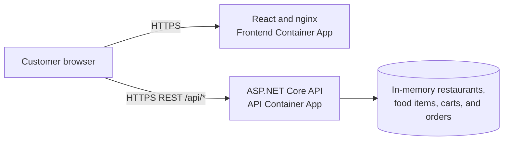
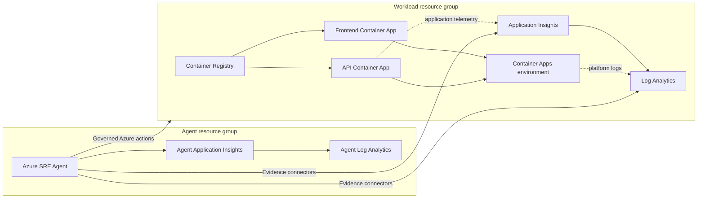
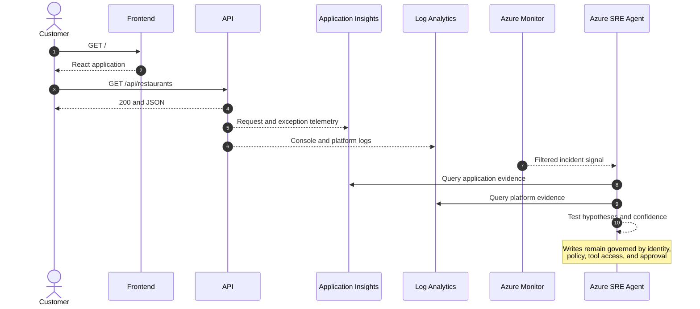

# Grubify Lab - Briefing Notes

> COACHES ONLY - Use this talk track before Deployment stage 00. Pair it with the participant [Lab Details - Understand Grubify](../Lab-Details.md) and the [SRE SignalOps mission index](../README.md).

## Briefing Goal

Help participants understand:

1. What the Grubify application does.
2. How a customer request moves through the system.
3. Which Azure resources support the workload and the SRE Agent.
4. Where operational evidence appears.
5. What each health check proves and does not prove.
6. Why a timestamped baseline is required before incident injection.
7. How the missions build a governed SRE operating model.

## Opening

### Say

> Grubify is a small food-ordering application used as the customer workload in this lab. The application is deliberately simple so we can focus on SRE reasoning: establish what normal looks like, observe a real symptom, collect evidence, test a cause, act within guardrails, and verify recovery.

### Core Principle

> Architecture describes what should exist. A baseline proves what is observable now.

Do not treat a successful deployment as proof that every customer path, telemetry path, connector, or agent action works.

## What Grubify Does

Grubify lets a customer:

- Open a React website.
- Browse restaurants.
- Browse food items.
- Read and update a user cart.
- Create and view demonstration orders.

The isolated SignalOps deployment is intentionally small:

- The frontend is React 18 served by nginx.
- The backend is an ASP.NET Core .NET 9 API.
- The browser calls the API directly over HTTPS.
- Restaurants, food items, carts, and orders are held in API process memory.
- There is no external database, queue, cache, or payment service in the core deployment.

### Important Consequence

Cart and order data is not durable. Restarting the API can clear in-memory customer state even when the service returns to a healthy status.

### Say

> Recovery has two dimensions: restore technical service health and understand any customer state that may have been lost. A green health endpoint does not automatically prove full business recovery.

## Customer Request Flow

### Explain the Flow

1. The browser requests the frontend root page.
2. nginx returns the React application.
3. React uses the configured API base URL.
4. The browser sends API requests directly to the API Container App.
5. The API reads or changes in-memory demonstration data.
6. The API returns JSON to the browser.
7. React renders the customer experience.

### Critical Distinction

The frontend and API are independent deployments with independent revisions, ingress endpoints, scaling rules, and failure modes.

- Frontend HTTP `200` proves static site delivery.
- Restaurant cards prove the browser-to-API path also works.
- API `/health` proves the process can answer a lightweight request.
- `/api/restaurants` proves a core domain read works.
- None of these checks alone proves the whole application is healthy.

## Routes and What They Prove

| Route | Expected result | What it proves |
|---|---:|---|
| Frontend `/` | `200` and usable HTML | nginx can deliver the React application |
| API `/health` | `200` | API liveness |
| API `/WeatherForecast` | `200` | Compatibility check for an older image without `/health` |
| API `/api/restaurants` | `200` and JSON | Restaurant domain data is available |
| API `/api/fooditems` | `200` and JSON | Menu catalog is available |
| API `/api/cart/demo-user` | `200` and JSON | A user-scoped state read works |
| API `/api/menu` | `404` | Negative control: the test detects an undefined route |
| API `/` | Normally `404` | Nothing is wrong; the API root is not an application route |

### Say

> A useful test has both positive and negative controls. We expect known routes to succeed and `/api/menu` to return 404. That helps us distinguish an actual outage from an incorrect URL.

## Live Lab Links

| Purpose | Link |
|---|---|
| Customer experience | [Open Grubify](https://ca-signalopscor-food-frontend.proudhill-f504bbcd.swedencentral.azurecontainerapps.io/) |
| API health | [Open health endpoint](https://ca-signalopscor-food-api.proudhill-f504bbcd.swedencentral.azurecontainerapps.io/health) |
| Restaurants | [Open restaurants endpoint](https://ca-signalopscor-food-api.proudhill-f504bbcd.swedencentral.azurecontainerapps.io/api/restaurants) |
| Food items | [Open food-items endpoint](https://ca-signalopscor-food-api.proudhill-f504bbcd.swedencentral.azurecontainerapps.io/api/fooditems) |
| Demo cart | [Open demo-user cart](https://ca-signalopscor-food-api.proudhill-f504bbcd.swedencentral.azurecontainerapps.io/api/cart/demo-user) |
| SignalOps missions | [Open the mission index](../Missions/README.md) |

Deployment stage 00 writes environment-specific addresses to `FRONTEND_URL` and `API_BASE_URL`. Use those values when working in a separately deployed environment.

## Azure Architecture

The lab separates the customer workload from the SRE Agent.

### Two Resource Groups

| Boundary | Responsibility |
|---|---|
| `rg-signalopscore-food` | Customer workload, application identities, registry, and workload telemetry |
| `rg-signalopscore-agent` | SRE Agent, agent identity, agent telemetry, and evidence connectors |

This separation makes ownership, cost, cleanup, access scope, and blast radius easier to explain.

### Fourteen Core Resources After Deployment stages 00-02

#### Grubify Workload - Eight Resources

1. Frontend Container App.
2. API Container App.
3. Container Apps environment.
4. Azure Container Registry.
5. Frontend managed identity.
6. API managed identity.
7. Workspace-based Application Insights.
8. Workload Log Analytics workspace.

#### SRE Agent - Six Resources

1. Azure SRE Agent.
2. Agent managed identity.
3. Agent Application Insights.
4. Agent Log Analytics workspace.
5. Log Analytics evidence connector.
6. Application Insights evidence connector.

The count excludes resource groups, RBAC records, Container App revisions, deployment records, subagent configuration, and response plans.

## Identity and Ownership

### Application Identities

- The frontend and API have separate managed identities.
- Each identity receives `AcrPull` for credential-free image retrieval.
- The applications do not need registry passwords.

### Agent Identity

- The SRE Agent has its own managed identity.
- Read and monitoring roles allow evidence collection.
- Contributor is bounded to the isolated workload resource group.
- Subscription-level monitoring access is distinct from workload write access.

### Say

> Autonomous describes how the agent can operate after policy evaluation. It does not mean unlimited access. The real safety boundary is the combination of managed scope, identity, RBAC, tools, policy, and approvals.

## Evidence and Control Flow

### Customer Path vs. Evidence Path

- **Customer request path:** Browser to frontend and browser to API.
- **Application evidence path:** API telemetry to Application Insights and Log Analytics.
- **Platform evidence path:** Container Apps console and system logs to Log Analytics.
- **Incident path:** Azure Monitor signal to the configured response plan and specialist agent.
- **Control path:** SRE Agent action through identity, RBAC, policy, and approval.

The SRE Agent is not in the customer request path. An unavailable agent does not directly prevent a customer from browsing restaurants.

## Architecture Is Not a Baseline

Architecture tells us the expected components and connections. A baseline is timestamped evidence showing the observed state of a specific environment.

### Use Three Baseline Labels

- **PASS:** Current evidence matches the normal expectation.
- **FAIL:** Current evidence contradicts the normal expectation. Stop and treat it as a pre-existing issue.
- **UNKNOWN:** Evidence is missing, stale, delayed, or inaccessible. Record the next check instead of assuming health.

### Baseline Checklist

| Dimension | Normal expectation |
|---|---|
| Azure scope | Correct subscription and both expected resource groups |
| Deployment | Both Container Apps are `Running` with ready revisions receiving traffic |
| Capacity | Frontend scales from 1 to 3 replicas; API scales from 1 to 5 |
| Frontend | Root returns `200` and usable HTML |
| API liveness | `/health` returns `200` |
| Domain reads | Restaurants and food items return `200` with JSON |
| Cart read | Demo-user cart returns `200` with JSON |
| Negative control | Undefined menu route returns `404` |
| Application telemetry | Recent requests show operation, time, duration, and result code |
| Platform telemetry | Recent frontend and API console or system records are available |
| Agent evidence access | The agent can retrieve permitted Grubify evidence |
| Safety posture | Proposed writes expose the applicable policy or approval decision |

### Do Not Start Fault Injection Until

- The subscription and resource groups are confirmed.
- Frontend delivery is proven.
- API liveness and core domain reads are proven.
- Active revisions and traffic allocation are known.
- Evidence access is proven or explicitly recorded as a controlled limitation.
- Incident routing to the intended handler is verified.

## What the Deployment Stages Build

### Deployment stage 00 - Deploy and Prove the Workload

- Deploy the isolated Grubify workload with azd and Bicep.
- Build the frontend and API independently.
- Store images in Azure Container Registry.
- Run both applications in Azure Container Apps.
- Add workspace-backed observability.
- Prove platform state and customer endpoints separately.

**Key lesson:** Successful provisioning does not replace runtime verification.

### Deployment stage 01 - Add the SRE Agent

- Deploy the reasoning and action plane outside the customer path.
- Assign a dedicated managed identity.
- Configure managed resources and bounded RBAC.
- Separate agent telemetry from workload telemetry.

**Key lesson:** Action mode and access scope are separate controls.

### Deployment stage 02 - Connect Evidence and Routing

- Add Application Insights and Log Analytics connectors.
- Register the Grubify incident specialist.
- Enable the HTTP-error response plan in Review mode.
- Audit telemetry, repository, knowledge, and routing readiness independently.

**Key lesson:** A deployed connector proves plumbing, not populated or queryable evidence.

## How the Remaining Missions Use Grubify

| Missions | Grubify learning focus |
|---|---|
| 01 | Inject and recover a controlled cart memory incident |
| 02 | Add reviewed architecture, runbook, report, and triage knowledge to Agent Memory |
| 03 | Investigate an unavailable, stale, or unauthorized evidence source |
| 04 | Route an ambiguous issue across application and network evidence domains |
| 05-06 | Apply heartbeat triage and improve the next response using verified learning |
| 07 | Evaluate backup assurance without inventing unsupported protection evidence |
| 08 | Exercise an approval-gated HTTP-error response |
| 09 | Use dependency evidence to bound customer impact |
| 10-11 | Investigate network security and routing failures in a provided sandbox or snapshot |
| 12 | Resolve a critical assurance risk before it becomes an incident |

## Deliberate Memory Incident

The Grubify cart path contains an intentional lab defect:

- Each cart POST allocates a 10 MB buffer.
- The buffer is added to a static collection.
- Entries are not removed.
- Repeated requests increase the API working set.
- With a 1 GiB memory limit, the process may restart or produce connection and HTTP errors.

### Why This Scenario Works for SRE Training

- The customer symptom is visible.
- Resource behavior is measurable.
- A recent deployment is not automatically the cause.
- Source evidence can confirm the retention mechanism.
- Restarting can recover service but may reset cart and order state.
- The team must verify both technical recovery and customer impact.

### Say

> The lab is designed to separate correlation from causation. Memory growth, a recent release, and HTTP errors may occur in the same timeline. The investigation must test each explanation and cite the evidence that confirms the real cause.

## Common Misinterpretations

| Observation | Correct interpretation |
|---|---|
| Frontend root is `200` | Static delivery works; the API path remains unproven |
| API root is `404` | Expected because `/` is not an API route |
| `/api/menu` is `404` | Expected negative control |
| Both Container Apps are `Running` | Platform state looks healthy; business operations still require tests |
| Application Insights exists | Telemetry is configured; recent populated evidence remains unproven |
| Connector provisioning is `Succeeded` | Connector plumbing exists; authorization, freshness, and query results remain separate checks |
| Agent endpoint says `unauthorized` in a browser | Expected because the endpoint requires an Azure SRE access token |
| Agent Memory is enabled but has zero files | The service is ready, but no operational knowledge has been loaded |
| API restart restores `/health` | Technical service recovered; in-memory customer state may have been lost |

## Claims to Avoid

- Do not describe Grubify as one indivisible health state.
- Do not claim frontend `200` proves restaurant browsing works.
- Do not claim provisioned telemetry resources contain current evidence.
- Do not claim the SRE Agent is in the customer request path.
- Do not describe Autonomous and High as a recommended production default.
- Do not imply carts and orders are durable.
- Do not claim the core deployment includes a database, queue, cache, payment service, hub-spoke network, Firewall, or Bastion.
- Do not display tokens, connection strings, shared keys, or environment secrets.

## Five-Minute Talk Track

> Grubify is a two-component food-ordering application. React and nginx serve the frontend, while a separate ASP.NET Core API provides restaurants, food items, carts, and orders. The browser calls that API directly. The API uses in-memory demonstration data, so a restart may restore service while resetting customer cart or order state.
>
> The frontend and API run as independent Azure Container Apps. Their images come from Azure Container Registry using separate managed identities. Application Insights records application behavior, and Log Analytics holds workspace-backed application and platform evidence.
>
> The Azure SRE Agent lives in a separate resource group and outside the customer request path. It queries permitted evidence through connectors and can propose or perform only the actions allowed by its managed identity, RBAC, tools, policies, and approval mode.
>
> Before creating an incident, we establish a timestamped baseline. Frontend delivery, API liveness, business routes, active revisions, telemetry population, connector access, and incident routing are separate checks. Each check is marked PASS, FAIL, or UNKNOWN.
>
> The lab then follows the SRE lifecycle: deploy the workload, add the governed agent, connect evidence, investigate a controlled memory incident, recover the API, preserve verified knowledge, and use that context to improve later responses.

## Questions to Ask Participants

1. Why does frontend HTTP `200` not prove that restaurant cards load?
2. Which check proves API liveness, and which check proves a business operation?
3. Why can an API restart recover service but still affect a customer?
4. What is the difference between a configured connector and populated evidence?
5. Why is the SRE Agent placed outside the customer request path?
6. Which controls limit what an Autonomous agent can change?
7. When should a baseline item be marked `UNKNOWN` instead of `PASS` or `FAIL`?
8. What evidence would you require before approving a restart or scaling action?

## Closing

### Say

> Grubify gives us a small but realistic system in which application health, customer impact, telemetry, diagnosis, and remediation can disagree. The lab teaches us to prove each layer independently, reason from inspectable evidence, and recover within explicit operational boundaries.

## One-Line Summary

> Understand the customer path, prove the evidence path, preserve the control boundary, and compare every incident with a known baseline.