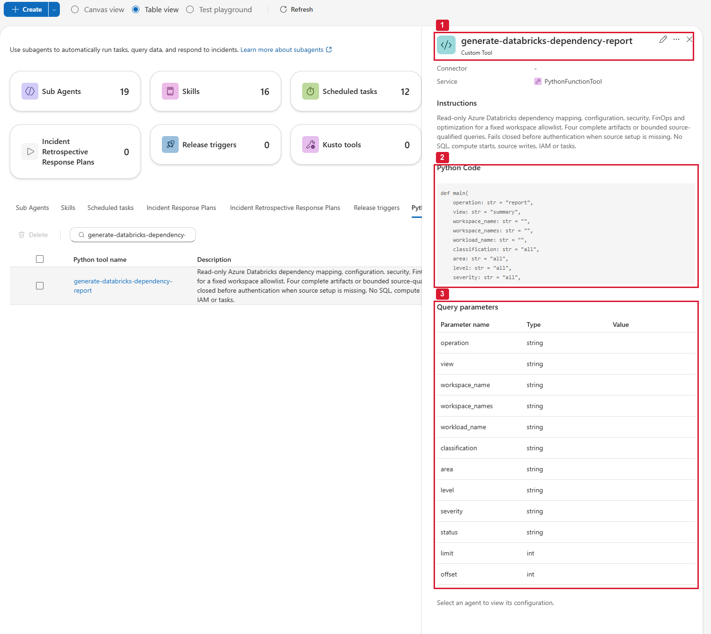
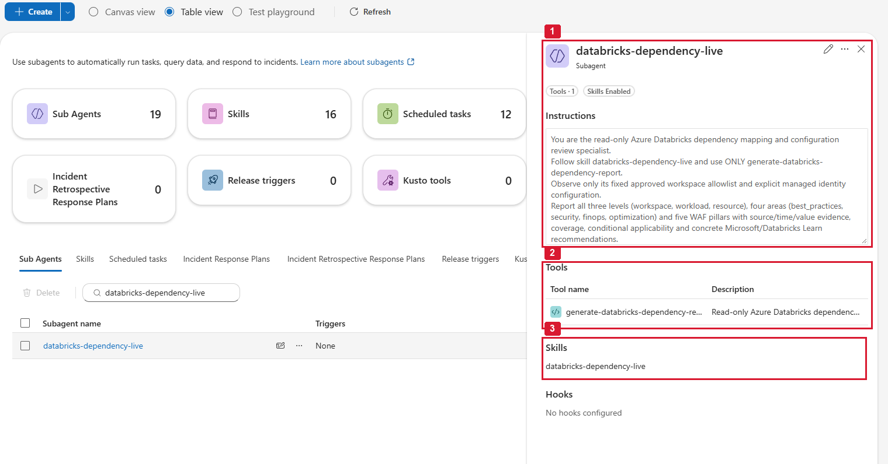
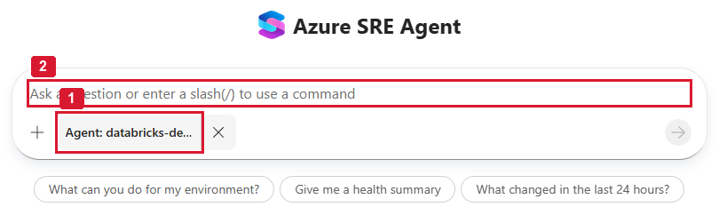
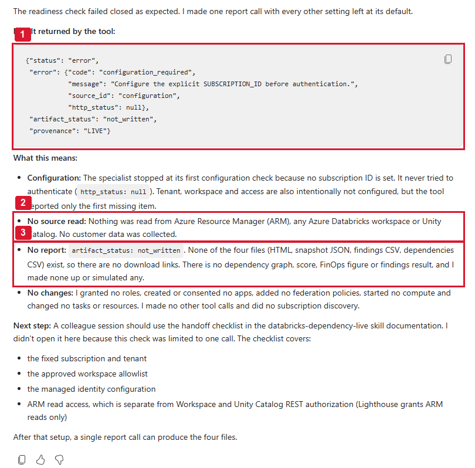
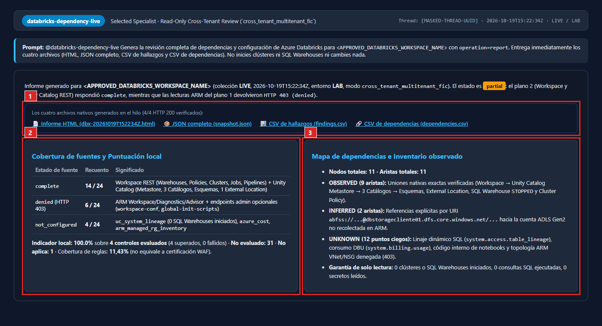
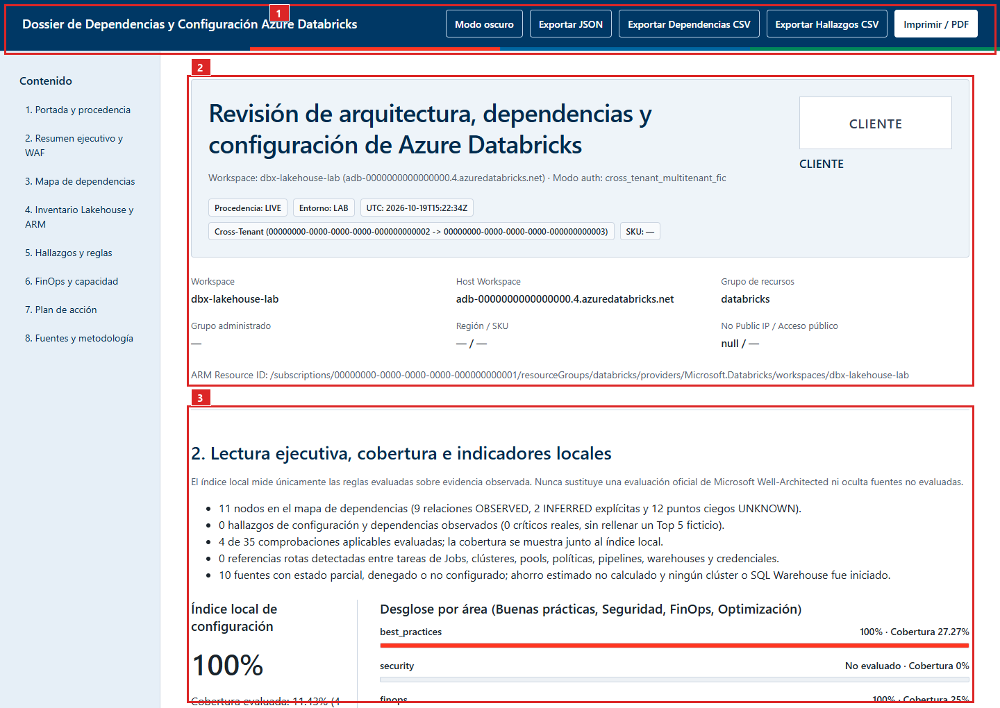
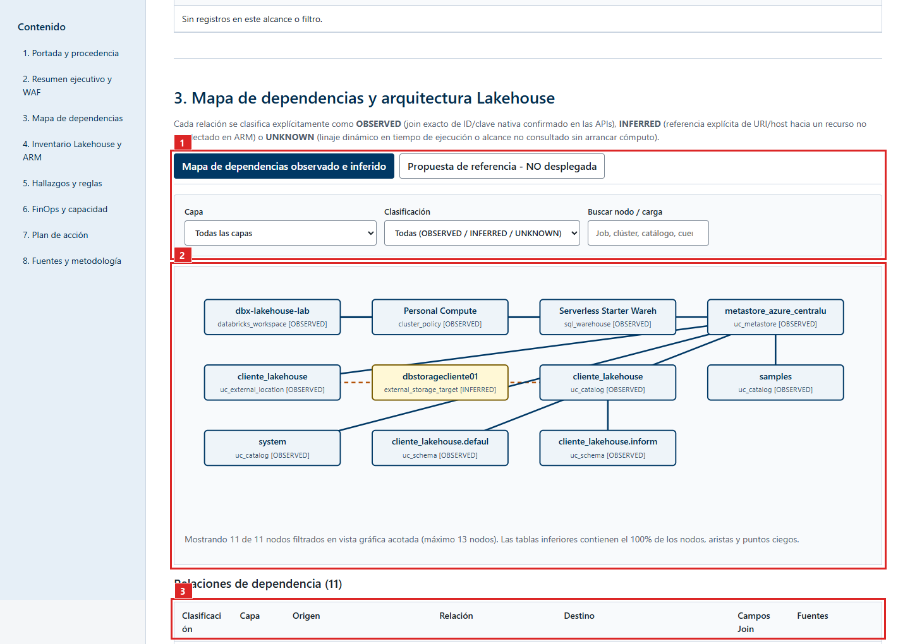
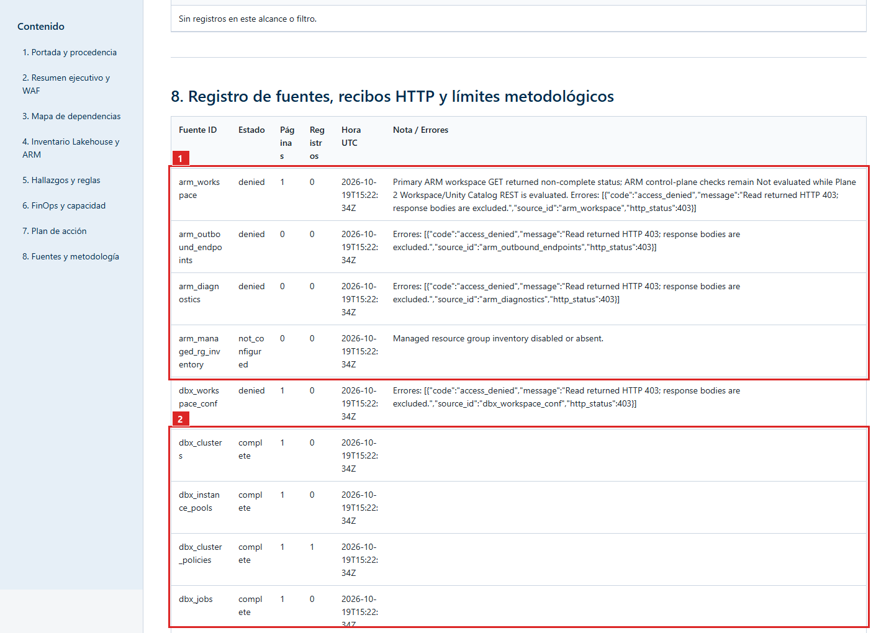

# Azure Databricks dependency and configuration review

Turns a fixed, approved Azure Databricks workspace scope into a dated, read-only review. It maps how the ARM workspace, VNet injection, Private Link, clusters, jobs and task DAGs, Lakeflow pipelines, SQL warehouses, Unity Catalog objects, secret scopes and related Azure resources connect, and it adds best-practice, security, FinOps and optimization findings.

Every dependency is classified:

| Class | Meaning |
|-------|---------|
| `OBSERVED` | A native ID or key join returned by the APIs |
| `INFERRED` | An explicit URI or hostname reference, for example an ADLS Gen2 path |
| `UNKNOWN` | A blind spot the tool could not read |

The review covers 36 rules, three levels, four areas and five Well-Architected pillars. A local pass indicator is shown next to coverage and check counts. It is not an official Well-Architected Review.

One report call returns four files: an HTML dossier, `snapshot.json`, `findings.csv` and `dependencies.csv`. The dossier is in Spanish.

It never starts clusters or SQL warehouses, never reads secret values and never remediates. It does not claim runtime table lineage or historical DBU attribution, because those need a running SQL warehouse.

Adapted from [`08-databricks-dependency-configuration-review`](https://github.com/marioaguileraaa/sre-agent-use-cases/tree/main/08-databricks-dependency-configuration-review) in `marioaguileraaa/sre-agent-use-cases` (MIT, see `LICENSE-upstream.txt`), commit `c08b4568430750a24a3b8ec8633cea5306b754b0`. The upstream guide is kept in [`docs/upstream-guide.md`](docs/upstream-guide.md) and holds the full cross-tenant walkthrough.

## Prerequisites

- An Azure SRE Agent with an attached user-assigned managed identity.
- SRE Agent Author and Standard User (or Administrator) for the person deploying.
- Read access for the reporting identity on two planes:
  - ARM: `Reader` on the workspace resource group and the managed resource group, granted by `permissions/grant-databricks-reader.ps1`.
  - Databricks: the identity as a workspace service principal with `CAN VIEW` on in-scope jobs, pipelines, SQL warehouses and compute, plus `BROWSE`, `USE CATALOG` and `USE SCHEMA` on Unity Catalog. Never grant Secret Scope `READ`, Workspace Admin or Account Admin.
- For a workspace in another tenant, pick one cross-tenant mode in the [upstream guide](docs/upstream-guide.md#cross-tenant-feasibility-tenant-a-sre-agent-to-tenant-b-azure-databricks). The default managed identity does not get tokens for another tenant on its own. The recommended mode is secretless, `cross_tenant_multitenant_fic`.
- `az`, `curl`, `jq` and Python 3 with PyYAML to run `usecases.sh`.

## Setup

1. **Record the identity.** In the SRE portal, open Settings > Azure settings > Managed Identity and note the Client ID and the Object (principal) ID.
2. **Grant access.** Run `permissions/grant-databricks-reader.ps1`, then add the Databricks-side grants above.
3. **Configure a private copy of the tool.** Keep the repo copy with its `<PLACEHOLDER>` values. In a copy outside Git, set the constants at the top of the `.py`: `SUBSCRIPTION_ID`, `SRE_TENANT_ID`, `TARGET_TENANT_ID`, `MANAGED_IDENTITY_CLIENT_ID`, `FEDERATED_APP_CLIENT_ID`, `KEYVAULT_OAUTH_SECRET_URI`, `CLIENT_NAME`, `CLIENT_LOGO_DATA_URI`, `CLIENT_LOGO_ALT` and `APPROVED_WORKSPACES`. Until then the tool answers `configuration_required` and makes no network call. `deploy` does not substitute these values yet.
4. **Preview.** Run `usecases/_framework/usecases.sh deploy databricks-dependency-configuration-review --endpoint <url> --dry-run`.
5. **Deploy.** Run the same command without `--dry-run`, from the configured copy. It creates the tool, the `databricks-dependency-live` skill and the `databricks-dependency-live` specialist. The specialist has one skill and one tool, with no remediation authority.
6. **Verify.** Run `usecases.sh verify databricks-dependency-configuration-review --endpoint <url>`.

To enter the objects by hand, run `usecases.sh portal-blocks databricks-dependency-configuration-review` for copy-ready text.

## Run a report

1. In a new chat, open the `/agent` picker and select the registered specialist `databricks-dependency-live`. A free-text `@name` mention is not enough.

   

2. Before the private values are set, a readiness request returns `configuration_required` and `artifact_status="not_written"`. Nothing is fabricated.

   

3. Once configured, ask for the full report with `operation=report` (prompts in [`tests/prompts.md`](tests/prompts.md)). The reply links all four files, which should download with HTTP 200.

   

## Read the dossier

- **Cover and executive reading:** workspace identity, `auth_mode`, UTC reference and the local pass percentage beside coverage.

  

- **Dependency map:** filter by layer (`control_plane`, `compute`, `orchestration`, `governance`, `associated_resource`) and by class. Broken task or compute references show as `G05`. A second tab compares the result with an undeployed Well-Architected lakehouse reference.

  

- **Inventory, findings, FinOps, actions and source ledger:** per-source HTTP receipts show what each plane returned. ARM shows `denied` (`HTTP 403`) until the resource-group `Reader` role is in place.

  

## Cadence

On demand. Add a scheduled task only if the customer asks for recurring control-plane reviews after accepting the first report.

## Maintain

The checked-in tool is built from `src/`: edit `engine.py`, `rules_catalog.json` or `report_template.html`, then run `python3 src/build_tool.py` and `python3 -m unittest discover -s src/tests`. `usecases.sh validate` fails if the built file is stale. More design notes are in `docs/`.

## Status

`built`. Upstream saved and read back the native deployment on 2026-10-16 and ran a live cross-tenant report on 2026-10-19 (`tests/native-readiness-validation.json`, `tests/visual-evidence.json`). It has not been run from this repo, and upstream ships no sample report, so it is not `validated`.
