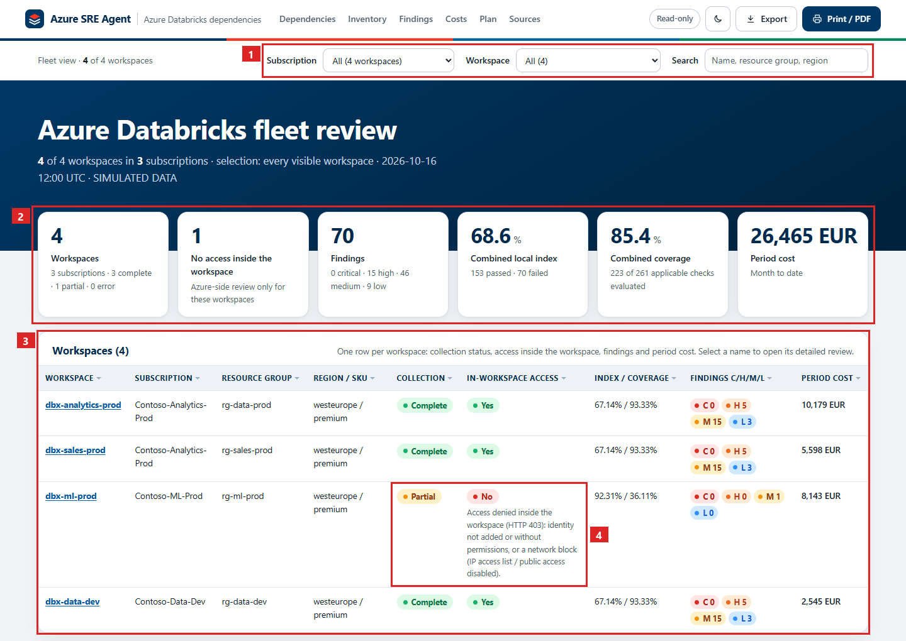
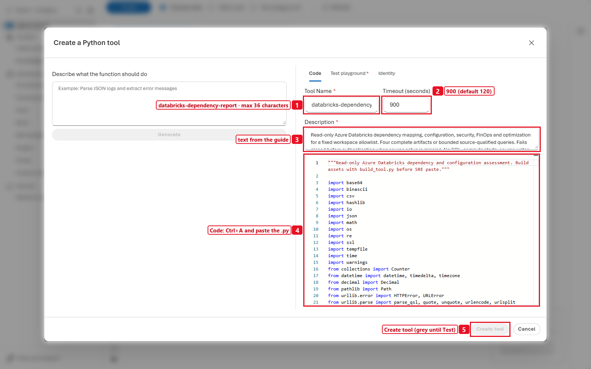
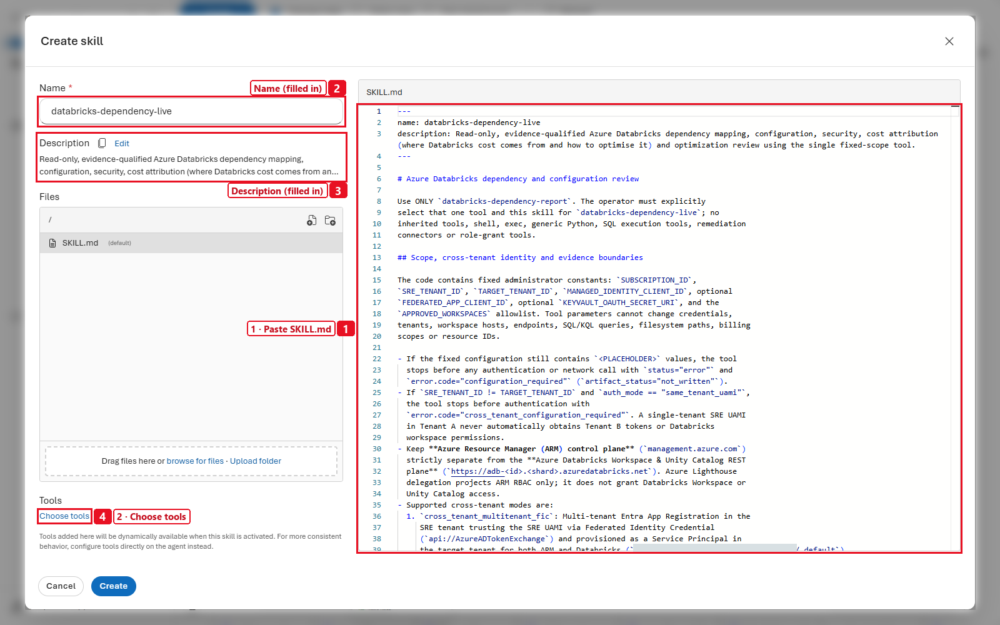
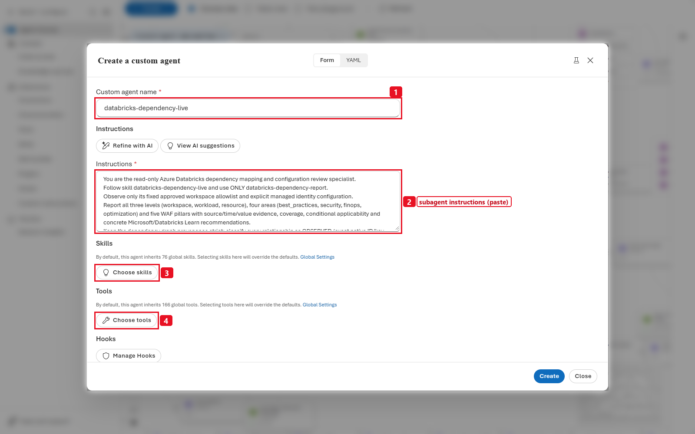
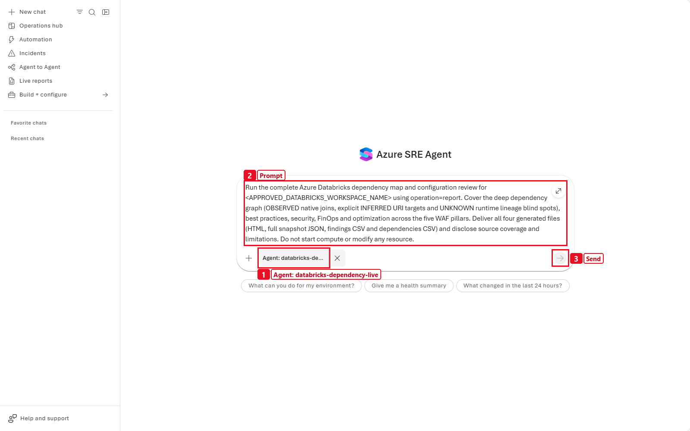
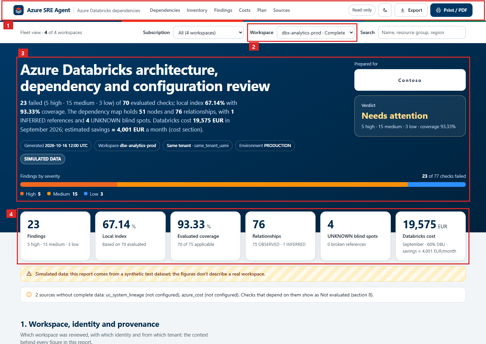
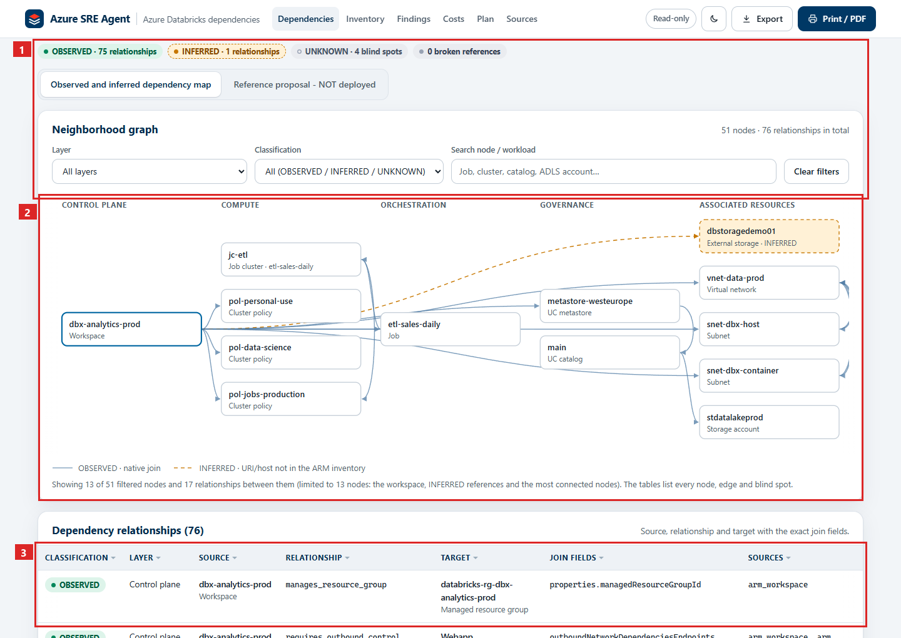
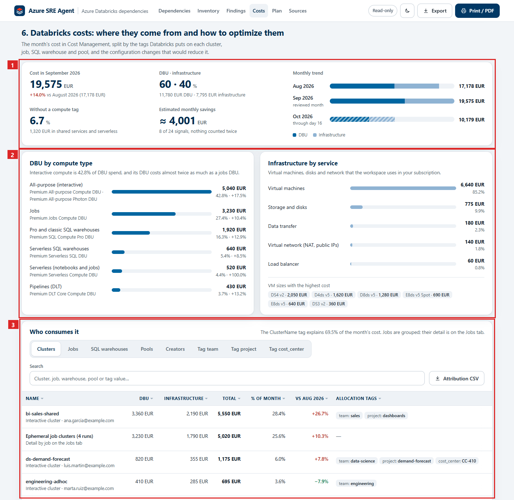

# Azure Databricks dependency and configuration review



*Sample run with simulated data: 4 workspaces in 3 subscriptions. 1 Subscription, Workspace and Search filters · 2 Fleet indicators: workspaces by collection status, without in-workspace access, findings, combined index and coverage, cost of the period · 3 One row per workspace, its name opening the detailed review · 4 A workspace the agent cannot read inside, still reviewed from the Azure side.*

> **The problem.** Our Databricks workspaces connect to many things, nobody has the full map, and nobody can say where their cost comes from or how to reduce it.

**What the agent does.** It reviews every Azure Databricks workspace the agent can read, in any subscription, or just one subscription or the workspaces you name. For each one it maps how it connects to networks, storage, Key Vault, jobs, pipelines and Unity Catalog, marking what is observed, inferred or unknown; shows where the cost comes from (DBUs against infrastructure, per cluster, job, SQL warehouse and tag) with estimated savings; and checks 36 best practices for security, cost and optimisation. One report covers the whole selection, with subscription and workspace filters.

There is no workspace list to maintain: in the same tenant, every call runs one fixed, read-only Azure Resource Graph query and works with every workspace the agent identity can read, in any subscription (up to 500). From chat you ask for all workspaces, one subscription or named workspaces; one report covers up to 50, collected six at a time, and opens on a fleet overview with **Subscription** and **Workspace** filters. A workspace where the agent has no in-workspace access keeps its Azure-side review and the report says why; it is never shown as empty or healthy. Workspaces in another tenant keep their configured list. Every dependency is classified as `OBSERVED` (a native ID or key join returned by the APIs), `INFERRED` (an explicit URI or hostname reference, for example an ADLS Gen2 path) or `UNKNOWN` (a blind spot the tool could not read). The review covers 36 rules, three levels, four areas and five Well-Architected pillars; the local pass indicator is always shown beside coverage and is not an official Well-Architected Review.

## At a glance

| | |
|---|---|
| **Runs** | On demand, from chat |
| **Reads** | Azure Resource Graph (discovery), Azure Databricks (ARM, workspace REST API and Unity Catalog) and Cost Management |
| **Changes** | Nothing. Read-only; it never starts clusters or SQL warehouses, never reads secret values and never remediates |
| **Delivers** | One HTML report for the whole selection, with a fleet overview and Subscription and Workspace filters, plus the findings CSV, the dependencies CSV and the full JSON snapshot |
| **Agent pieces** | Tool `databricks-dependency-report` · skill `databricks-dependency-live` · subagent `databricks-dependency-live` |
| **Access** | `Reader` and `Cost Management Reader` once on the management group (or the subscriptions), and the identity inside each workspace as a service principal with view-only grants; [`grant-databricks-permissions.ps1`](permissions/grant-databricks-permissions.ps1) does both |
| **Report language** | English |

**Compare with:** [AKS cluster review](https://microsoft.github.io/frontier-sre-agent-rvas/usecase.html?id=0081-aks-well-architected-review) · [Monthly Azure FinOps review](https://microsoft.github.io/frontier-sre-agent-rvas/usecase.html?id=0015-consolidated-cost-reporting)

## Prerequisites

- An Azure SRE Agent with an attached user-assigned managed identity.
- SRE Agent Author and Standard User, or SRE Agent Administrator, for the person deploying.
- For the one-time grant: Owner, User Access Administrator or Role Based Access Control Administrator on the management group (or the subscriptions), and Workspace Admin in the workspaces. The identity gets read access on two planes: ARM `Reader` and `Cost Management Reader` at that scope, and inside each workspace a service principal with the `workspace-access` and `databricks-sql-access` entitlements, `CAN VIEW` on jobs, pipelines and SQL warehouses, and `BROWSE`, `USE CATALOG` and `USE SCHEMA` in Unity Catalog. Never grant Secret Scope `READ`, Workspace Admin or Account Admin.
- A network route from the agent to each workspace for the in-workspace reads; a private workspace still gets its Azure-side review.
- For a workspace in another tenant, auto-discovery is off: list it in `APPROVED_WORKSPACES` and choose one cross-tenant mode from the upstream guide. The recommended mode is `cross_tenant_multitenant_fic`: a multi-tenant app whose certificate the tool reads from Key Vault (`CROSS_TENANT_CERT_KEYVAULT_URL`, `CROSS_TENANT_CERT_NAME`), because the agent sandbox token cannot be used as a federated client assertion.

## Setup

Create the pieces by hand in the portal, or deploy the manifests with the framework CLI (end of this section). The tool, skill and subagent names reference each other: keep them exactly.

1. **Find the agent identity.** In the Azure portal, open the agent resource group and the managed identity whose name starts with `id-`. Note its **Client ID** for the tool and its **Object (principal) ID** for the role assignments.
2. **Grant read access.** In the same tenant, run [`permissions/grant-databricks-permissions.ps1`](permissions/grant-databricks-permissions.ps1) once with `-IdentityClientId`, `-ManagementGroupId` (recommended; or `-AllSubscriptions`, `-SubscriptionIds` or `-SubscriptionId`) and `-IncludeCost`. It assigns `Reader` and `Cost Management Reader` at that scope, discovers every workspace in it and, inside each one, adds the identity with the view-only grants listed under **Prerequisites**. A workspace it cannot reach is recorded and the script continues; the summary is saved to `databricks-access-summary.csv`, and there is nothing to paste into the tool. Add `-WhatIf` first to see what it would do, and run it again later to give `CAN VIEW` on new jobs, pipelines and SQL warehouses. For a single workspace, [`permissions/grant-databricks-reader.ps1`](permissions/grant-databricks-reader.ps1) assigns `Reader` on its resource group and managed resource group only (the Azure side).
3. **Configure a private copy of the tool.** Download [`generate-databricks-dependency-report.py`](manifests/tools/generate-databricks-dependency-report.py) and set `SRE_TENANT_ID`, `TARGET_TENANT_ID` (the same value in the same tenant, which turns on auto-discovery) and `MANAGED_IDENTITY_CLIENT_ID`. Everything else is optional: `APPROVED_WORKSPACES` only for per-workspace overrides or workspaces in another tenant, `DISCOVERY_SUBSCRIPTION_IDS` to limit discovery, and the logo. Keep configured copies outside Git. Until the three values are set, report, query and list calls answer `configuration_required` with `artifact_status="not_written"` and make no network call.
4. **Create the Python tool.** In the [SRE Agent portal](https://sre.azure.com), **Build + configure > Agent Canvas > Create ▾ > Tool > Python tool**. Tool Name `databricks-dependency-report`, the description from the manifest, the code of your configured `generate-databricks-dependency-report.py`, timeout `900` seconds and the 13 parameters of [`manifests/tools/databricks-dependency-report.yaml`](manifests/tools/databricks-dependency-report.yaml). Leave **Enable Azure Identity** off: the code gets its own tokens with the agent managed identity. Run **Test** on the **Test playground** tab with `{"operation": "self_test"}` (works before the tool is configured) or, once it is configured, `{"operation": "list_workspaces"}` (about 2 seconds); the playground cuts calls at about 100 seconds, so run reports from chat, then **Create tool**.

   
5. **Create the skill.** **Create ▾ > Skill**: name `databricks-dependency-live`, the description from its front matter, **Choose tools** > only `databricks-dependency-report`, and paste the body of [`SKILL.md`](manifests/skills/databricks-dependency-live/SKILL.md) below the front matter the form generates.

   
6. **Create the subagent.** **Create ▾ > Custom agent**: name `databricks-dependency-live`, instructions from `system_prompt` in [`manifests/subagents/databricks-dependency-live.yaml`](manifests/subagents/databricks-dependency-live.yaml), **Choose skills** > `databricks-dependency-live` and **Choose tools** > `databricks-dependency-report`. Choosing them replaces the inherited global tools and skills, so the subagent can only run this read-only tool.

   
7. **Test from chat.** **New chat**, type `/agent`, pick `databricks-dependency-live` and send the prompt under **Run it**. The answer summarizes the workspaces collected, partial and failed, those without in-workspace access and why, and links the four files (HTML, snapshot JSON, findings CSV and dependencies CSV); `self_test` files are labelled SIMULATED.

   

**Or deploy the manifests with the CLI.** From the repository root, or the unzipped package, and from a configured copy of the tool (the CLI sends the code as it is in the folder; it has not been run against a live agent yet):

```bash
usecases/_framework/usecases.sh deploy 0021-databricks-dependency-configuration-review --endpoint https://<agent>.azuresre.ai --dry-run
usecases/_framework/usecases.sh deploy 0021-databricks-dependency-configuration-review --endpoint https://<agent>.azuresre.ai
usecases/_framework/usecases.sh verify 0021-databricks-dependency-configuration-review --endpoint https://<agent>.azuresre.ai
```

Every click, with a screenshot, is in the [upstream step-by-step guide](https://github.com/marioaguileraaa/sre-agent-use-cases/tree/main/08-databricks-dependency-configuration-review).

## Run it

In a **New chat**, type `/agent`, pick `databricks-dependency-live` and send:

```text
Generate the complete Azure Databricks dependency and configuration report for every workspace in every subscription (operation=report, workspace_names=all). Cover the dependency graph (OBSERVED native joins, explicit INFERRED URI targets and UNKNOWN runtime lineage blind spots), best practices, security, FinOps and optimization. Deliver the four files (HTML, full snapshot JSON, findings CSV and dependencies CSV) and tell me which workspaces have no in-workspace access and why. Do not start compute or modify any resource.
```

One report covers up to 50 workspaces, collected six at a time within the 900-second timeout; with more, ask for one report per subscription. The detailed cost analysis runs in reports of up to 5 workspaces; larger reports keep the period cost of each workspace.

More prompts, with the expected result of each, are in [`tests/prompts.md`](tests/prompts.md).

## Read the report

- **Fleet overview:** **Subscription**, **Workspace** and **Search** filters, KPI cards and one row per workspace with its collection status, in-workspace access and the reason when it is missing, index and coverage, findings and period cost. Choosing a workspace opens its detailed review.
- **Cover and executive reading:** workspace identity, authentication mode, UTC reference and the local pass percentage beside coverage.
- **Dependency map:** filter by layer (`control_plane`, `compute`, `orchestration`, `governance`, `associated_resource`) and by class. A second tab compares the result with an undeployed Well-Architected lakehouse reference.
- **Costs:** the month's Databricks cost, DBU against infrastructure, who consumes it and optimization signals with estimated savings, counted once per object.
- **Findings, actions and source ledger:** per-source HTTP receipts show what each plane returned; a workspace without in-workspace access shows its workspace REST and Unity Catalog sources as `denied`, never as empty inventories.



*Detailed review of one workspace, chosen in the Workspace filter: 1 top bar with sections, Read-only chip, export menu and print · 2 Workspace filter (All returns to the fleet overview) · 3 verdict-first summary with provenance chips and severity · 4 KPI cards: findings, local index beside coverage, relationships, blind spots and Databricks cost.*



*Dependency map: 1 classification counts and filters · 2 layered graph, solid OBSERVED joins and dashed INFERRED references · 3 edges table with join fields and sources.*



*Cost section, from SIMULATED data: 1 month cost, DBU and infrastructure split, unattributed share and estimated savings · 2 DBU by compute type and infrastructure by service · 3 who consumes it, by cluster, job, SQL warehouse, pool, creator and tag.*

## Sample report

[`sample-report/`](sample-report/) holds the [HTML report](sample-report/simulated-20261016T120000Z-c0a7e5d10b2c.html) (1.5 MB; download it and open it in a browser), the findings CSV and the dependencies CSV of a SIMULATED fleet run that the tool wrote offline from its built-in simulated data, without calling Azure or Databricks: four workspaces in three subscriptions (`dbx-analytics-prod` and `dbx-sales-prod` in `Contoso-Analytics-Prod`, `dbx-ml-prod` in `Contoso-ML-Prod`, `dbx-data-dev` in `Contoso-Data-Dev`). `dbx-ml-prod` has no in-workspace access (every workspace REST and Unity Catalog read returns HTTP 403) and keeps its Azure-side review. Every workspace, host, user and identifier is fictitious. The snapshot JSON (1.3 MB) is left out because the HTML embeds it (**Export > Full snapshot (JSON)** exports it); the four original files are in the [upstream sample run](https://github.com/marioaguileraaa/sre-agent-use-cases/tree/main/08-databricks-dependency-configuration-review/sample-run).

## Cadence

On demand. Add a scheduled task only if the workspace owners want recurring reviews after accepting the first report; with many workspaces, one scheduled report per subscription keeps each run short.

## Maintain

The tool in `manifests/tools/` is built from `src/`. Edit `src/engine.py` or the report template, then run `python3 src/build_tool.py` and `python3 -m unittest discover -s src/tests`. `usecases.sh validate` fails if the built file is stale.

## Status

`validated`: built, with test prompts in `tests/` and a SIMULATED sample report. Upstream saved and read back the native deployment on 2026-10-16, ran a live cross-tenant report on 2026-10-19, re-validated the sidecar-token and Key Vault certificate changes in a lab agent on 2026-11-06 and, on 2026-11-17, ran fleet discovery (`list_workspaces`) and reports of all workspaces and of one workspace in a same-tenant lab agent through the Python tool Test playground (`tests/native-readiness-validation.json`, `tests/visual-evidence.json`, `tests/runtime-changes.json`). A workspace without in-workspace access is covered by the unit tests in `src/tests/` and the sample report. It has not been deployed from this repository with `usecases.sh deploy` yet. Screenshots and evidence from runs before 16 November 2026 show the previous tool name `generate-databricks-dependency-report` (37 characters, over today's portal limit).

## Credits

- **Built and tested by** Mario Aguilera: [github.com/marioaguileraaa](https://github.com/marioaguileraaa)
- **Upstream source and step-by-step guide** (every step with a screenshot, troubleshooting and the acceptance checks): [github.com/marioaguileraaa/sre-agent-use-cases/tree/main/08-databricks-dependency-configuration-review](https://github.com/marioaguileraaa/sre-agent-use-cases/tree/main/08-databricks-dependency-configuration-review). MIT license; this entry was converted from commit [`affb0d7`](https://github.com/marioaguileraaa/sre-agent-use-cases/commit/affb0d7).
- **Field guide:** [plate 08](https://marioaguileraaa.github.io/sre-agent-use-cases/#plate-08)
