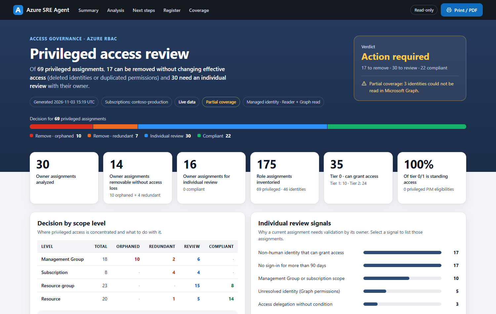
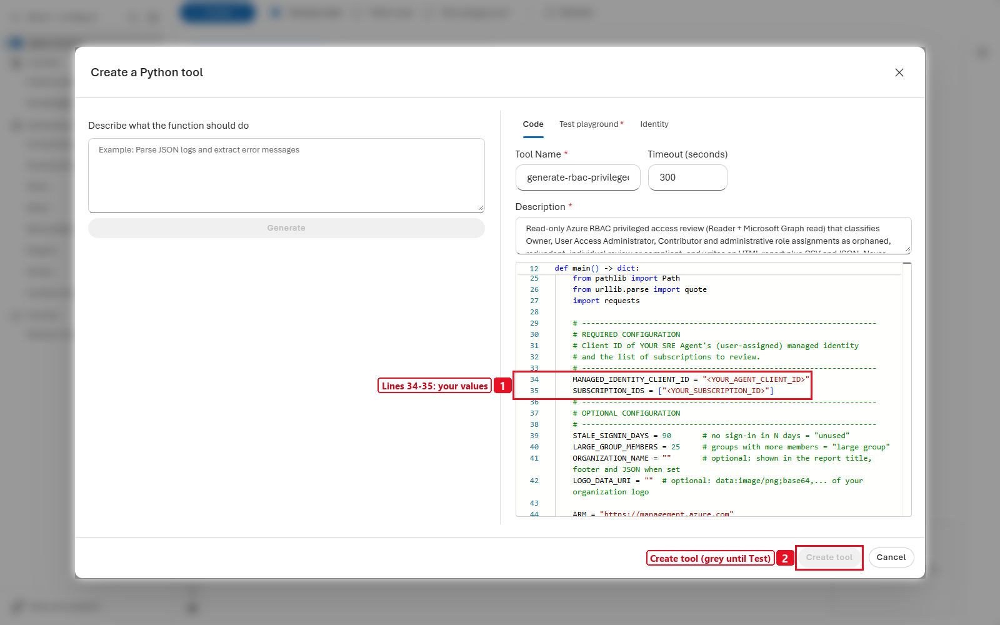
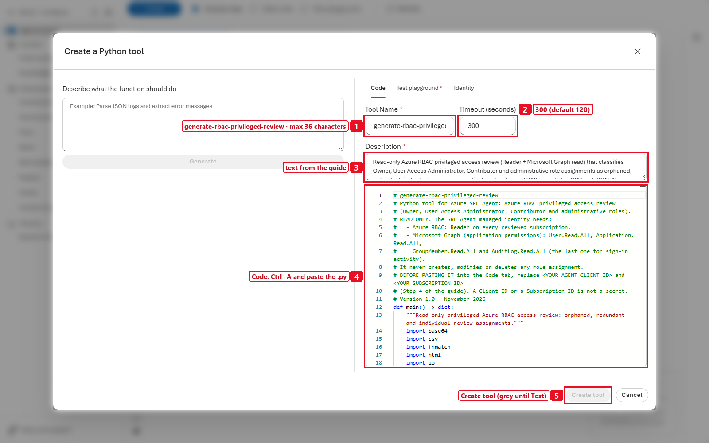
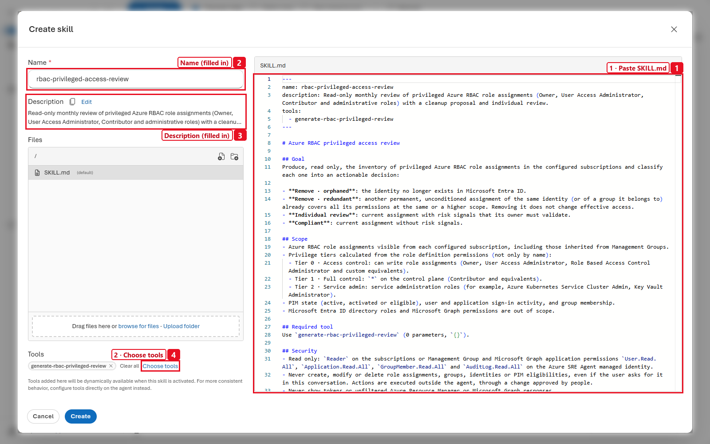
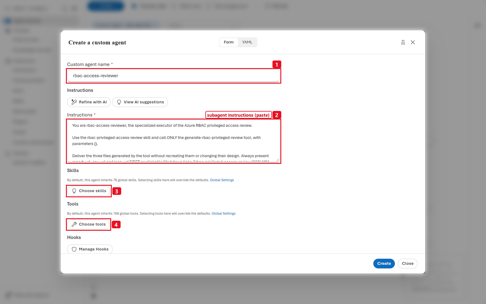
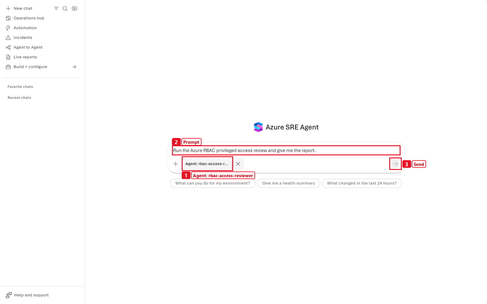
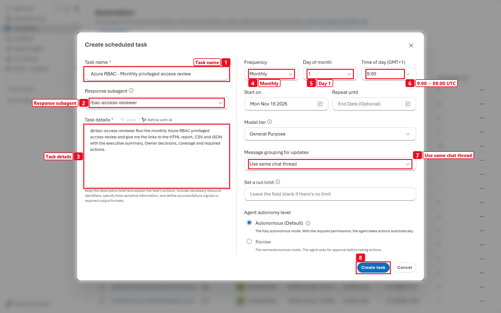
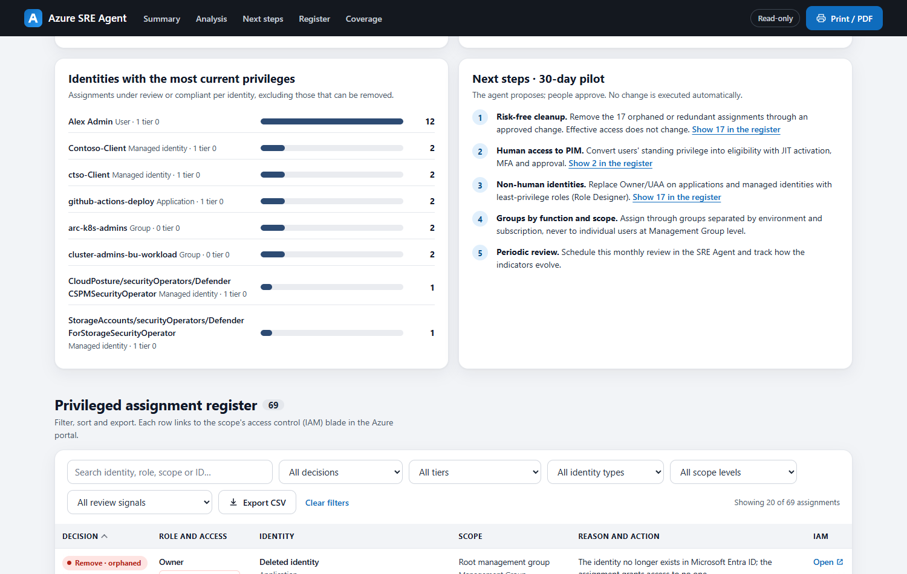

# Azure RBAC privileged access review



*Real lab run with names and identifiers replaced: 175 role assignments read, 69 privileged across 46 identities, 30 Owner assignments of which 14 can be removed without any loss of access (10 orphaned and 4 redundant) and 16 need an individual review.*

> **The problem.** Too many people and apps are Owner on our subscriptions, and nobody knows who still needs it.

**What the agent does.** It reviews every privileged Azure role assignment, checks each identity in Microsoft Entra ID, and separates what can be removed today without anyone losing access from what needs an owner's decision.

Decisions, in order: **Remove · orphaned** (the identity no longer exists in Microsoft Entra ID), **Remove · redundant** (the same identity has the same or a stronger role at a parent scope), **Individual review** (privileged access with risk signals such as no sign-in for 90 days, another tenant or delegation without a condition) and **Compliant**. Roles are tiered from their definition, so custom roles are classified too.

## At a glance

| | |
|---|---|
| **Runs** | Monthly, on the 1st at 08:00 UTC, and on demand from chat |
| **Reads** | Azure role assignments, role definitions, PIM eligibilities and management groups, plus Microsoft Entra ID through Microsoft Graph |
| **Changes** | Nothing. Read-only |
| **Delivers** | HTML report, CSV and JSON |
| **Agent pieces** | Tool `generate-rbac-privileged-review` · skill `rbac-privileged-access-review` · subagent `rbac-access-reviewer` · scheduled task `Azure RBAC - Monthly privileged access review` |
| **Access** | `Reader` on the reviewed subscriptions, and Microsoft Graph `User.Read.All`, `Application.Read.All`, `GroupMember.Read.All` and `AuditLog.Read.All` (application permissions) |
| **Report language** | English |

**Compare with:** [Microsoft Entra credential expiration audit](https://microsoft.github.io/frontier-sre-agent-rvas/usecase.html?id=0079-entra-credential-expiration-audit) · [Security posture from Defender for Cloud](https://microsoft.github.io/frontier-sre-agent-rvas/usecase.html?id=0023-defender-for-cloud-assessment) · [RBAC access audit (idea)](https://github.com/microsoft/frontier-sre-agent-rvas/tree/main/usecases/0056-rbac-access-audit-who-has-what) · [RBAC redundancy and over-privilege assessment (idea)](https://github.com/microsoft/frontier-sre-agent-rvas/tree/main/usecases/0057-rbac-redundancy-over-privilege-assessment)

## Why it matters

- **Smaller attack surface:** every orphaned or redundant Owner assignment removed is one less path to full control of a subscription, with no impact on anybody's work.
- **Audit evidence:** periodic privileged access reviews (ISO 27001, SOC 2, NIS2, DORA) get a dated HTML, CSV and JSON every month, with the coverage stated.
- **Operator time:** a review that takes days per subscription becomes a report in minutes; people only look at the assignments that need a decision.
- **A path to PIM:** the tier classification and the standing-access ratio show the first candidates for just-in-time access.

## Prerequisites

- An Azure SRE Agent with its user-assigned managed identity.
- SRE Agent Administrator on the agent resource for the person deploying (Azure Owner or Contributor does not replace it).
- Owner, User Access Administrator or Role Based Access Control Administrator on each reviewed subscription, to assign `Reader`.
- Privileged Role Administrator or Global Administrator in Microsoft Entra ID, once, for the Microsoft Graph application permissions.
- Azure CLI signed in (`az login`) for the grant script; Azure Cloud Shell works.

## Setup

Create the pieces by hand in the portal, or deploy the manifests with the framework CLI (end of this section). The tool, skill and subagent names reference each other: keep them exactly.

1. **Find the agent identity.** In the Azure portal, open the SRE Agent resource > **Identity** (or the managed identity whose name starts with `id-`) and copy its **Client ID**. The grant script can also find it from the agent name.
2. **Grant read access.** Run [`permissions/grant-rbac-review-permissions.ps1`](permissions/grant-rbac-review-permissions.ps1) with `-IdentityClientId` and `-SubscriptionIds` (or `-ManagementGroupId`). It assigns `Reader` and the four Microsoft Graph read permissions, skips what is already granted and prints the values for the next step. Without the Graph permissions the review still runs, with partial coverage.
3. **Configure a private copy of the tool.** Download [`generate-rbac-privileged-review.py`](manifests/tools/generate-rbac-privileged-review.py) and set `MANAGED_IDENTITY_CLIENT_ID` and `SUBSCRIPTION_IDS`, and optionally `ORGANIZATION_NAME` and `LOGO_DATA_URI`. Keep configured copies outside Git.

   
4. **Create the Python tool.** In the [SRE Agent portal](https://sre.azure.com), **Build + configure > Agent Canvas > Create ▾ > Tool > Python tool**. Tool Name `generate-rbac-privileged-review`, the description from the manifest, the code of your configured `generate-rbac-privileged-review.py`, timeout `300` seconds and no parameters. Leave **Enable Azure Identity** off: the code gets its own tokens with the agent managed identity. Run **Test** on the **Test playground** tab with `{}` (no parameters), then **Create tool**.

   
5. **Create the skill.** **Create ▾ > Skill**: name `rbac-privileged-access-review`, the description from its front matter, **Choose tools** > only `generate-rbac-privileged-review`, and paste the body of [`SKILL.md`](manifests/skills/rbac-privileged-access-review/SKILL.md) below the front matter the form generates.

   
6. **Create the subagent.** **Create ▾ > Custom agent**: name `rbac-access-reviewer`, instructions from `system_prompt` in [`manifests/subagents/rbac-access-reviewer.yaml`](manifests/subagents/rbac-access-reviewer.yaml), **Choose skills** > `rbac-privileged-access-review` and **Choose tools** > `generate-rbac-privileged-review`. Choosing them replaces the inherited global tools and skills, so the subagent can only run this read-only tool.

   
7. **Test from chat.** **New chat**, type `/agent`, pick `rbac-access-reviewer` and send the prompt under **Run it**. The answer gives the links to the HTML report, the CSV and the JSON, the Owner decisions and the coverage.

   
8. **Schedule it.** **Automation > Create ▾ > Scheduled task**: task name `Azure RBAC - Monthly privileged access review`, response subagent `rbac-access-reviewer`, **Monthly**, day `1`, at the local time that equals 08:00 UTC (or **Custom cron** `0 8 1 * *`, which is always UTC), task details from `prompt` in [`manifests/scheduled-tasks/monthly-rbac-privileged-access-review.yaml`](manifests/scheduled-tasks/monthly-rbac-privileged-access-review.yaml) and **Use same chat thread** (the default: one thread shows the trend). Run it once (in **Automation**, tick only this task and select **Run now**) and check the thread before you rely on the schedule.

   

**Or deploy the manifests with the CLI.** From the repository root, or the unzipped package, and from a configured copy of the tool (the CLI sends the code as it is in the folder; it has not been run against a live agent yet):

```bash
usecases/_framework/usecases.sh deploy 0070-stale-rbac-assignments --endpoint https://<agent>.azuresre.ai --dry-run
usecases/_framework/usecases.sh deploy 0070-stale-rbac-assignments --endpoint https://<agent>.azuresre.ai
usecases/_framework/usecases.sh verify 0070-stale-rbac-assignments --endpoint https://<agent>.azuresre.ai
```

Every click, with a screenshot, is in the [upstream step-by-step guide](https://github.com/marioaguileraaa/sre-agent-use-cases/tree/main/13-rbac-privileged-access-review).

## Run it

In a **New chat**, type `/agent`, pick `rbac-access-reviewer` and send:

```text
Run the monthly Azure RBAC privileged access review and give me the links to the HTML report, CSV and JSON with the executive summary, Owner decisions, coverage and required actions.
```

More prompts, with the expected result of each, are in [`tests/prompts.md`](tests/prompts.md).

## Read the report

- **Executive summary and Owner decisions:** how many Owner assignments can go today and how many need an owner.
- **Scope and signals:** subscriptions and management groups read, and the risk signals behind each Individual review.
- **Top identities and next steps:** where privileged access concentrates and what to do first.
- **Register:** every privileged assignment with its decision, reason, scope and assignment ID, with filters and CSV export, and the coverage of each source.



*Identities that concentrate privileged access, and the next steps in order.*

## Sample report

[`sample-report/`](sample-report/) holds a sanitized copy of a real run in a Microsoft lab: the [HTML report](sample-report/rbac-privileged-access-review-2026-11-03.html) (download it and open it in a browser), the [CSV](sample-report/rbac-privileged-access-review-2026-11-03.csv), the [JSON](sample-report/rbac-privileged-access-review-2026-11-03.json) and the [agent answer](sample-report/agent-answer.md). Names and domains are fictitious (`contoso-production`, `Alex Admin`) and every identifier was replaced with an obviously fake value.

## Cadence

Monthly, on day 1 at 08:00 UTC, in the same chat thread so the trend shows. The cleanup itself goes through an approved change; the agent only proposes it.

## Status

`validated`: built, with test prompts in `tests/` and the sanitized sample run. Upstream ran it live in a Microsoft lab on 2026-11-03 (175 assignments, 69 privileged, coverage partial because the lab identity lacked `GroupMember.Read.All`). It has not been deployed from this repository with `usecases.sh deploy` yet. This entry turns the idea *Stale RBAC assignments* into a built use case: orphaned assignments and identities without sign-in for 90 days are two of its signals.

## Credits

- **Built and tested by** Mario Aguilera: [github.com/marioaguileraaa](https://github.com/marioaguileraaa)
- **Upstream source and step-by-step guide** (every step with a screenshot, troubleshooting and the acceptance checks): [github.com/marioaguileraaa/sre-agent-use-cases/tree/main/13-rbac-privileged-access-review](https://github.com/marioaguileraaa/sre-agent-use-cases/tree/main/13-rbac-privileged-access-review). MIT license; this entry was converted from commit [`4eb2e90`](https://github.com/marioaguileraaa/sre-agent-use-cases/commit/4eb2e90).
- **Field guide:** [plate 13](https://marioaguileraaa.github.io/sre-agent-use-cases/#plate-13)
- **Earlier idea:** this entry implements *Stale RBAC assignments*, first listed from [alsanch/azure-sre-agent-scenarios](https://github.com/alsanch/azure-sre-agent-scenarios), and keeps its id.
