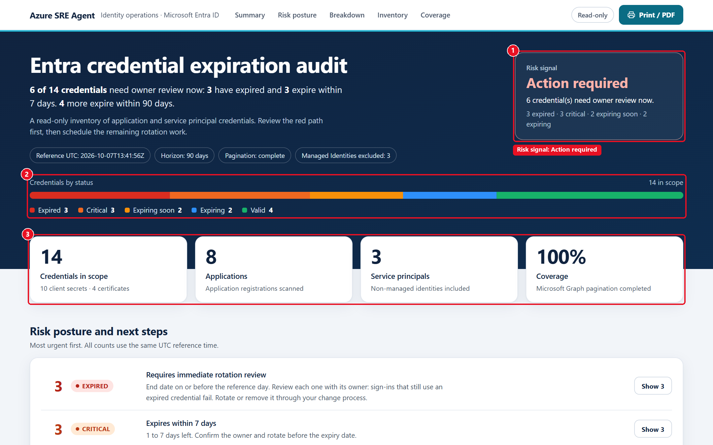
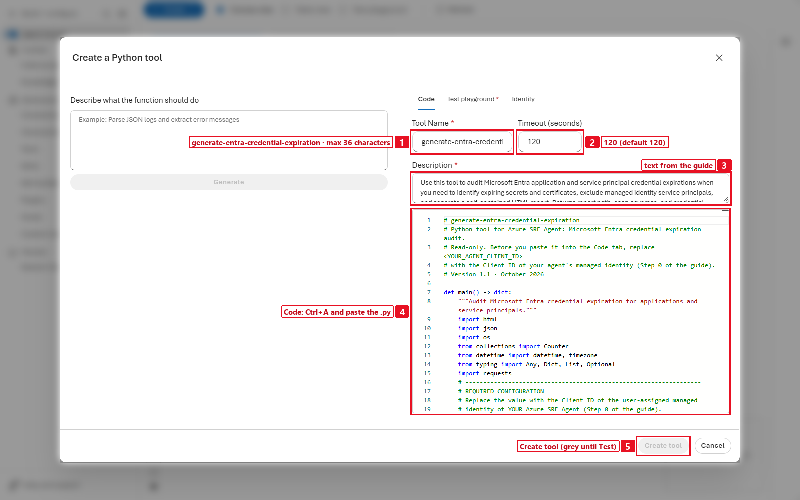
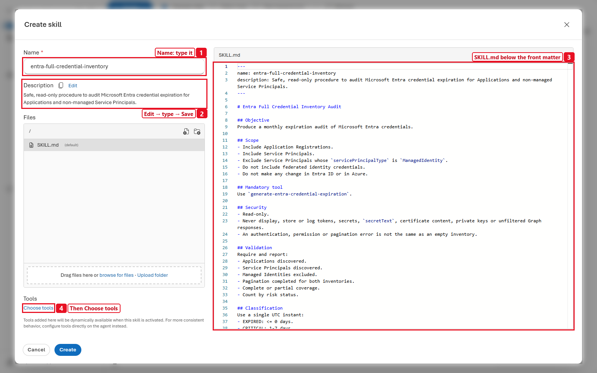
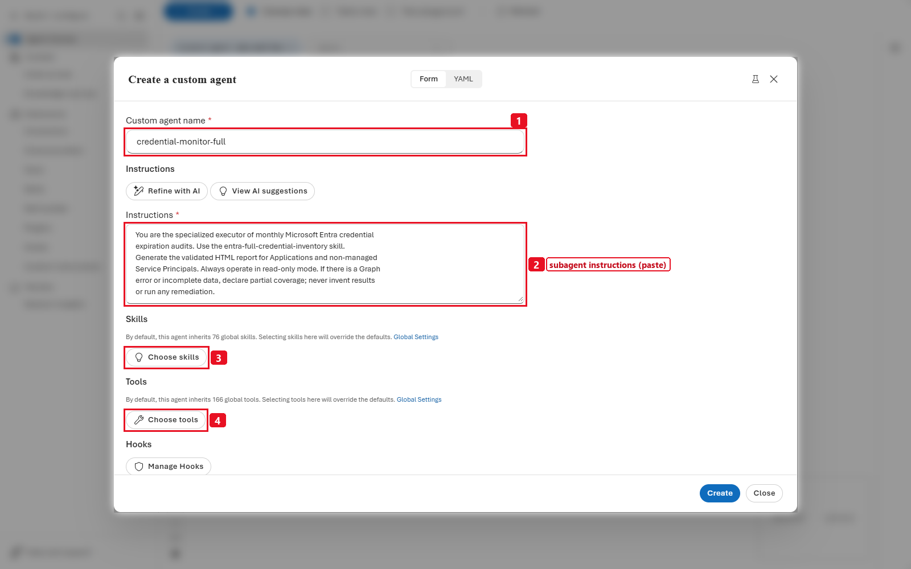
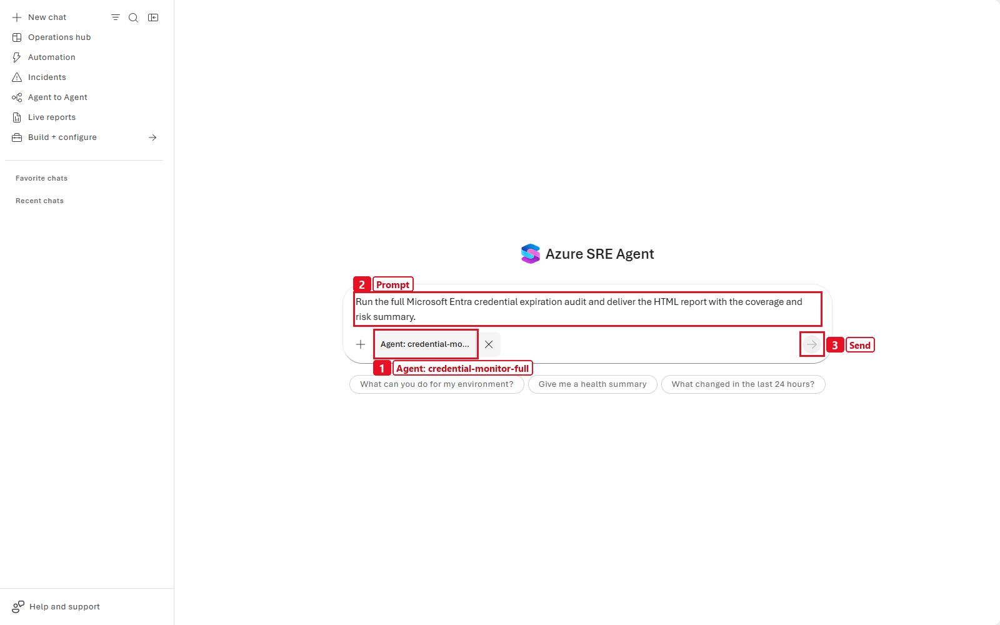
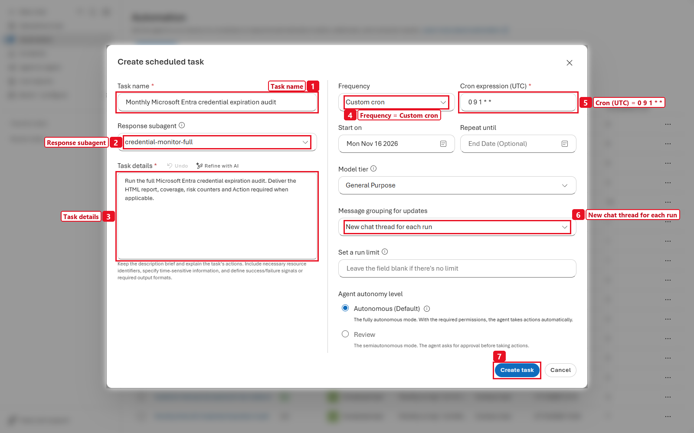
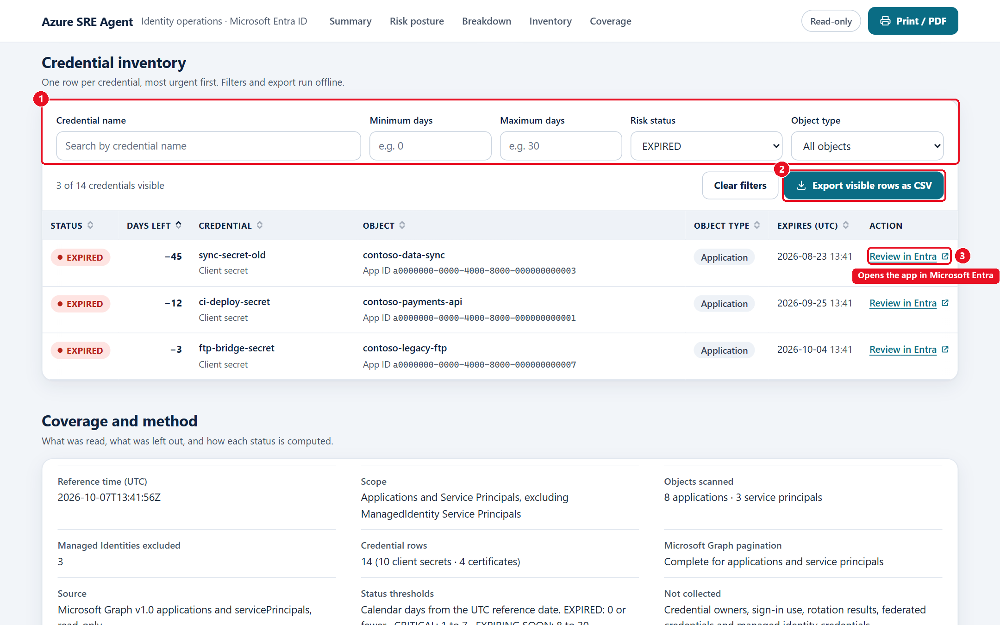

# Microsoft Entra credential expiration audit



*Sample report with fictitious data. 1 Risk signal: Action required when credentials have expired or expire within 7 days · 2 Credentials by status against one UTC reference time · 3 Coverage: credentials, applications, service principals and Graph pagination.*

> **The problem.** An app stopped working overnight because a secret or a certificate expired, and nobody saw it coming.

**What the agent does.** Every month it checks every app registration and service principal in Microsoft Entra ID and lists the secrets and certificates that have expired or are about to, sorted by urgency, so they can be renewed in time.

## At a glance

| | |
|---|---|
| **Runs** | Monthly, on the 1st at 09:00 UTC, and on demand from chat |
| **Reads** | Microsoft Entra ID, through Microsoft Graph v1.0 (`/applications` and `/servicePrincipals`) |
| **Changes** | Nothing. Read-only; it never rotates, creates or deletes a credential |
| **Delivers** | One interactive HTML report with filters, sorting, CSV export and links to Microsoft Entra |
| **Agent pieces** | Tool `generate-entra-credential-expiration` · skill `entra-full-credential-inventory` · subagent `credential-monitor-full` · scheduled task `Monthly Microsoft Entra credential expiration audit` |
| **Access** | Microsoft Graph `Application.Read.All` (application permission) for the agent managed identity |
| **Report language** | English |

**Compare with:** [Azure RBAC privileged access review](https://microsoft.github.io/frontier-sre-agent-rvas/usecase.html?id=0070-stale-rbac-assignments) · [Certificate renewal automation (idea)](https://github.com/microsoft/frontier-sre-agent-rvas/tree/main/usecases/0012-certificate-renewal-automation) · [SSL/TLS certificate expiration tracking (idea)](https://github.com/microsoft/frontier-sre-agent-rvas/tree/main/usecases/0069-ssl-tls-certificate-expiration-tracking)

## Why it matters

- **Fewer outages:** expired and expiring credentials are flagged every month with a 90-day horizon, so owners rotate them in a planned window instead of during an incident.
- **Less manual work:** one scheduled, tenant-wide run replaces portal checks app by app, with the same scope and thresholds every time.
- **Clear priorities:** five risk levels and an Action required flag put `EXPIRED` and `CRITICAL` first, and each row links to the app in Microsoft Entra.
- **Dated evidence:** each run is a self-contained report with explicit coverage (objects scanned, exclusions, pagination). A partial read is never shown as an all-clear.

## Prerequisites

- An Azure SRE Agent with its user-assigned managed identity (name starts with `id-`).
- SRE Agent Author and SRE Agent Standard User, or SRE Agent Administrator, on the agent resource for the person deploying.
- A Microsoft Entra account with **Privileged Role Administrator**, once, to grant the Microsoft Graph permission.
- PowerShell 7 (or Windows PowerShell 5.1) that can install the `Microsoft.Graph` module.

## Setup

Create the pieces by hand in the portal, or deploy the manifests with the framework CLI (end of this section). The tool, skill and subagent names reference each other: keep them exactly.

1. **Find the agent identity.** In the Azure portal, open the agent resource group and the managed identity whose name starts with `id-`, and copy its **Client ID** (not the Object ID). A Client ID is not a secret.
2. **Grant read access.** Edit [`permissions/grant-graph-permission.ps1`](permissions/grant-graph-permission.ps1), set `$managedIdentityClientId` to the Client ID and run it with an account that holds **Privileged Role Administrator**. It grants only the Microsoft Graph application permission `Application.Read.All` to the agent identity and does not create duplicates.
3. **Configure a private copy of the tool.** Download [`generate-entra-credential-expiration.py`](manifests/tools/generate-entra-credential-expiration.py) and set `MANAGED_IDENTITY_CLIENT_ID` to the same Client ID. Keep configured copies outside Git. Until it is set, the tool returns `Configuration required` with `coverage` partial and makes no call.
4. **Create the Python tool.** In the [SRE Agent portal](https://sre.azure.com), **Build + configure > Agent Canvas > Create ▾ > Tool > Python tool**. Tool Name `generate-entra-credential-expiration`, the description from the manifest, the code of your configured `generate-entra-credential-expiration.py`, timeout `120` seconds and no parameters. Leave **Enable Azure Identity** off: the code gets its own tokens with the agent managed identity. Run **Test** on the **Test playground** tab with `{}` (no parameters), then **Create tool**.

   
5. **Create the skill.** **Create ▾ > Skill**: name `entra-full-credential-inventory`, the description from its front matter, **Choose tools** > only `generate-entra-credential-expiration`, and paste the body of [`SKILL.md`](manifests/skills/entra-full-credential-inventory/SKILL.md) below the front matter the form generates.

   
6. **Create the subagent.** **Create ▾ > Custom agent**: name `credential-monitor-full`, instructions from `system_prompt` in [`manifests/subagents/credential-monitor-full.yaml`](manifests/subagents/credential-monitor-full.yaml), **Choose skills** > `entra-full-credential-inventory` and **Choose tools** > `generate-entra-credential-expiration`. Choosing them replaces the inherited global tools and skills, so the subagent can only run this read-only tool.

   
7. **Test from chat.** **New chat**, type `/agent`, pick `credential-monitor-full` and send the prompt under **Run it**. The answer links the HTML report through `report_url` and shows complete coverage and the counts by status.

   
8. **Schedule it.** **Automation > Create ▾ > Scheduled task**: task name `Monthly Microsoft Entra credential expiration audit`, response subagent `credential-monitor-full`, **Custom cron** `0 9 1 * *` (UTC), task details from `prompt` in [`manifests/scheduled-tasks/monthly-entra-credential-expiration-audit.yaml`](manifests/scheduled-tasks/monthly-entra-credential-expiration-audit.yaml) and **New chat thread for each run**. Run it once (in **Automation**, tick only this task and select **Run now**) and check the thread before you rely on the schedule.

   

**Or deploy the manifests with the CLI.** From the repository root, or the unzipped package, and from a configured copy of the tool (the CLI sends the code as it is in the folder; it has not been run against a live agent yet):

```bash
usecases/_framework/usecases.sh deploy 0079-entra-credential-expiration-audit --endpoint https://<agent>.azuresre.ai --dry-run
usecases/_framework/usecases.sh deploy 0079-entra-credential-expiration-audit --endpoint https://<agent>.azuresre.ai
usecases/_framework/usecases.sh verify 0079-entra-credential-expiration-audit --endpoint https://<agent>.azuresre.ai
```

Every click, with a screenshot, is in the [upstream step-by-step guide](https://github.com/marioaguileraaa/sre-agent-use-cases/tree/main/01-entra-credential-expiration-audit).

## Run it

In a **New chat**, type `/agent`, pick `credential-monitor-full` and send:

```text
Run the full Microsoft Entra credential expiration audit and deliver the HTML report with the coverage and risk summary.
```

More prompts, with the expected result of each, are in [`tests/prompts.md`](tests/prompts.md).

## Read the report

- **Risk signal:** *Action required* when credentials have expired or expire within 7 days, with the count of each status.
- **Risk posture and next steps:** each status, most urgent first, with what to do and a **Show** button that filters the inventory.
- **Inventory:** filters by name, days left, status and object type, sortable columns, **Export visible rows as CSV** and a **Review in Entra** link per row.
- **Coverage and method:** scope, exclusions (managed identities, federated credentials), thresholds and Graph pagination. **Print / PDF** prints the same report on A4.



*1 Filters by name, days left, status and object type · 2 Export visible rows as CSV · 3 Review in Entra opens the app for its owner.*

## Sample report

Download [`entra-credential-expiration-audit-SAMPLE.html`](sample-report/entra-credential-expiration-audit-SAMPLE.html) and open it in a browser to try the filters, the sorting and the CSV export, or [open the same sample online](https://marioaguileraaa.github.io/sre-agent-use-cases/01-entra-credential-expiration-audit/sample-report/entra-credential-expiration-audit-SAMPLE.html). It uses fictitious data (Contoso, Fabrikam).

## Cadence

Monthly, on day 1 at 09:00 UTC. Each run is a current snapshot of the credentials, not a history; keep the monthly HTML files to follow the trend. Owners rotate credentials through their own change process.

## Status

`validated`: built, with test prompts in `tests/` and a sample report with fictitious data. Upstream ran it live in a Microsoft lab tenant (14 app registrations and 502 service principals scanned, 45 credentials classified in about a minute) and re-checked every portal step on 16 November 2026. It has not been deployed from this repository with `usecases.sh deploy` yet.

## Credits

- **Built and tested by** Mario Aguilera: [github.com/marioaguileraaa](https://github.com/marioaguileraaa)
- **Upstream source and step-by-step guide** (every step with a screenshot, troubleshooting and the acceptance checks): [github.com/marioaguileraaa/sre-agent-use-cases/tree/main/01-entra-credential-expiration-audit](https://github.com/marioaguileraaa/sre-agent-use-cases/tree/main/01-entra-credential-expiration-audit). MIT license; this entry was converted from commit [`4eb2e90`](https://github.com/marioaguileraaa/sre-agent-use-cases/commit/4eb2e90).
- **Field guide:** [plate 01](https://marioaguileraaa.github.io/sre-agent-use-cases/#plate-01)
