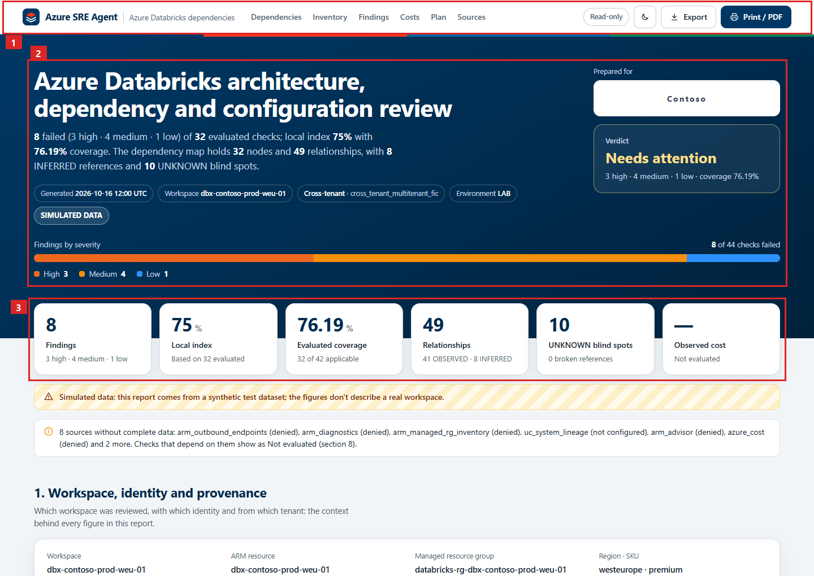
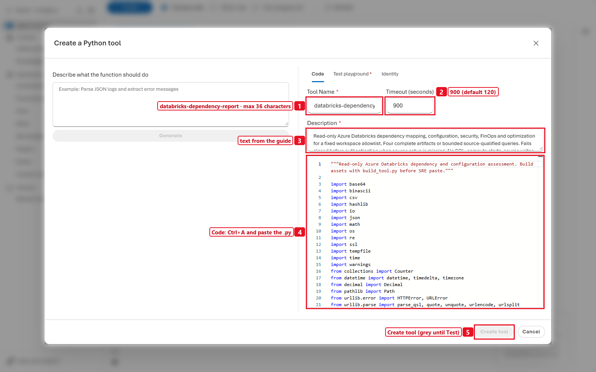
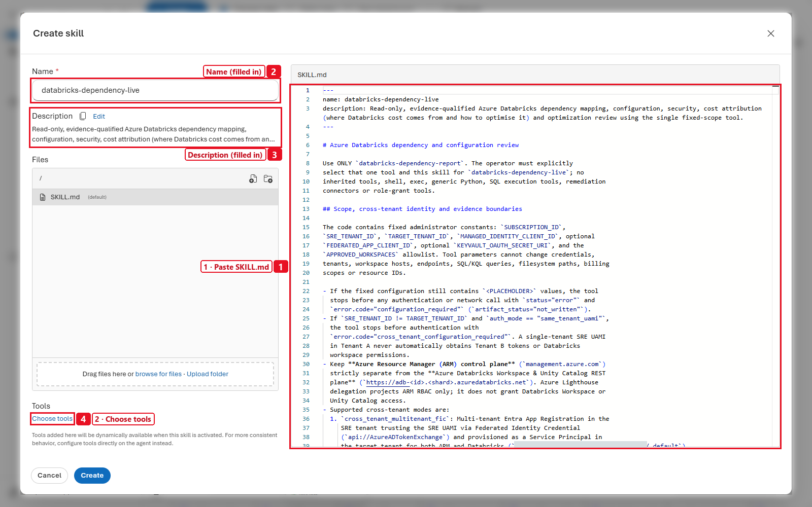
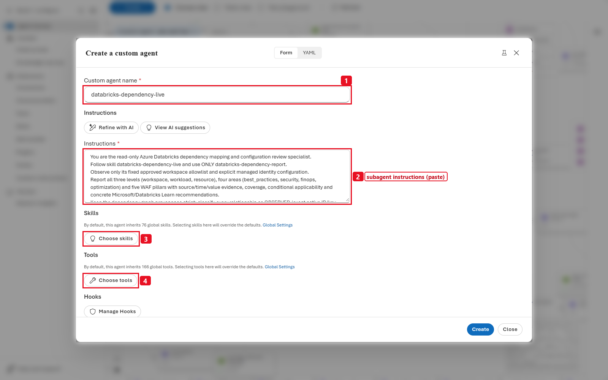
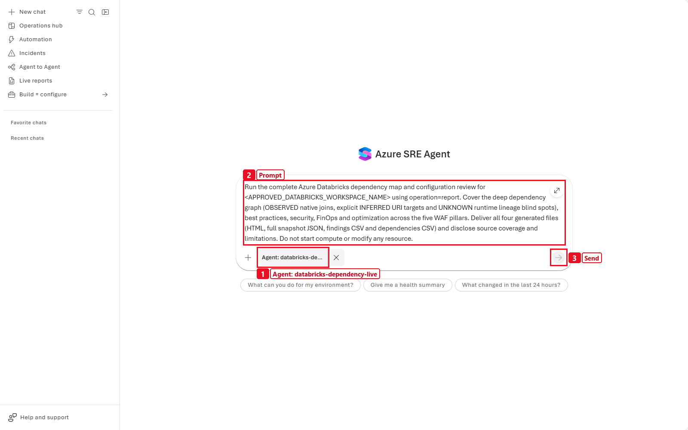
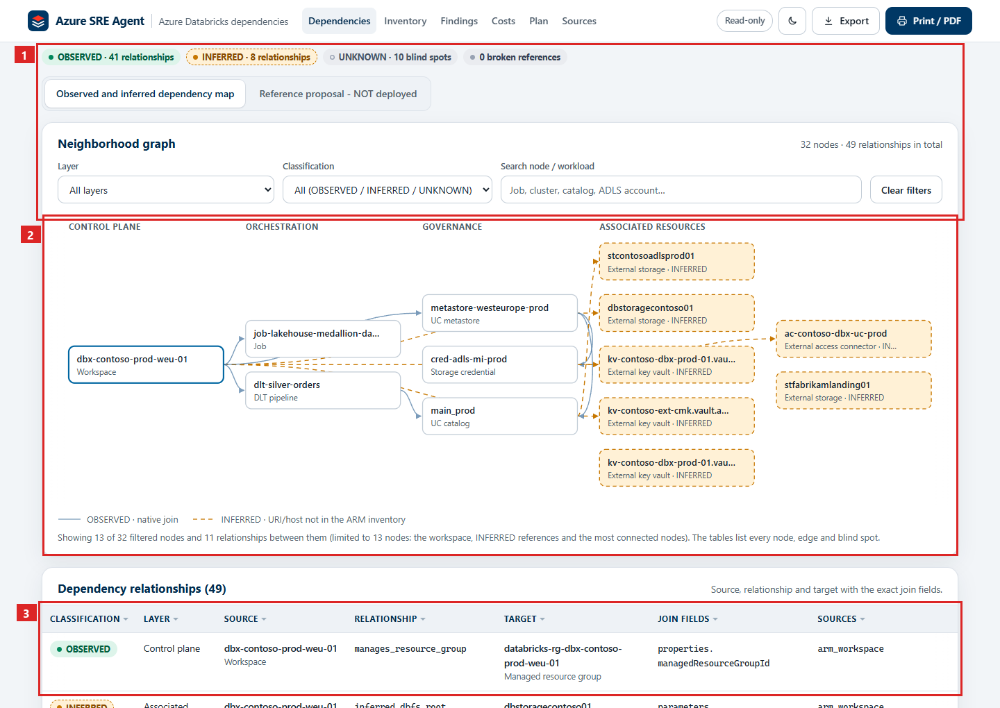
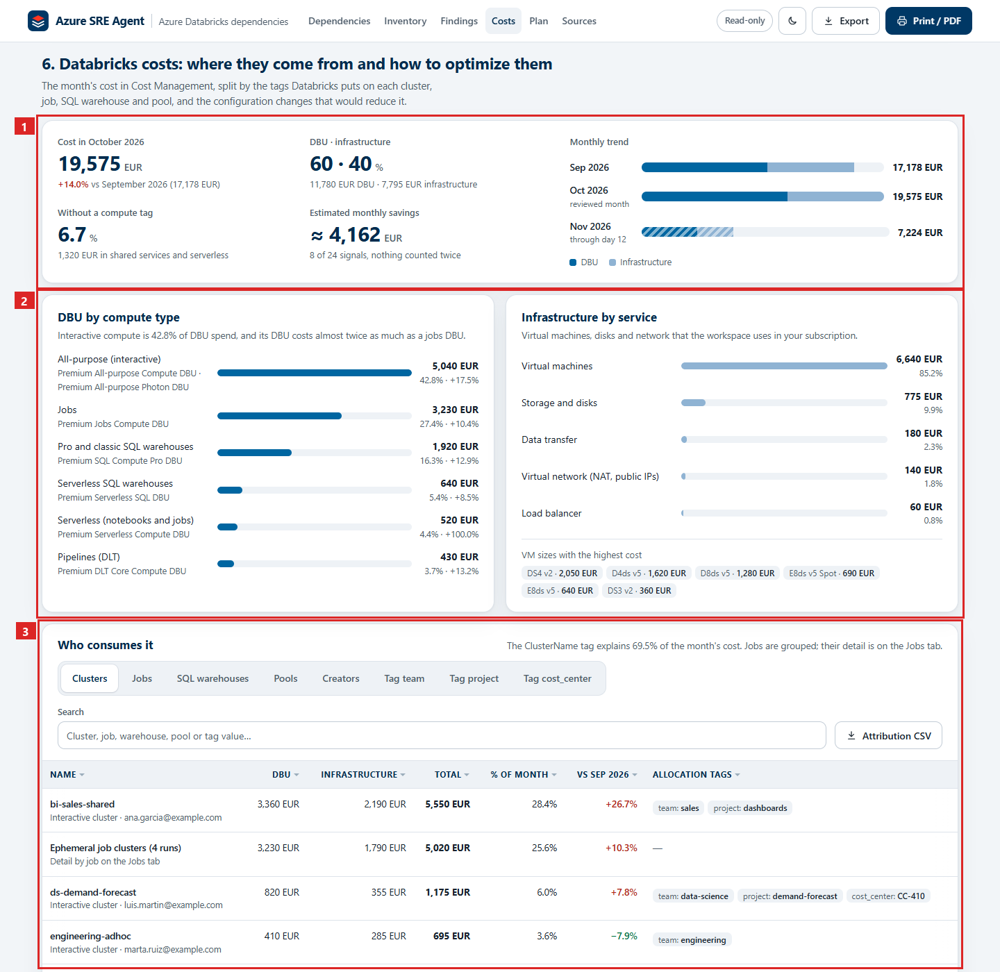

# Azure Databricks dependency and configuration review



*Sample run with simulated data. 1 Top bar with sections, Read-only chip, export menu and print · 2 Verdict-first summary with provenance chips and severity · 3 KPI cards: findings, local index beside coverage, relationships, blind spots and observed cost.*

> **The problem.** Our Databricks workspace connects to many things, nobody has the full map, and nobody can say where its cost comes from or how to reduce it.

**What the agent does.** It maps how an Azure Databricks workspace connects to networks, storage, Key Vault, jobs, pipelines and Unity Catalog, marking what is observed, inferred or unknown; shows where the Databricks cost comes from (DBUs against infrastructure, per cluster, job, SQL warehouse and tag) with estimated savings; and checks 36 best practices for security, cost and optimisation.

Every dependency is classified as `OBSERVED` (a native ID or key join returned by the APIs), `INFERRED` (an explicit URI or hostname reference, for example an ADLS Gen2 path) or `UNKNOWN` (a blind spot the tool could not read). The review covers 36 rules, three levels, four areas and five Well-Architected pillars; the local pass indicator is always shown beside coverage and is not an official Well-Architected Review.

## At a glance

| | |
|---|---|
| **Runs** | On demand, from chat |
| **Reads** | Azure Databricks (ARM, workspace REST API and Unity Catalog) and Cost Management |
| **Changes** | Nothing. Read-only; it never starts clusters or SQL warehouses, never reads secret values and never remediates |
| **Delivers** | HTML report, findings CSV, dependencies CSV and the full JSON snapshot |
| **Agent pieces** | Tool `databricks-dependency-report` · skill `databricks-dependency-live` · subagent `databricks-dependency-live` |
| **Access** | ARM `Reader` on the workspace resource groups, optional `Cost Management Reader`, and the identity as a Databricks service principal with view-only grants |
| **Report language** | English |

**Compare with:** [AKS cluster review](https://microsoft.github.io/frontier-sre-agent-rvas/usecase.html?id=0081-aks-well-architected-review) · [Monthly Azure FinOps review](https://microsoft.github.io/frontier-sre-agent-rvas/usecase.html?id=0015-consolidated-cost-reporting)

## Prerequisites

- An Azure SRE Agent with an attached user-assigned managed identity.
- SRE Agent Author and Standard User, or SRE Agent Administrator, for the person deploying.
- Read access for the reporting identity on two planes: ARM `Reader` on the workspace resource group and its managed resource group (granted by `permissions/grant-databricks-reader.ps1`), and the identity added as a Databricks workspace service principal with `CAN VIEW` on in-scope jobs, pipelines, SQL warehouses and compute plus `BROWSE`, `USE CATALOG` and `USE SCHEMA` in Unity Catalog. Never grant Secret Scope `READ`, Workspace Admin or Account Admin.
- Optional: `Cost Management Reader` on the subscription, for the cost section.
- For a workspace in another tenant, choose one cross-tenant mode from the upstream guide. The recommended mode is `cross_tenant_multitenant_fic`: a multi-tenant app whose certificate the tool reads from Key Vault (`CROSS_TENANT_CERT_KEYVAULT_URL`, `CROSS_TENANT_CERT_NAME`), because the agent sandbox token cannot be used as a federated client assertion.

## Setup

Create the pieces by hand in the portal, or deploy the manifests with the framework CLI (end of this section). The tool, skill and subagent names reference each other: keep them exactly.

1. **Find the agent identity.** In the Azure portal, open the agent resource group and the managed identity whose name starts with `id-`. Note its **Client ID** for the tool and its **Object (principal) ID** for the role assignments.
2. **Grant read access.** Run [`permissions/grant-databricks-reader.ps1`](permissions/grant-databricks-reader.ps1) in the tenant that hosts the workspace, then add the Databricks-side grants listed under **Prerequisites**.
3. **Configure a private copy of the tool.** Download [`generate-databricks-dependency-report.py`](manifests/tools/generate-databricks-dependency-report.py) and set the constants at the top: the values under **Parameters**, plus the optional logo. Keep configured copies outside Git. Until they are set, report and query calls answer `configuration_required` with `artifact_status="not_written"` and make no network call.
4. **Create the Python tool.** In the [SRE Agent portal](https://sre.azure.com), **Build + configure > Agent Canvas > Create ▾ > Tool > Python tool**. Tool Name `databricks-dependency-report`, the description from the manifest, the code of your configured `generate-databricks-dependency-report.py`, timeout `900` seconds and the 12 parameters of [`manifests/tools/databricks-dependency-report.yaml`](manifests/tools/databricks-dependency-report.yaml). Leave **Enable Azure Identity** off: the code gets its own tokens with the agent managed identity. Run **Test** on the **Test playground** tab with `{"operation": "self_test"}` (works before the tool is configured), then **Create tool**.

   
5. **Create the skill.** **Create ▾ > Skill**: name `databricks-dependency-live`, the description from its front matter, **Choose tools** > only `databricks-dependency-report`, and paste the body of [`SKILL.md`](manifests/skills/databricks-dependency-live/SKILL.md) below the front matter the form generates.

   
6. **Create the subagent.** **Create ▾ > Custom agent**: name `databricks-dependency-live`, instructions from `system_prompt` in [`manifests/subagents/databricks-dependency-live.yaml`](manifests/subagents/databricks-dependency-live.yaml), **Choose skills** > `databricks-dependency-live` and **Choose tools** > `databricks-dependency-report`. Choosing them replaces the inherited global tools and skills, so the subagent can only run this read-only tool.

   
7. **Test from chat.** **New chat**, type `/agent`, pick `databricks-dependency-live` and send the prompt under **Run it**. The answer links the four files (HTML, snapshot JSON, findings CSV and dependencies CSV); `self_test` files are labelled SIMULATED.

   

**Or deploy the manifests with the CLI.** From the repository root, or the unzipped package, and from a configured copy of the tool (the CLI sends the code as it is in the folder; it has not been run against a live agent yet):

```bash
usecases/_framework/usecases.sh deploy 0021-databricks-dependency-configuration-review --endpoint https://<agent>.azuresre.ai --dry-run
usecases/_framework/usecases.sh deploy 0021-databricks-dependency-configuration-review --endpoint https://<agent>.azuresre.ai
usecases/_framework/usecases.sh verify 0021-databricks-dependency-configuration-review --endpoint https://<agent>.azuresre.ai
```

Every click, with a screenshot, is in the [upstream step-by-step guide](https://github.com/marioaguileraaa/sre-agent-use-cases/tree/main/08-databricks-dependency-configuration-review).

## Run it

In a **New chat**, type `/agent`, pick `databricks-dependency-live` and send:

```text
Run the complete Azure Databricks dependency map and configuration review for <APPROVED_DATABRICKS_WORKSPACE_NAME> using operation=report. Cover the deep dependency graph (OBSERVED native joins, explicit INFERRED URI targets and UNKNOWN runtime lineage blind spots), best practices, security, FinOps and optimization across the five WAF pillars. Deliver all four generated files (HTML, full snapshot JSON, findings CSV and dependencies CSV) and disclose source coverage and limitations. Do not start compute or modify any resource.
```

More prompts, with the expected result of each, are in [`tests/prompts.md`](tests/prompts.md).

## Read the report

- **Cover and executive reading:** workspace identity, authentication mode, UTC reference and the local pass percentage beside coverage.
- **Dependency map:** filter by layer (`control_plane`, `compute`, `orchestration`, `governance`, `associated_resource`) and by class. A second tab compares the result with an undeployed Well-Architected lakehouse reference.
- **Costs:** the month's Databricks cost, DBU against infrastructure, who consumes it and optimization signals with estimated savings, counted once per object.
- **Findings, actions and source ledger:** per-source HTTP receipts show what each plane returned; ARM shows `denied` (`HTTP 403`) until the resource-group `Reader` role is in place.



*Dependency map: 1 classification counts and filters · 2 layered graph, solid OBSERVED joins and dashed INFERRED references · 3 edges table with join fields and sources.*



*Cost section, from SIMULATED data: 1 month cost, DBU and infrastructure split, unattributed share and estimated savings · 2 DBU by compute type and infrastructure by service · 3 who consumes it, by cluster, job, SQL warehouse, pool, creator and tag.*

## Sample report

[`sample-report/`](sample-report/) holds the four files of a SIMULATED run that the tool wrote offline from the sanitized test fixture, without calling Azure or Databricks: the [HTML report](sample-report/simulated-20261016T120000Z-c0a7e5d10b2c.html) (download it and open it in a browser), the JSON snapshot, the findings CSV and the dependencies CSV. Every workspace, host, user and identifier is fictitious (`dbx-contoso-prod-weu-01`, `Contoso`).

## Cadence

On demand. Add a scheduled task only if the workspace owner wants recurring reviews after accepting the first report.

## Maintain

The tool in `manifests/tools/` is built from `src/`. Edit `src/engine.py` or the report template, then run `python3 src/build_tool.py` and `python3 -m unittest discover -s src/tests`. `usecases.sh validate` fails if the built file is stale.

## Status

`validated`: built, with test prompts in `tests/` and a SIMULATED sample report. Upstream saved and read back the native deployment on 2026-10-16, ran a live cross-tenant report on 2026-10-19 and re-validated the sidecar-token and Key Vault certificate changes in a lab agent on 2026-11-06 (`tests/native-readiness-validation.json`, `tests/visual-evidence.json`, `tests/runtime-changes.json`). It has not been deployed from this repository with `usecases.sh deploy` yet. Screenshots and evidence from runs before 16 November 2026 show the previous tool name `generate-databricks-dependency-report` (37 characters, over today's portal limit).

## Credits

Built and tested by Mario Aguilera ([@marioaguileraaa](https://github.com/marioaguileraaa)). Source: [`08-databricks-dependency-configuration-review`](https://github.com/marioaguileraaa/sre-agent-use-cases/tree/main/08-databricks-dependency-configuration-review) in `marioaguileraaa/sre-agent-use-cases` (MIT), commit `4eb2e90`. The upstream guide has every step with a screenshot, troubleshooting and the acceptance checks. Field guide: [plate 08](https://marioaguileraaa.github.io/sre-agent-use-cases/#plate-08).
