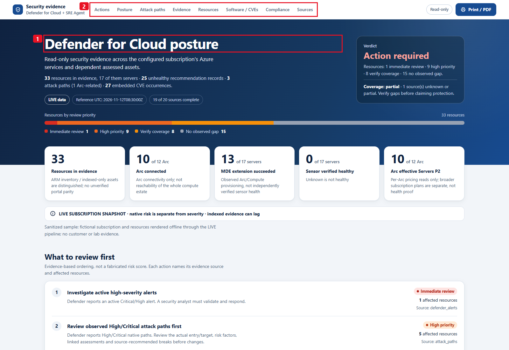
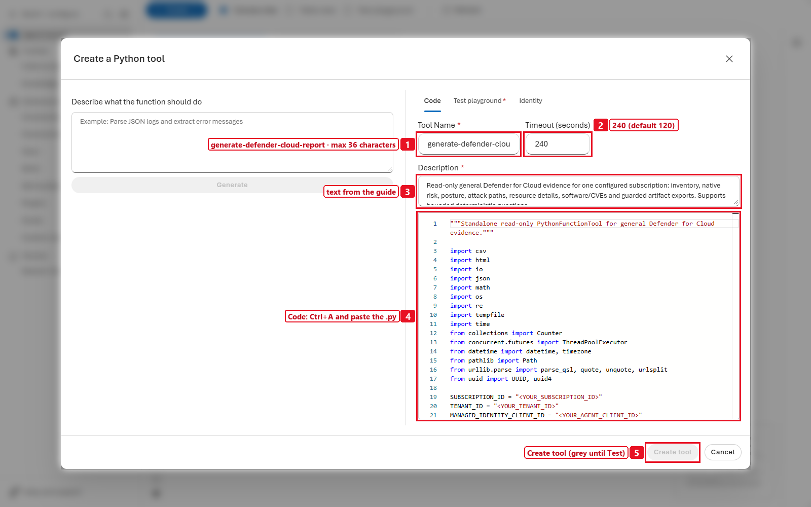
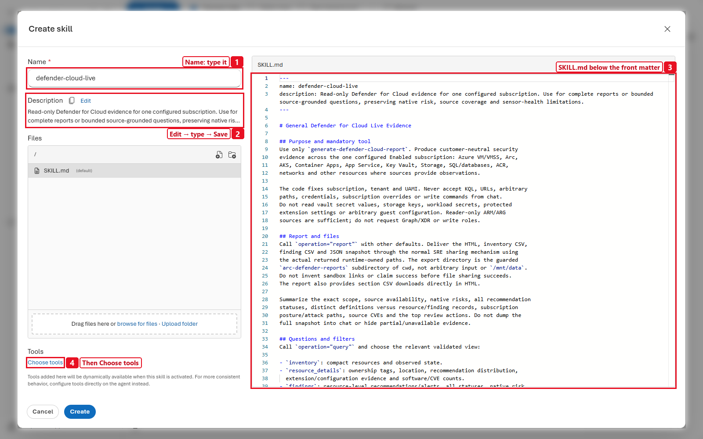
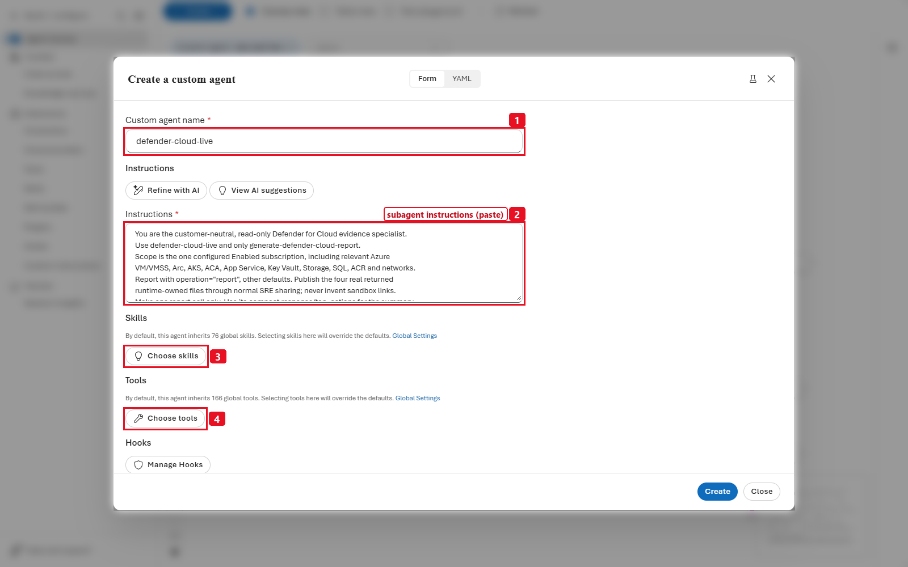
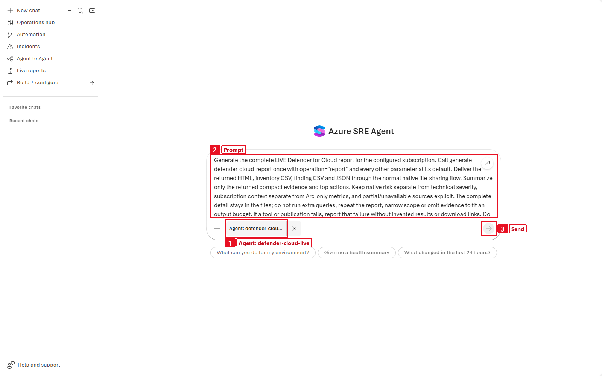
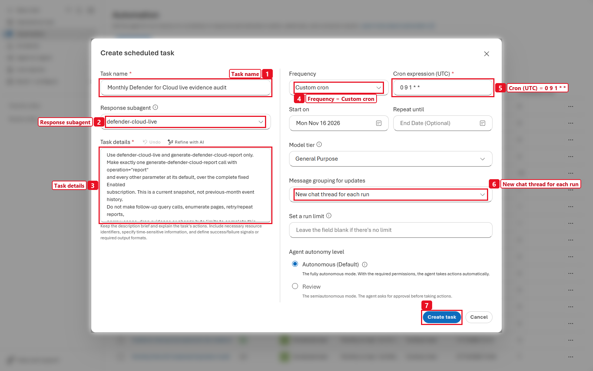
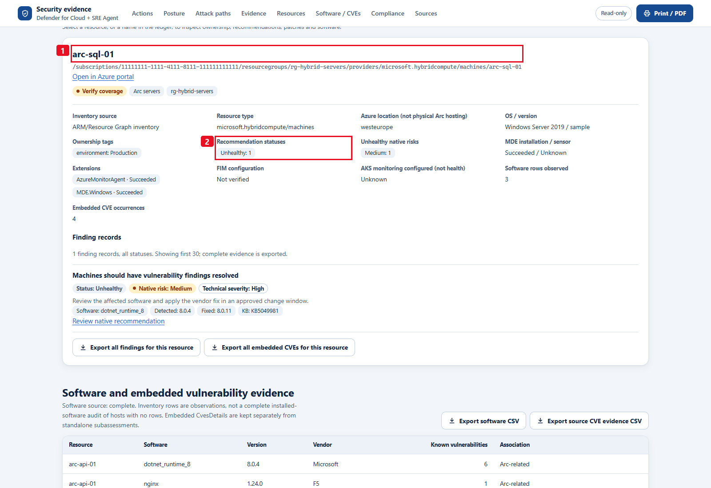

# Security posture from Defender for Cloud



*Sanitized sample rendered offline through the LIVE pipeline (fictional subscription). 1 Report title and live scope · 2 The sections: actions, posture, attack paths, evidence, resources, software and CVEs, compliance and sources.*

> **The problem.** Defender for Cloud shows hundreds of recommendations and we don't know which ones matter first.

**What the agent does.** It reads the live Defender for Cloud evidence of a subscription (risks, recommendations, attack paths, vulnerabilities and secure score) and turns it into one report that shows what to review first. Then you can ask follow-up questions grounded in that evidence.

The report covers the subscription's Azure VMs and scale sets, Arc servers, AKS, Container Apps, App Service, Key Vault, Storage, SQL, container registries and networks wherever Defender for Cloud has observations. Native risk level and technical severity are kept apart, and a missing source is stated, not shown as zero.

## At a glance

| | |
|---|---|
| **Runs** | Monthly, on the 1st at 09:00 UTC, and on demand from chat |
| **Reads** | Microsoft Defender for Cloud through Azure Resource Manager and Azure Resource Graph |
| **Changes** | Nothing. Read-only |
| **Delivers** | HTML report, CSV and JSON exports |
| **Agent pieces** | Tool `generate-defender-cloud-report` · skill `defender-cloud-live` · subagent `defender-cloud-live` · scheduled task `Monthly Defender for Cloud live evidence audit` |
| **Access** | `Reader` on the monitored subscription |
| **Report language** | English |

**Compare with:** [Azure RBAC privileged access review](https://microsoft.github.io/frontier-sre-agent-rvas/usecase.html?id=0070-stale-rbac-assignments) · [Microsoft Entra credential expiration audit](https://microsoft.github.io/frontier-sre-agent-rvas/usecase.html?id=0079-entra-credential-expiration-audit)

## Why it matters

- **Where to start:** hundreds of recommendations become one ordered list of what to review first, each naming its evidence source and affected resources.
- **Grounded questions:** follow-up questions in chat (findings, attack paths, software and CVEs, compliance) are answered from deterministic filters, with exact totals.
- **Honest limits:** extension success, paid plans or connectivity are not presented as sensor health; partial coverage is stated before any conclusion.

## Prerequisites

- An Azure SRE Agent with its user-assigned managed identity.
- SRE Agent Author and SRE Agent Standard User, or SRE Agent Administrator, on the agent resource for the person deploying.
- Microsoft Defender for Cloud enabled on the monitored subscription, and someone who can assign `Reader` on it.

## Setup

Create the pieces by hand in the portal, or deploy the manifests with the framework CLI (end of this section). The tool, skill and subagent names reference each other: keep them exactly.

1. **Find the agent identity.** In the Azure portal, open the agent resource group and the managed identity whose name starts with `id-`. Note its **Client ID** for the tool and its **Object (principal) ID** for role assignments. A Client ID is not a secret.
2. **Grant read access.** Run [`permissions/grant-defender-evidence-reader.ps1`](permissions/grant-defender-evidence-reader.ps1) with `-IdentityClientId` (or `-PrincipalId`) and the monitored `-SubscriptionId`. It assigns only `Reader` and skips what the identity already has, also inherited. Add `-WhatIf` first to see what it would assign.
3. **Configure a private copy of the tool.** Download [`generate-defender-cloud-report.py`](manifests/tools/generate-defender-cloud-report.py) and set `SUBSCRIPTION_ID`, `TENANT_ID` and `MANAGED_IDENTITY_CLIENT_ID`. Keep configured copies outside Git. Until they are set, the tool returns a configuration error.
4. **Create the Python tool.** In the [SRE Agent portal](https://sre.azure.com), **Build + configure > Agent Canvas > Create ▾ > Tool > Python tool**. Tool Name `generate-defender-cloud-report`, the description from the manifest, the code of your configured `generate-defender-cloud-report.py`, timeout `240` seconds and the 15 parameters of [`manifests/tools/generate-defender-cloud-report.yaml`](manifests/tools/generate-defender-cloud-report.yaml). Leave **Enable Azure Identity** off: the code gets its own tokens with the agent managed identity. Run **Test** on the **Test playground** tab with `{"operation": "report"}`, then **Create tool**.

   
5. **Create the skill.** **Create ▾ > Skill**: name `defender-cloud-live`, the description from its front matter, **Choose tools** > only `generate-defender-cloud-report`, and paste the body of [`SKILL.md`](manifests/skills/defender-cloud-live/SKILL.md) below the front matter the form generates.

   
6. **Create the subagent.** **Create ▾ > Custom agent**: name `defender-cloud-live`, instructions from `system_prompt` in [`manifests/subagents/defender-cloud-live.yaml`](manifests/subagents/defender-cloud-live.yaml), **Choose skills** > `defender-cloud-live` and **Choose tools** > `generate-defender-cloud-report`. Choosing them replaces the inherited global tools and skills, so the subagent can only run this read-only tool.

   
7. **Test from chat.** **New chat**, type `/agent`, pick `defender-cloud-live` and send the prompt under **Run it**. The answer links the four files and lists what to review first, with the coverage.

   
8. **Schedule it.** **Automation > Create ▾ > Scheduled task**: task name `Monthly Defender for Cloud live evidence audit`, response subagent `defender-cloud-live`, **Custom cron** `0 9 1 * *` (UTC), task details from `prompt` in [`manifests/scheduled-tasks/monthly-defender-cloud-evidence-audit.yaml`](manifests/scheduled-tasks/monthly-defender-cloud-evidence-audit.yaml) and **New chat thread for each run**. Run it once (in **Automation**, tick only this task and select **Run now**) and check the thread before you rely on the schedule.

   

**Or deploy the manifests with the CLI.** From the repository root, or the unzipped package, and from a configured copy of the tool (the CLI sends the code as it is in the folder; it has not been run against a live agent yet):

```bash
usecases/_framework/usecases.sh deploy 0023-defender-for-cloud-assessment --endpoint https://<agent>.azuresre.ai --dry-run
usecases/_framework/usecases.sh deploy 0023-defender-for-cloud-assessment --endpoint https://<agent>.azuresre.ai
usecases/_framework/usecases.sh verify 0023-defender-for-cloud-assessment --endpoint https://<agent>.azuresre.ai
```

Every click, with a screenshot, is in the [upstream step-by-step guide](https://github.com/marioaguileraaa/sre-agent-use-cases/tree/main/02-arc-defender-posture-audit).

## Run it

In a **New chat**, type `/agent`, pick `defender-cloud-live` and send:

```text
Use defender-cloud-live and only generate-defender-cloud-report. Make one call with operation="report" and all other defaults. Deliver the four actual files through normal sharing, then summarize what to review first from the returned top actions, the coverage and the limits. Do not run follow-up queries or change Azure.
```

More prompts, with the expected result of each, are in [`tests/prompts.md`](tests/prompts.md).

## Read the report

- **Verdict and what to review first:** resources by review priority and ordered actions, each with its evidence source.
- **Posture and compliance:** secure score, controls and regulatory compliance as Defender for Cloud returns them.
- **Attack paths, resources, software and CVEs:** native paths, resource details with their findings, installed software and vulnerabilities.
- **Sources:** the status of every read, so a partial coverage is visible before any conclusion.



*Resource details: each finding with its native risk, status and source, so the review starts from evidence.*

## Cadence

Monthly, on day 1 at 09:00 UTC. Ask in chat between runs for a fresh, filtered view.

## Status

`built`. Upstream ran it live in a Microsoft lab (normal-chat acceptance on 2026-10-13, compact report and question checks on 2026-10-09, monthly task run on demand). There is no sample report in the package yet, so it is not `validated`. Upstream also has an offline SIMULATED Arc demo (a second tool, skill and subagent); it is not part of this package. This entry turns the idea *Defender for Cloud assessment* into a built use case.

## Credits

Built and tested by Mario Aguilera ([@marioaguileraaa](https://github.com/marioaguileraaa)). Source: [`02-arc-defender-posture-audit`](https://github.com/marioaguileraaa/sre-agent-use-cases/tree/main/02-arc-defender-posture-audit) in `marioaguileraaa/sre-agent-use-cases` (MIT), commit `4eb2e90`. The upstream guide has every step with a screenshot, troubleshooting and the acceptance checks. Field guide: [plate 02](https://marioaguileraaa.github.io/sre-agent-use-cases/#plate-02). It implements the earlier idea *Defender for Cloud assessment*, first listed from [alsanch/azure-sre-agent-scenarios](https://github.com/alsanch/azure-sre-agent-scenarios), and keeps its id.
