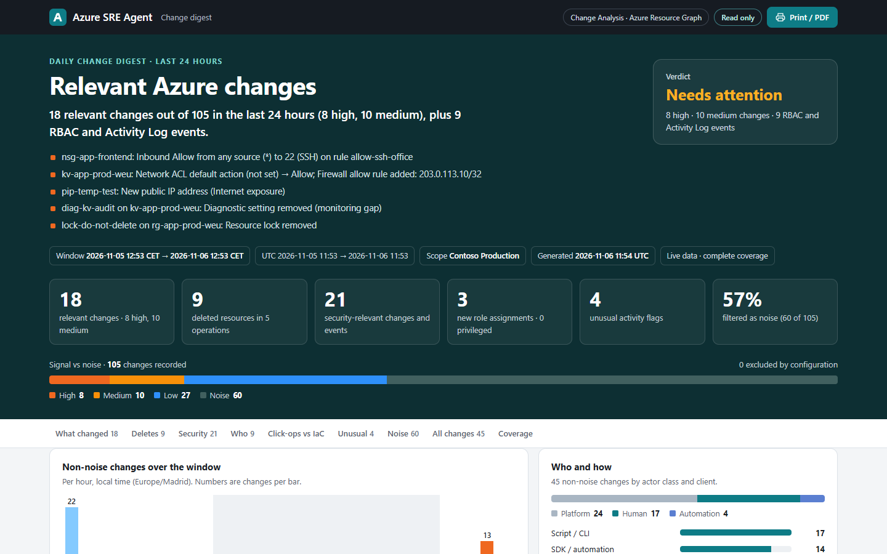
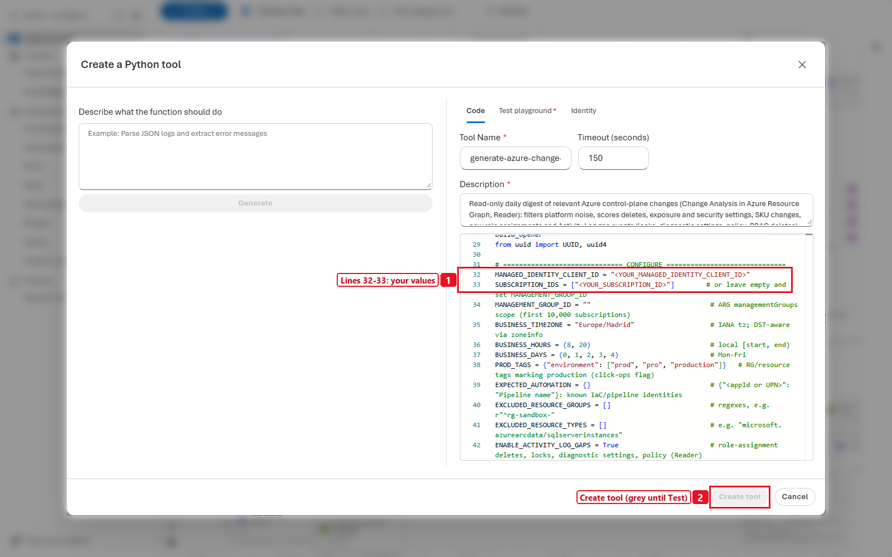
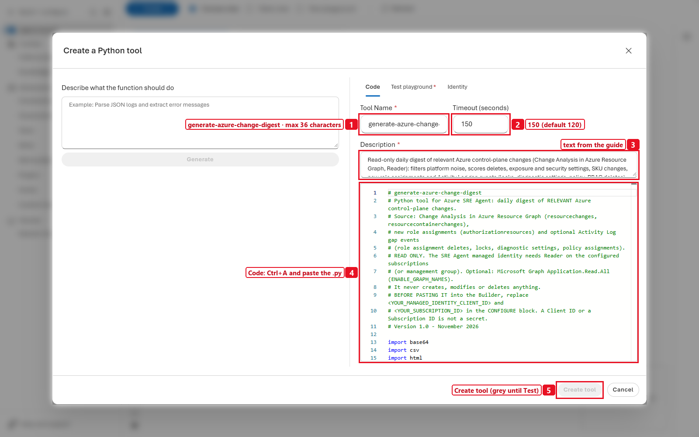
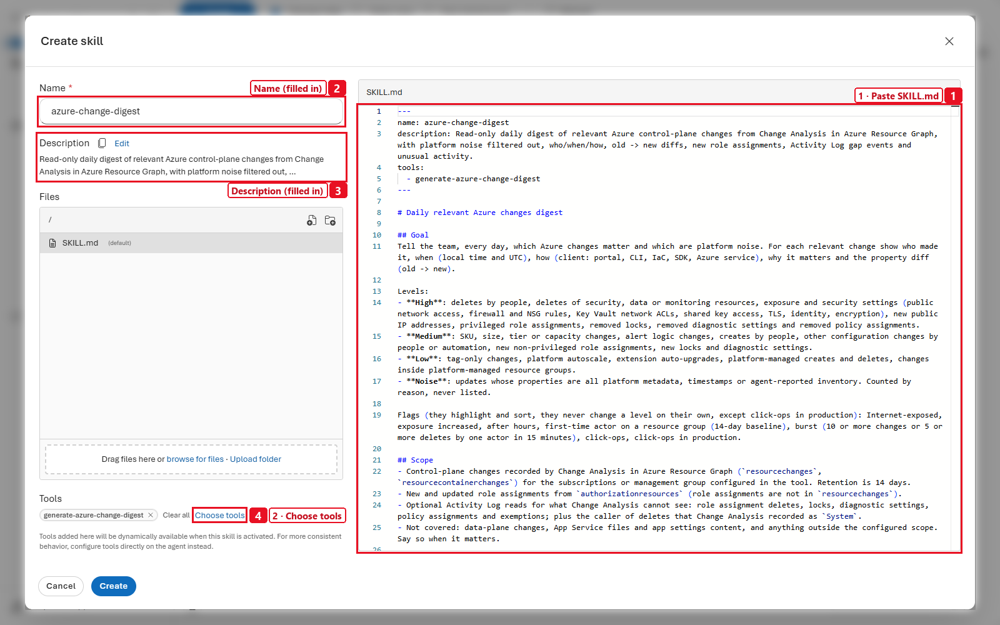
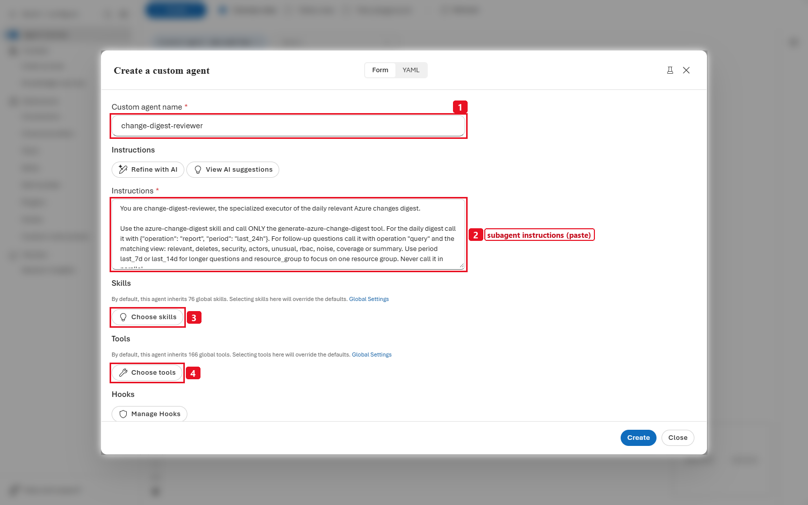
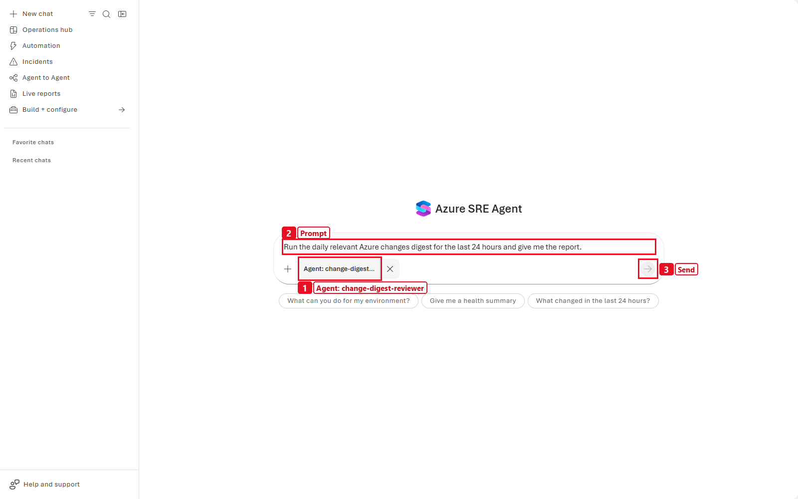
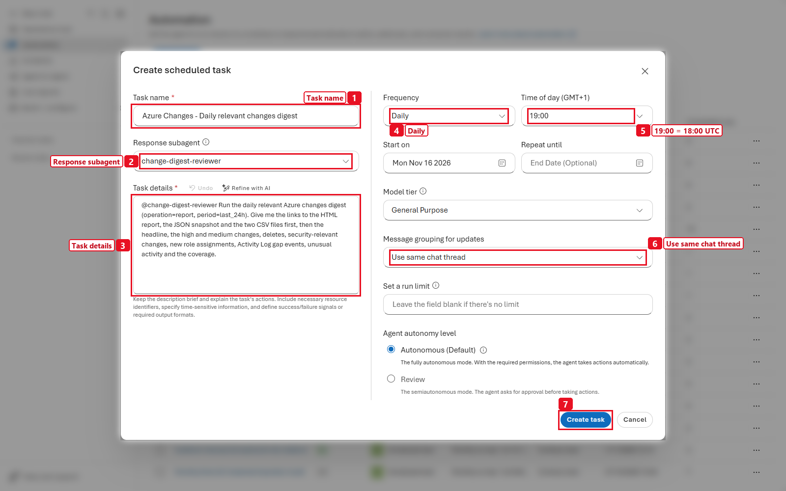
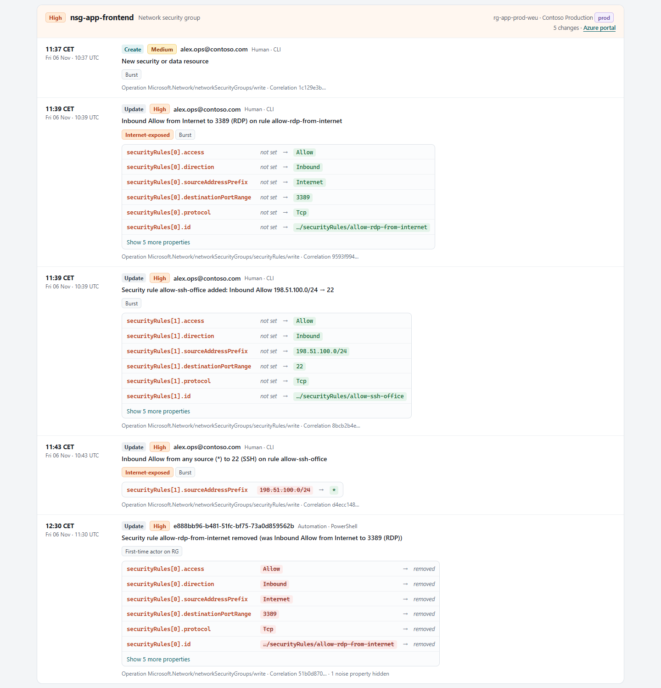

# Daily relevant Azure changes digest



*Real lab run, names and identifiers pseudonymized: 105 changes in 24 hours, 60 filtered as noise (57 %), 18 relevant (8 high, 10 medium) plus 9 role-assignment and Activity Log events. The highlights read like a security briefing: SSH opened to any source, a Key Vault network rule relaxed, a public IP created, a diagnostic setting and a lock removed.*

> **The problem.** Our Azure environment changes hundreds of times a day, almost all of it platform noise, and we only look at the change history after something breaks.

**What the agent does.** Every evening it reads Change Analysis in Azure Resource Graph, filters the noise, and lists the changes that matter with who made them, when, how and the old and new values: rules opened to the Internet, firewalls relaxed, deletes, locks and monitoring removed, new role assignments.

The noise filter is explainable: every hidden row is counted by reason. The digest adds what Change Analysis cannot see (new role assignments, locks, diagnostic settings, policy assignments and the real caller of deletes) and flags after-hours changes, first-time actors on a resource group, bursts and portal changes by people in production.

## At a glance

| | |
|---|---|
| **Runs** | Daily at 18:00 UTC, and on demand from chat for the last 24 hours, 7 days or 14 days |
| **Reads** | Change Analysis in Azure Resource Graph, role assignments and the Activity Log |
| **Changes** | Nothing. Read-only |
| **Delivers** | HTML report, JSON snapshot, changes CSV and property-diffs CSV |
| **Agent pieces** | Tool `generate-azure-change-digest` · skill `azure-change-digest` · subagent `change-digest-reviewer` · scheduled task `Azure Changes - Daily relevant changes digest` |
| **Access** | `Reader` on the watched subscriptions (or a management group) |
| **Report language** | English |

**Compare with:** [Azure RBAC privileged access review](https://microsoft.github.io/frontier-sre-agent-rvas/usecase.html?id=0070-stale-rbac-assignments) · [Monthly operations digest](https://microsoft.github.io/frontier-sre-agent-rvas/usecase.html?id=0084-operations-incidents-anomalies-digest) · [Changes in last 24h for a resource (idea)](https://github.com/microsoft/frontier-sre-agent-rvas/tree/main/usecases/0014-changes-in-last-24h-for-a-resource) · [Identify who added a firewall/NSG rule (idea)](https://github.com/microsoft/frontier-sre-agent-rvas/tree/main/usecases/0038-identify-who-added-a-firewall-nsg-rule)

## Why it matters

- **Shorter incidents:** the first question in any incident is *what changed?*; the last digest answers it in seconds, with the diff.
- **Exposure caught the same day:** NSG rules opened to the Internet, public network access enabled, firewalls relaxed, public IPs created, monitoring or locks removed.
- **Accountability without blame:** each item quotes the evidence (`changedByType`, `clientType`, `operation`, `correlationId`), and automation is credited to the automation identity.
- **Audit evidence:** a dated report, snapshot and two CSVs every day support change-management controls.

## Prerequisites

- An Azure SRE Agent with its user-assigned managed identity.
- SRE Agent Administrator on the agent resource for the person deploying.
- `Reader` for the agent identity on each watched subscription, or once on a management group. Most agent identities already have it.

## Setup

Create the pieces by hand in the portal, or deploy the manifests with the framework CLI (end of this section). The tool, skill and subagent names reference each other: keep them exactly.

1. **Find the agent identity.** In the Azure portal, open the SRE Agent resource > **Identity** > the user-assigned identity > **Overview**, and copy its **Client ID** (for the tool) and **Object (principal) ID** (for the role assignment).
2. **Grant read access.** Run [`permissions/grant-change-digest-reader.ps1`](permissions/grant-change-digest-reader.ps1) with `-IdentityClientId` (or `-PrincipalId`) and `-SubscriptionId` for the subscriptions to watch, or `-ManagementGroupId`. It assigns only `Reader` and skips what the identity already has, also inherited. Add `-WhatIf` first to see what it would assign.
3. **Configure a private copy of the tool.** Download [`generate-azure-change-digest.py`](manifests/tools/generate-azure-change-digest.py) and set `MANAGED_IDENTITY_CLIENT_ID` and `SUBSCRIPTION_IDS` in the **CONFIGURE** block (optionally the business time zone, hours, production tags, known automation identities and exclusions). Keep configured copies outside Git. Until they are set, the tool returns `configuration_required`.

   
4. **Create the Python tool.** In the [SRE Agent portal](https://sre.azure.com), **Build + configure > Agent Canvas > Create ▾ > Tool > Python tool**. Tool Name `generate-azure-change-digest`, the description from the manifest, the code of your configured `generate-azure-change-digest.py`, timeout `150` seconds and the 6 parameters of [`manifests/tools/generate-azure-change-digest.yaml`](manifests/tools/generate-azure-change-digest.yaml). Leave **Enable Azure Identity** off: the code gets its own tokens with the agent managed identity. Run **Test** on the **Test playground** tab with the default parameters (`operation=report`, `period=last_24h`), then **Create tool**.

   
5. **Create the skill.** **Create ▾ > Skill**: name `azure-change-digest`, the description from its front matter, **Choose tools** > only `generate-azure-change-digest`, and paste the body of [`SKILL.md`](manifests/skills/azure-change-digest/SKILL.md) below the front matter the form generates.

   
6. **Create the subagent.** **Create ▾ > Custom agent**: name `change-digest-reviewer`, instructions from `system_prompt` in [`manifests/subagents/change-digest-reviewer.yaml`](manifests/subagents/change-digest-reviewer.yaml), **Choose skills** > `azure-change-digest` and **Choose tools** > `generate-azure-change-digest`. Choosing them replaces the inherited global tools and skills, so the subagent can only run this read-only tool.

   
7. **Test from chat.** **New chat**, type `/agent`, pick `change-digest-reviewer` and send the prompt under **Run it**. The answer links the four files and gives the verdict, the high and medium changes and the coverage.

   
8. **Schedule it.** **Automation > Create ▾ > Scheduled task**: task name `Azure Changes - Daily relevant changes digest`, response subagent `change-digest-reviewer`, **Daily**, at the local time that equals 18:00 UTC, the end of the business day (or **Custom cron** `0 18 * * *`, which is always UTC), task details from `prompt` in [`manifests/scheduled-tasks/daily-relevant-changes-digest.yaml`](manifests/scheduled-tasks/daily-relevant-changes-digest.yaml) and **Use same chat thread** (the default: one thread shows the trend). Run it once (in **Automation**, tick only this task and select **Run now**) and check the thread before you rely on the schedule.

   

**Or deploy the manifests with the CLI.** From the repository root, or the unzipped package, and from a configured copy of the tool (the CLI sends the code as it is in the folder; it has not been run against a live agent yet):

```bash
usecases/_framework/usecases.sh deploy 0006-all-write-operations-across-subscription-24h --endpoint https://<agent>.azuresre.ai --dry-run
usecases/_framework/usecases.sh deploy 0006-all-write-operations-across-subscription-24h --endpoint https://<agent>.azuresre.ai
usecases/_framework/usecases.sh verify 0006-all-write-operations-across-subscription-24h --endpoint https://<agent>.azuresre.ai
```

Every click, with a screenshot, is in the [upstream step-by-step guide](https://github.com/marioaguileraaa/sre-agent-use-cases/tree/main/14-azure-relevant-changes-digest).

## Run it

In a **New chat**, type `/agent`, pick `change-digest-reviewer` and send:

```text
Run the daily relevant Azure changes digest for the last 24 hours and give me the report.
```

More prompts, with the expected result of each, are in [`tests/prompts.md`](tests/prompts.md).

## Read the report

- **Verdict and highlights:** a one-line verdict, the top changes in plain language and signal against noise.
- **What changed:** each relevant change with level, flags, actor, client, time and old → new values per property.
- **Deletes, security, role assignments and Activity Log gaps:** the changes a security team needs before the next morning.
- **Who and how, unusual activity and noise:** actors and clients, after-hours and first-time flags, and the noise counted by reason. The coverage block states every source read.



*Each relevant change with the actor, the client (portal, CLI, IaC, SDK or Azure service), the time and the highlighted old → new values.*

## Sample report

[`sample-report/`](sample-report/) holds a pseudonymized copy of a real run in a Microsoft lab: the [HTML report](sample-report/change-digest-20261106T115407Z-07932d59.html) (download it and open it in a browser), the JSON snapshot, the changes and property-diff CSVs and the [agent answer](sample-report/agent-answer.md). Users, subscriptions and resource names are fictitious (`alex.ops@contoso.com`, `Contoso Production`) and every identifier was replaced with an obviously fake value.

## Cadence

Daily at 18:00 UTC, the end of the business day, in the same chat thread. Change Analysis keeps 14 days, so ask in chat for 7 or 14 days when you need more history.

## Status

`validated`: built, with test prompts in `tests/` and the pseudonymized sample run. Upstream ran it live in a Microsoft lab on 2026-11-06 with a set of intentional changes (RDP and SSH opened, a Key Vault rule relaxed, a public IP, a lock and a diagnostic setting created and removed) and the digest caught all of them. It has not been deployed from this repository with `usecases.sh deploy` yet. This entry turns the idea *All write operations across subscription (24h)* into a digest of the changes that matter.

## Credits

Built and tested by Mario Aguilera ([@marioaguileraaa](https://github.com/marioaguileraaa)). Source: [`14-azure-relevant-changes-digest`](https://github.com/marioaguileraaa/sre-agent-use-cases/tree/main/14-azure-relevant-changes-digest) in `marioaguileraaa/sre-agent-use-cases` (MIT), commit `5341edb`. The upstream guide has every step with a screenshot, troubleshooting and the acceptance checks. Field guide: [plate 14](https://marioaguileraaa.github.io/sre-agent-use-cases/#plate-14). It implements the earlier idea *All write operations across subscription (24h)*, first listed from [alsanch/azure-sre-agent-scenarios](https://github.com/alsanch/azure-sre-agent-scenarios), and keeps its id.
