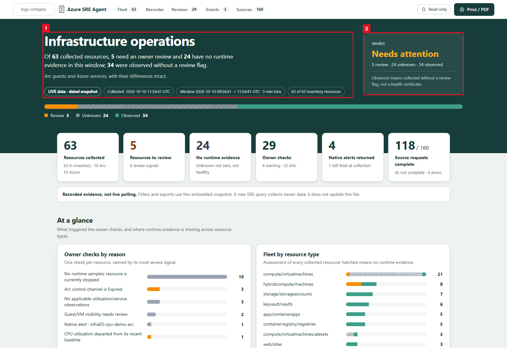
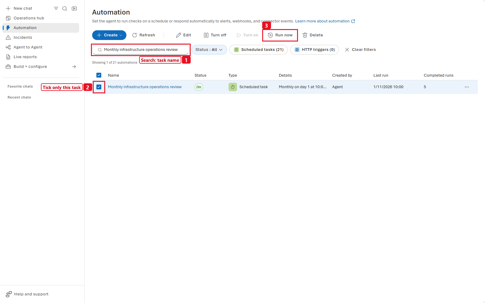
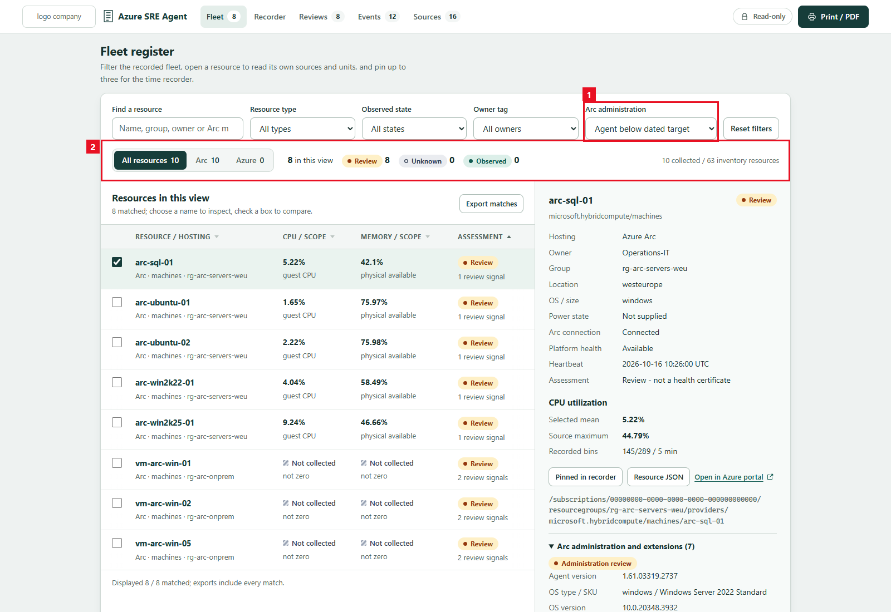

# Server health and capacity review



*Lab run. 1 Report title, verdict sentence and the collection window · 2 Verdict: observed means collected without a review flag, not a health certificate.*

> **The problem.** We run servers in Azure and on-premises, and nobody has one view of CPU, memory and what is about to run out.

**What the agent does.** It collects CPU, memory, capacity, health and alerts for Azure virtual machines and Azure Arc servers, and explains them in one monthly operations review that flags unusual behaviour and says clearly where data is missing.

Guest, platform and managed-service metrics keep their own meaning, units and grain. A missing metric is **Unknown**, never zero or healthy, and native alerts stay separate from local threshold, peak and median-MAD review flags.

## At a glance

| | |
|---|---|
| **Runs** | Monthly, on the 1st at 09:00 UTC, and on demand from chat (it can also investigate a matched alert; see the upstream guide) |
| **Reads** | Azure Monitor metrics and alerts, Log Analytics (InsightsMetrics, Perf, Heartbeat), Resource Health, Azure Resource Graph and Azure Arc |
| **Changes** | Nothing. Read-only |
| **Delivers** | HTML report, resources CSV, signals CSV and the complete JSON |
| **Agent pieces** | Tool `infrastructure-operations-report` · skill `infra-ops-live` · subagent `infra-ops-live` · scheduled task `Monthly infrastructure operations review` |
| **Access** | `Reader` on the monitored subscription and `Log Analytics Reader` on the approved workspaces |
| **Report language** | English |

**Compare with:** [Monthly operations digest](https://microsoft.github.io/frontier-sre-agent-rvas/usecase.html?id=0084-operations-incidents-anomalies-digest) · [Patching results and failed machines](https://microsoft.github.io/frontier-sre-agent-rvas/usecase.html?id=0083-update-manager-patching-failure-investigation) · [Resource health status summary (idea)](https://github.com/microsoft/frontier-sre-agent-rvas/tree/main/usecases/0060-resource-health-status-summary)

## Why it matters

- **One view of the fleet:** Azure VMs and Arc servers, in Azure and on-premises, with CPU, memory, capacity, health and alerts in one monthly review.
- **Unusual behaviour flagged:** threshold, peak and baseline departures, each with its evidence and source.
- **Gaps stated:** resources without runtime evidence are counted as Unknown, so missing telemetry is visible instead of looking healthy.

## Prerequisites

- An Azure SRE Agent with its user-assigned managed identity.
- SRE Agent Author and SRE Agent Standard User, or SRE Agent Administrator, on the agent resource for the person deploying.
- The approved Log Analytics workspaces where VM Insights or Azure Monitor Agent write guest metrics, and someone who can assign `Reader` and `Log Analytics Reader`.

## Setup

Create the pieces by hand in the portal, or deploy the manifests with the framework CLI (end of this section). The tool, skill and subagent names reference each other: keep them exactly.

1. **Find the agent identity.** In the Azure portal, open the agent resource group and the managed identity whose name starts with `id-`. Note its **Client ID** for the tool and its **Object (principal) ID** for role assignments. A Client ID is not a secret.
2. **Grant read access.** Run [`permissions/grant-infrastructure-operations-reader.ps1`](permissions/grant-infrastructure-operations-reader.ps1) with `-IdentityClientId` (or `-PrincipalId`), the monitored `-SubscriptionId` and `-WorkspaceResourceId` with the full resource IDs of the approved workspaces (the tool itself takes their workspace IDs). It assigns `Reader` and `Log Analytics Reader` and skips what the identity already has, also inherited. Add `-WhatIf` first to see what it would assign.
3. **Configure a private copy of the tool.** Download [`generate-infrastructure-operations-report.py`](manifests/tools/generate-infrastructure-operations-report.py) and set `SUBSCRIPTION_ID`, `TENANT_ID`, `MANAGED_IDENTITY_CLIENT_ID` and `LOG_WORKSPACE_IDS`, and optionally the logo. Keep configured copies outside Git. Until they are set, the tool returns a configuration error.
4. **Create the Python tool.** In the [SRE Agent portal](https://sre.azure.com), **Build + configure > Agent Canvas > Create ▾ > Tool > Python tool**. Tool Name `infrastructure-operations-report`, the description from the manifest, the code of your configured `generate-infrastructure-operations-report.py`, timeout `900` seconds and the 16 parameters of [`manifests/tools/infrastructure-operations-report.yaml`](manifests/tools/infrastructure-operations-report.yaml). Leave **Enable Azure Identity** off: the code gets its own tokens with the agent managed identity. Run **Test** on the **Test playground** tab with `{"operation": "report", "period": "last_24h"}`, then **Create tool**.
5. **Create the skill.** **Create ▾ > Skill**: name `infra-ops-live`, the description from its front matter, **Choose tools** > only `infrastructure-operations-report`, and paste the body of [`SKILL.md`](manifests/skills/infra-ops-live/SKILL.md) below the front matter the form generates.
6. **Create the subagent.** **Create ▾ > Custom agent**: name `infra-ops-live`, instructions from `system_prompt` in [`manifests/subagents/infra-ops-live.yaml`](manifests/subagents/infra-ops-live.yaml), **Choose skills** > `infra-ops-live` and **Choose tools** > `infrastructure-operations-report`. Choosing them replaces the inherited global tools and skills, so the subagent can only run this read-only tool.
7. **Test from chat.** **New chat**, type `/agent`, pick `infra-ops-live` and send the prompt under **Run it**. The answer links the four files and summarizes the window, the counts and the resources to review.
8. **Schedule it.** **Automation > Create ▾ > Scheduled task**: task name `Monthly infrastructure operations review`, response subagent `infra-ops-live`, **Custom cron** `0 9 1 * *` (UTC), task details from `prompt` in [`manifests/scheduled-tasks/monthly-infrastructure-operations-review.yaml`](manifests/scheduled-tasks/monthly-infrastructure-operations-review.yaml) and **New chat thread for each run**. Run it once (in **Automation**, tick only this task and select **Run now**) and check the thread before you rely on the schedule.

   

**Or deploy the manifests with the CLI.** From the repository root, or the unzipped package, and from a configured copy of the tool (the CLI sends the code as it is in the folder; it has not been run against a live agent yet):

```bash
usecases/_framework/usecases.sh deploy 0080-infrastructure-operations-health --endpoint https://<agent>.azuresre.ai --dry-run
usecases/_framework/usecases.sh deploy 0080-infrastructure-operations-health --endpoint https://<agent>.azuresre.ai
usecases/_framework/usecases.sh verify 0080-infrastructure-operations-health --endpoint https://<agent>.azuresre.ai
```

Every click, with a screenshot, is in the [upstream step-by-step guide](https://github.com/marioaguileraaa/sre-agent-use-cases/tree/main/03-infrastructure-operations-health).

## Run it

In a **New chat**, type `/agent`, pick `infra-ops-live` and send:

```text
Use infra-ops-live and infrastructure-operations-report only. Make exactly one call with operation="report", period="previous_month", hosting="all", metric="all" and other defaults, then immediately show all four file downloads and a short summary from the returned window, counts and top review names.
```

More prompts, with the expected result of each, are in [`tests/prompts.md`](tests/prompts.md).

## Read the report

- **Verdict and fleet:** resources collected, to review, without runtime evidence and observed, with the collection window.
- **At a glance:** owner checks by reason and the fleet by resource type, with missing evidence hatched.
- **Recorder and reviews:** CPU, memory and disk series per resource and the signals behind each review.
- **Events and sources:** native alerts and Resource Health, and the status of every source request.



*Arc administration: agent and OS versions and native extensions, current at collection, compared only with an approved baseline.*

## Cadence

Monthly, on day 1 at 09:00 UTC, for the previous complete UTC calendar month. Ask in chat for the last 2 hours, 24 hours or 7 days during an incident.

## Status

`built`. Upstream validated it live in a Microsoft lab (telemetry, monthly and incident evidence on 2026-10-10; Arc administration and normal chat on 2026-10-16). There is no sample report in the package yet, so it is not `validated`. Screenshots and evidence from runs before 16 November 2026 show the previous tool name `generate-infrastructure-operations-report` (40 characters, over today's portal limit).

## Credits

Built and tested by Mario Aguilera ([@marioaguileraaa](https://github.com/marioaguileraaa)). Source: [`03-infrastructure-operations-health`](https://github.com/marioaguileraaa/sre-agent-use-cases/tree/main/03-infrastructure-operations-health) in `marioaguileraaa/sre-agent-use-cases` (MIT), commit `4eb2e90`. The upstream guide has every step with a screenshot, troubleshooting and the acceptance checks. Field guide: [plate 03](https://marioaguileraaa.github.io/sre-agent-use-cases/#plate-03).
