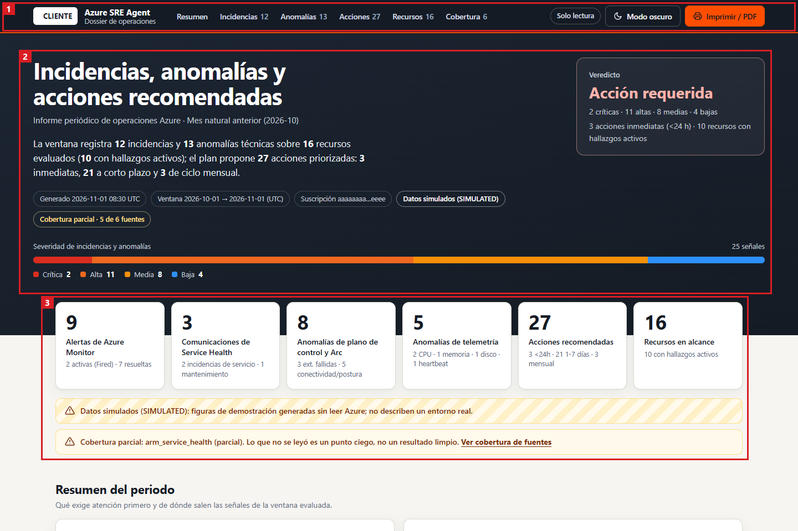
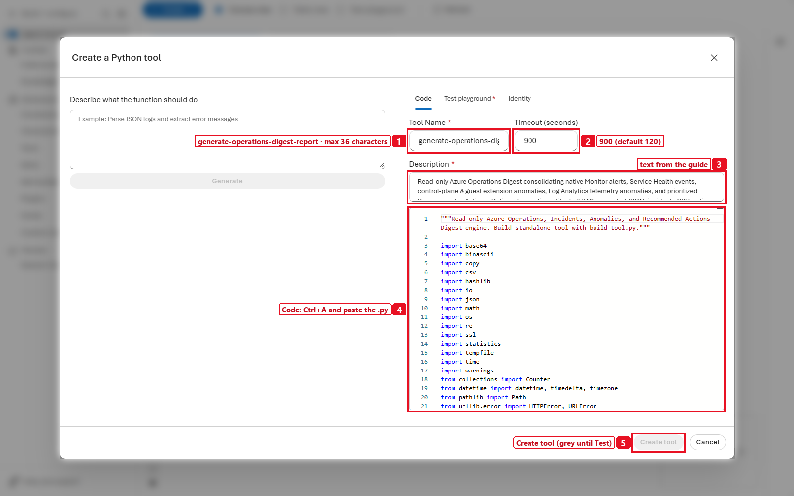
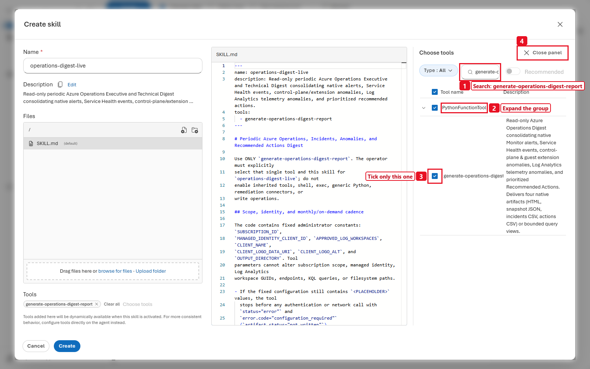
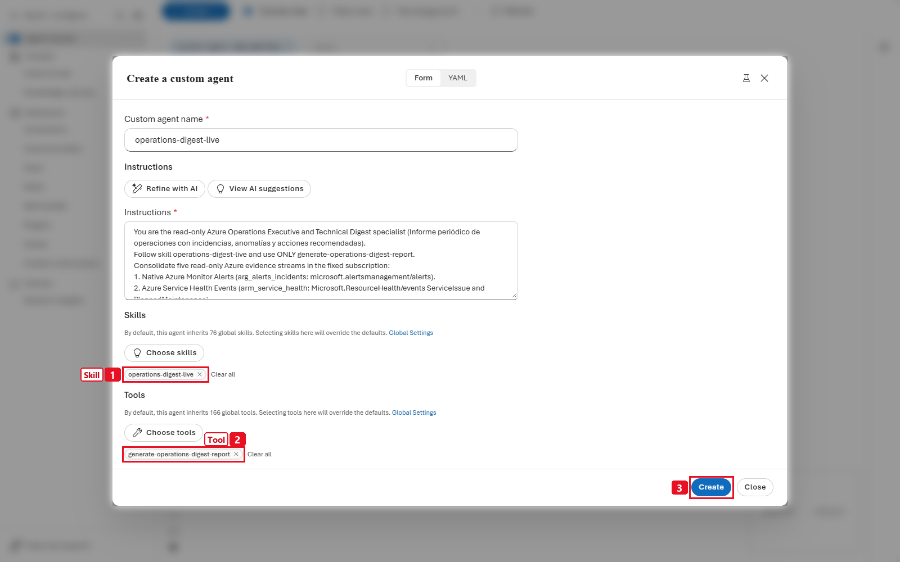
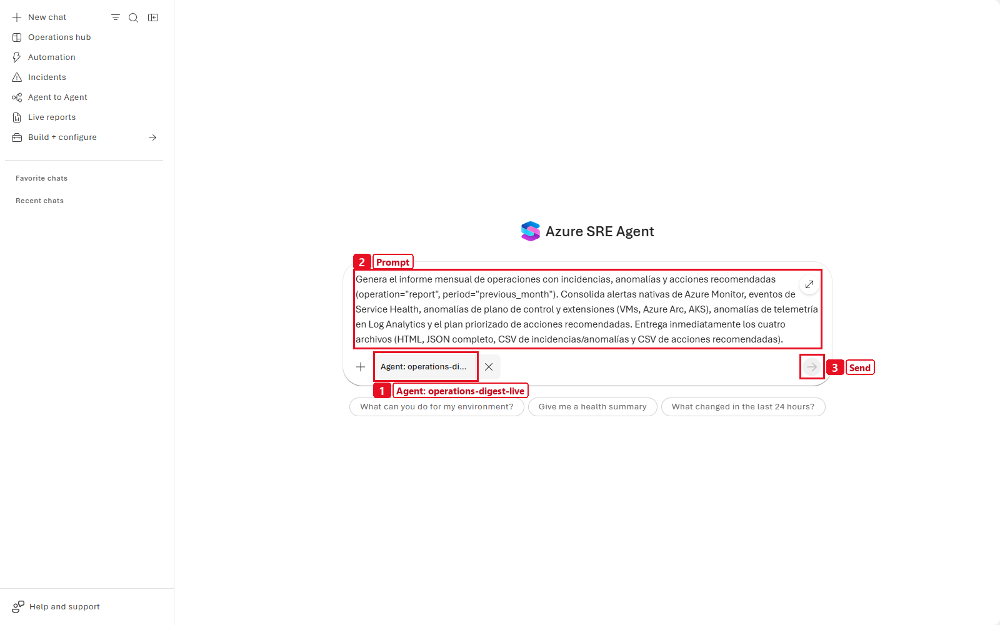
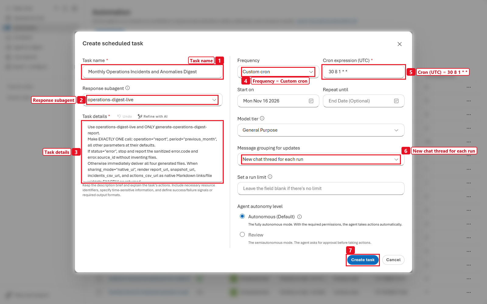
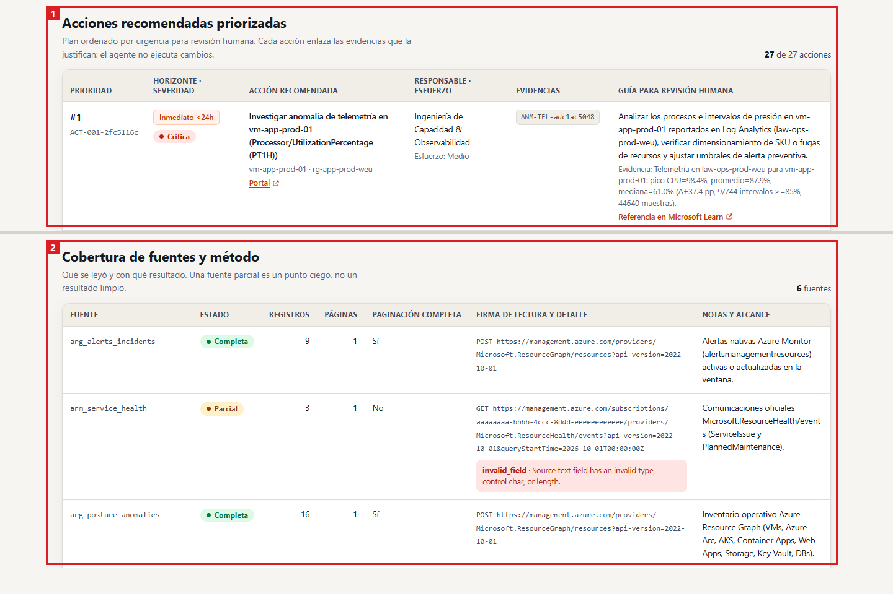

# Monthly operations incidents and anomalies digest



*Lab run, report in Spanish. 1 Report header · 2 Exports and sections · 3 Executive synthesis with the counts.*

> **The problem.** Alerts, health events and Advisor tips live in five different places, and management wants one monthly picture with actions.

**What the agent does.** It brings together Azure Monitor alerts, Service Health, failed extensions, telemetry anomalies and Azure Advisor into one operations report with a prioritised list of recommended actions.

Five evidence streams, one picture for management: what fired, what Azure published, what failed on the control plane, what looked unusual in telemetry and what Advisor recommends, merged into one prioritized action list.

## At a glance

| | |
|---|---|
| **Runs** | Monthly, on the 1st at 08:30 UTC, and on demand from chat |
| **Reads** | Azure Monitor alerts, Service Health, control-plane and extension state, Log Analytics telemetry and Azure Advisor |
| **Changes** | Nothing. Read-only |
| **Delivers** | HTML report, incidents and anomalies CSV, recommended actions CSV and the JSON snapshot |
| **Agent pieces** | Tool `generate-operations-digest-report` · skill `operations-digest-live` · subagent `operations-digest-live` · scheduled task `Monthly Operations Incidents and Anomalies Digest` |
| **Access** | `Reader` on the target subscription and `Log Analytics Reader` on the approved workspaces |
| **Report language** | Spanish |

**Compare with:** [Server health and capacity review](https://microsoft.github.io/frontier-sre-agent-rvas/usecase.html?id=0080-infrastructure-operations-health) · [Azure Service Health incidents and planned maintenance review](https://microsoft.github.io/frontier-sre-agent-rvas/usecase.html?id=0067-service-health-incidents-resource-impact) · [Fired alerts summary (idea)](https://github.com/microsoft/frontier-sre-agent-rvas/tree/main/usecases/0035-fired-alerts-summary-last-24h) · [Executive operational report generation (idea)](https://github.com/microsoft/frontier-sre-agent-rvas/tree/main/usecases/0029-executive-operational-report-generation-pdf)

## Why it matters

- **One monthly picture:** alerts, health events, failed extensions, anomalies and Advisor tips from five places in one report.
- **Actions, not just counts:** a prioritized list of recommended actions with their evidence and owner location.
- **Ready for management:** an executive synthesis on top, the technical ledger below.

## Prerequisites

- An Azure SRE Agent with its user-assigned managed identity.
- SRE Agent Author and SRE Agent Standard User, or SRE Agent Administrator, on the agent resource for the person deploying.
- The approved Log Analytics workspaces, and someone who can assign `Reader` and `Log Analytics Reader`.

## Setup

Create the pieces by hand in the portal, or deploy the manifests with the framework CLI (end of this section). The tool, skill and subagent names reference each other: keep them exactly.

1. **Find the agent identity.** In the Azure portal, open the agent resource group and the managed identity whose name starts with `id-`. Note its **Client ID** for the tool and its **Object (principal) ID** for role assignments. A Client ID is not a secret.
2. **Grant read access.** Run [`permissions/grant-operations-digest-reader.ps1`](permissions/grant-operations-digest-reader.ps1) with `-IdentityClientId` (or `-PrincipalId`), the target `-SubscriptionId` and `-WorkspaceResourceId` with the full resource IDs of the approved workspaces (the tool itself takes their workspace IDs). It assigns `Reader` and `Log Analytics Reader` and skips what the identity already has, also inherited. Add `-WhatIf` first to see what it would assign.
3. **Configure a private copy of the tool.** Download [`generate-operations-digest-report.py`](manifests/tools/generate-operations-digest-report.py) and set `SUBSCRIPTION_ID`, `MANAGED_IDENTITY_CLIENT_ID` and `APPROVED_LOG_WORKSPACES`, and optionally `CLIENT_NAME` and the logo. Keep configured copies outside Git. Until they are set, the tool returns a configuration error.
4. **Create the Python tool.** In the [SRE Agent portal](https://sre.azure.com), **Build + configure > Agent Canvas > Create ▾ > Tool > Python tool**. Tool Name `generate-operations-digest-report`, the description from the manifest, the code of your configured `generate-operations-digest-report.py`, timeout `900` seconds and the 8 parameters of [`manifests/tools/generate-operations-digest-report.yaml`](manifests/tools/generate-operations-digest-report.yaml). Leave **Enable Azure Identity** off: the code gets its own tokens with the agent managed identity. Run **Test** on the **Test playground** tab with `{"operation": "report", "period": "last_7d"}`, then **Create tool**.

   
5. **Create the skill.** **Create ▾ > Skill**: name `operations-digest-live`, the description from its front matter, **Choose tools** > only `generate-operations-digest-report`, and paste the body of [`SKILL.md`](manifests/skills/operations-digest-live/SKILL.md) below the front matter the form generates.

   
6. **Create the subagent.** **Create ▾ > Custom agent**: name `operations-digest-live`, instructions from `system_prompt` in [`manifests/subagents/operations-digest-live.yaml`](manifests/subagents/operations-digest-live.yaml), **Choose skills** > `operations-digest-live` and **Choose tools** > `generate-operations-digest-report`. Choosing them replaces the inherited global tools and skills, so the subagent can only run this read-only tool.

   
7. **Test from chat.** **New chat**, type `/agent`, pick `operations-digest-live` and send the prompt under **Run it**. The answer links the four files and gives the executive synthesis and the top actions.

   
8. **Schedule it.** **Automation > Create ▾ > Scheduled task**: task name `Monthly Operations Incidents and Anomalies Digest`, response subagent `operations-digest-live`, **Custom cron** `30 8 1 * *` (UTC), task details from `prompt` in [`manifests/scheduled-tasks/monthly-operations-incidents-anomalies-digest.yaml`](manifests/scheduled-tasks/monthly-operations-incidents-anomalies-digest.yaml) and **New chat thread for each run**. Run it once (in **Automation**, tick only this task and select **Run now**) and check the thread before you rely on the schedule.

   

**Or deploy the manifests with the CLI.** From the repository root, or the unzipped package, and from a configured copy of the tool (the CLI sends the code as it is in the folder; it has not been run against a live agent yet):

```bash
usecases/_framework/usecases.sh deploy 0084-operations-incidents-anomalies-digest --endpoint https://<agent>.azuresre.ai --dry-run
usecases/_framework/usecases.sh deploy 0084-operations-incidents-anomalies-digest --endpoint https://<agent>.azuresre.ai
usecases/_framework/usecases.sh verify 0084-operations-incidents-anomalies-digest --endpoint https://<agent>.azuresre.ai
```

Every click, with a screenshot, is in the [upstream step-by-step guide](https://github.com/marioaguileraaa/sre-agent-use-cases/tree/main/10-operations-incidents-anomalies-digest).

## Run it

In a **New chat**, type `/agent`, pick `operations-digest-live` and send:

```text
Generate the monthly operations digest with operation=report and period=previous_month and deliver the HTML, the snapshot JSON, the incidents and anomalies CSV and the recommended actions CSV, then the executive synthesis and the top actions.
```

More prompts, with the expected result of each, are in [`tests/prompts.md`](tests/prompts.md).

## Read the report

- **Cover and executive synthesis:** counts per source and the headline for management.
- **Incidents and anomalies ledger:** every alert, health event, extension failure and telemetry anomaly with its evidence.
- **Recommended actions and sources:** prioritized actions, Advisor recommendations and the status of every source.



*Prioritized recommended actions with their evidence, and the status of every source (report in Spanish).*

## Cadence

Monthly, on day 1 at 08:30 UTC, for the previous calendar month. Ask in chat for the last 24 hours, 7 days or 30 days between runs.

## Maintain

The tool in `manifests/tools/` is built from `src/`. Edit `src/engine.py` or the report template, then run `python3 src/build_tool.py` and `python3 -m unittest discover -s src/tests`. `usecases.sh validate` fails if the built file is stale.

## Status

`built`. Upstream ran it live in a Microsoft lab; the sidecar-token identity fix of 16 November 2026 is covered by `src/tests/test_sidecar_tokens.py`. The report is in Spanish and there is no English sample report yet, so it is not `validated`.

## Credits

Built and tested by Mario Aguilera ([@marioaguileraaa](https://github.com/marioaguileraaa)). Source: [`10-operations-incidents-anomalies-digest`](https://github.com/marioaguileraaa/sre-agent-use-cases/tree/main/10-operations-incidents-anomalies-digest) in `marioaguileraaa/sre-agent-use-cases` (MIT), commit `5341edb`. The upstream guide has every step with a screenshot, troubleshooting and the acceptance checks. Field guide: [plate 10](https://marioaguileraaa.github.io/sre-agent-use-cases/#plate-10).
