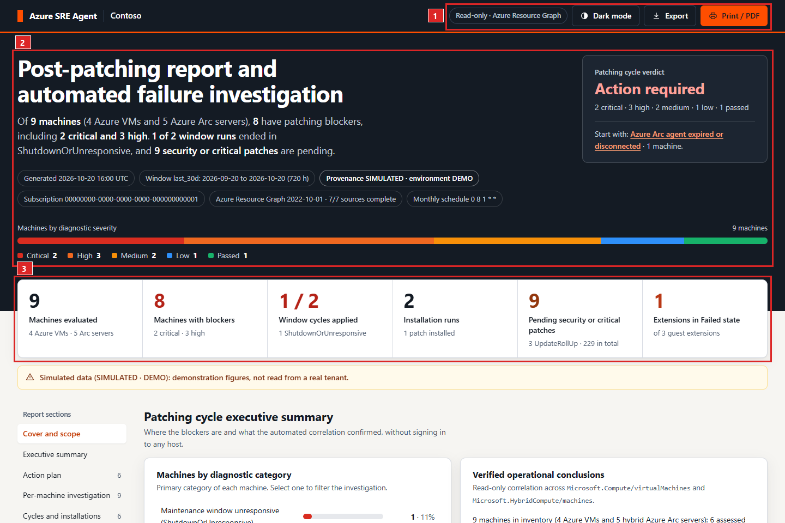
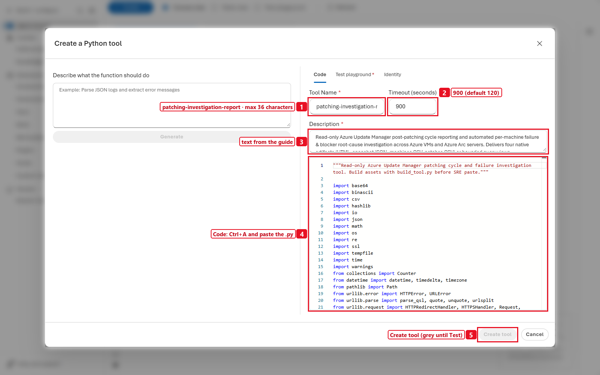
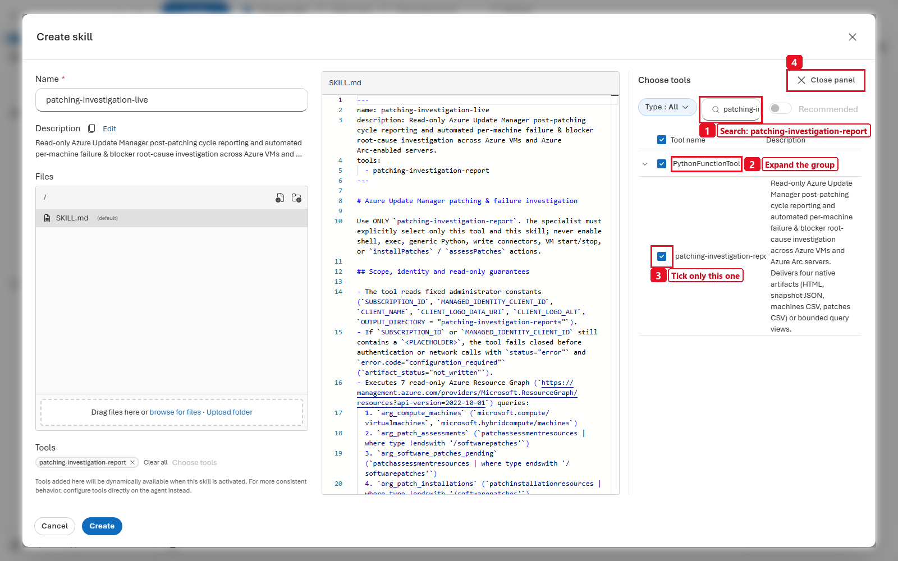
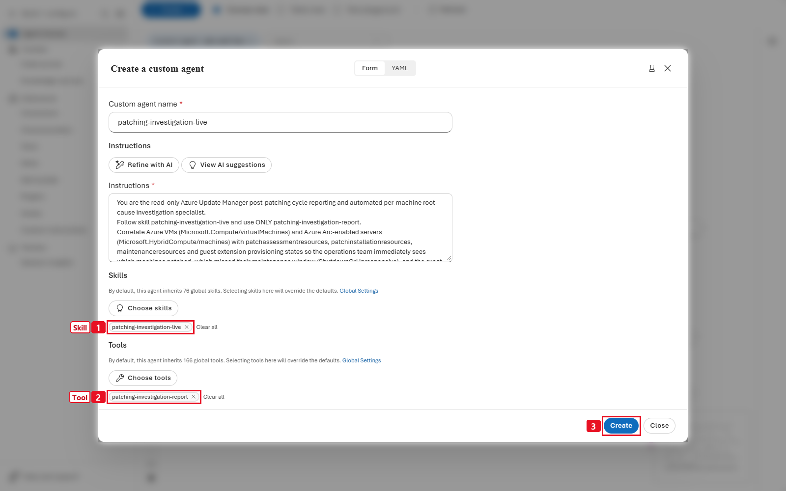
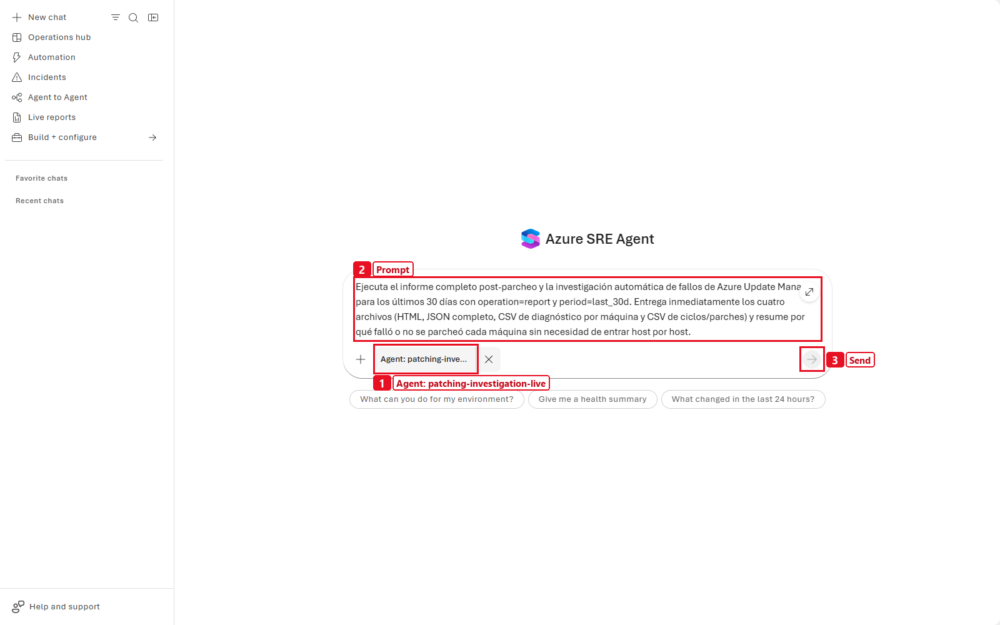
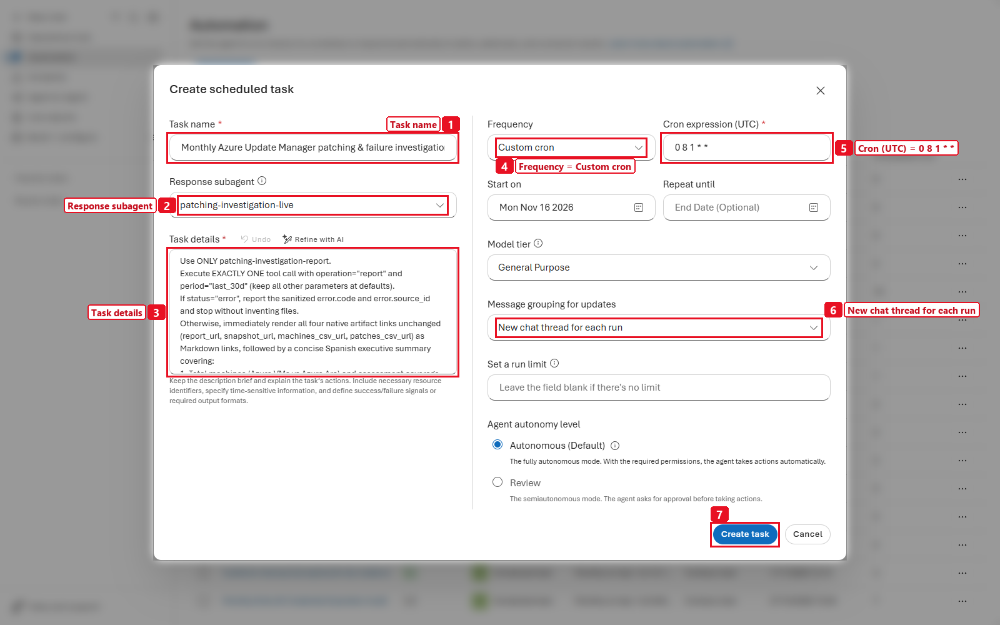
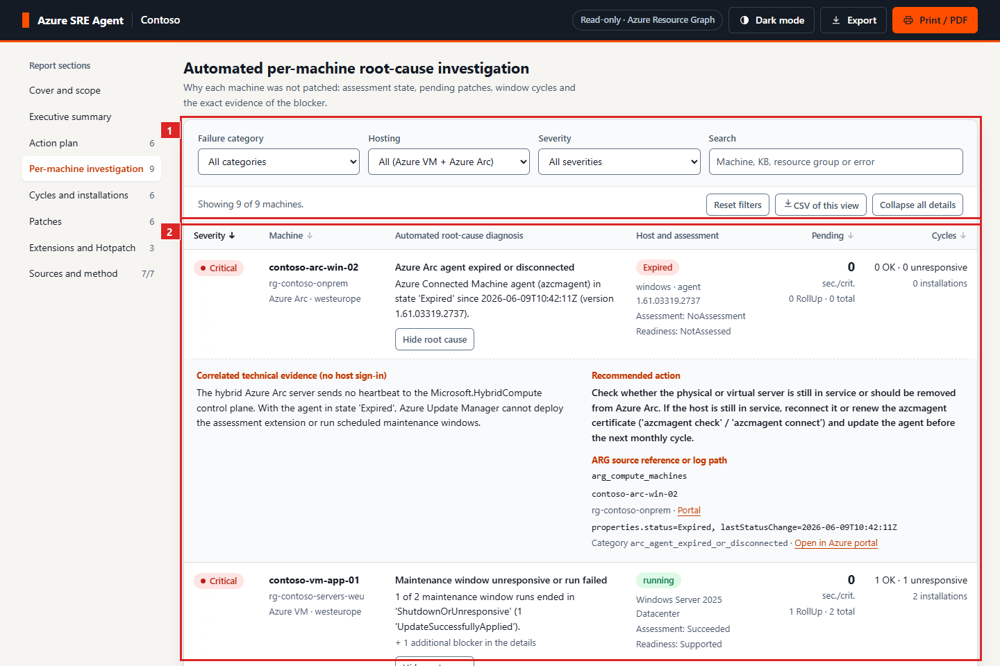

# Patching results and failed machines investigation



*Sample run with simulated data. 1 Read-only chip, dark mode, export menu and print · 2 Verdict-first cover: key numbers, window and provenance chips, verdict and machines by severity · 3 Summary of the patching cycle.*

> **The problem.** After every patching window someone has to log in to each failed server to find out why it didn't patch.

**What the agent does.** After each patching cycle it checks every Azure virtual machine and Azure Arc server in Azure Update Manager and, for each machine that failed, explains the most likely cause from the evidence Azure already has.

Each machine is classified in one of seven operational categories (`maintenance_window_unresponsive`, `arc_agent_expired_or_disconnected`, `assessment_stuck_or_readiness_undetermined`, `hotpatch_or_patch_extension_error`, `pending_security_patches_unscheduled`, `unassessed_no_update_manager_telemetry` or `healthy`), with the exact source evidence.

## At a glance

| | |
|---|---|
| **Runs** | Monthly, on the 1st at 08:00 UTC, and on demand from chat |
| **Reads** | Azure Update Manager through Azure Resource Graph (assessments, installations, maintenance configurations and extensions) for Azure VMs and Arc servers |
| **Changes** | Nothing. Read-only; it never installs patches, reboots machines or triggers assessments |
| **Delivers** | HTML report, machines CSV, patches CSV and the JSON snapshot |
| **Agent pieces** | Tool `patching-investigation-report` · skill `patching-investigation-live` · subagent `patching-investigation-live` · scheduled task `Monthly Azure Update Manager patching & failure investigation` |
| **Access** | `Reader` on the target subscription |
| **Report language** | English |

**Compare with:** [Server health and capacity review](https://microsoft.github.io/frontier-sre-agent-rvas/usecase.html?id=0080-infrastructure-operations-health) · [Extension health across VMs (idea)](https://github.com/microsoft/frontier-sre-agent-rvas/tree/main/usecases/0032-extension-health-across-vms)

## Why it matters

- **No more logging in to each failed server:** the likely cause of every failure comes with its evidence.
- **One view for Azure and Arc:** the same categories for virtual machines in Azure and servers on-premises.
- **Patching gaps found early:** machines with pending security patches and no schedule, or no Update Manager telemetry at all.

## Prerequisites

- An Azure SRE Agent with its user-assigned managed identity.
- SRE Agent Author and SRE Agent Standard User, or SRE Agent Administrator, on the agent resource for the person deploying.
- Machines managed with Azure Update Manager, and someone who can assign `Reader` on the subscription.

## Setup

Create the pieces by hand in the portal, or deploy the manifests with the framework CLI (end of this section). The tool, skill and subagent names reference each other: keep them exactly.

1. **Find the agent identity.** In the Azure portal, open the agent resource group and the managed identity whose name starts with `id-`. Note its **Client ID** for the tool and its **Object (principal) ID** for role assignments. A Client ID is not a secret.
2. **Grant read access.** Run [`permissions/grant-patching-investigation-reader.ps1`](permissions/grant-patching-investigation-reader.ps1) with `-IdentityClientId` (or `-PrincipalId`) and the target `-SubscriptionId`. It assigns only `Reader` and skips what the identity already has, also inherited. Add `-WhatIf` first to see what it would assign.
3. **Configure a private copy of the tool.** Download [`generate-patching-investigation-report.py`](manifests/tools/generate-patching-investigation-report.py) and set `SUBSCRIPTION_ID` and `MANAGED_IDENTITY_CLIENT_ID`, and optionally `CLIENT_NAME` and the logo. Keep configured copies outside Git. Until they are set, the tool returns a configuration error.
4. **Create the Python tool.** In the [SRE Agent portal](https://sre.azure.com), **Build + configure > Agent Canvas > Create ▾ > Tool > Python tool**. Tool Name `patching-investigation-report`, the description from the manifest, the code of your configured `generate-patching-investigation-report.py`, timeout `900` seconds and the 8 parameters of [`manifests/tools/patching-investigation-report.yaml`](manifests/tools/patching-investigation-report.yaml). Leave **Enable Azure Identity** off: the code gets its own tokens with the agent managed identity. Run **Test** on the **Test playground** tab with `{"operation": "report", "period": "last_7d"}`, then **Create tool**.

   
5. **Create the skill.** **Create ▾ > Skill**: name `patching-investigation-live`, the description from its front matter, **Choose tools** > only `patching-investigation-report`, and paste the body of [`SKILL.md`](manifests/skills/patching-investigation-live/SKILL.md) below the front matter the form generates.

   
6. **Create the subagent.** **Create ▾ > Custom agent**: name `patching-investigation-live`, instructions from `system_prompt` in [`manifests/subagents/patching-investigation-live.yaml`](manifests/subagents/patching-investigation-live.yaml), **Choose skills** > `patching-investigation-live` and **Choose tools** > `patching-investigation-report`. Choosing them replaces the inherited global tools and skills, so the subagent can only run this read-only tool.

   
7. **Test from chat.** **New chat**, type `/agent`, pick `patching-investigation-live` and send the prompt under **Run it**. The answer links the four files and lists the failed machines with their category.

   
8. **Schedule it.** **Automation > Create ▾ > Scheduled task**: task name `Monthly Azure Update Manager patching & failure investigation`, response subagent `patching-investigation-live`, **Custom cron** `0 8 1 * *` (UTC), task details from `prompt` in [`manifests/scheduled-tasks/monthly-update-manager-patching-investigation.yaml`](manifests/scheduled-tasks/monthly-update-manager-patching-investigation.yaml) and **New chat thread for each run**. Run it once (in **Automation**, tick only this task and select **Run now**) and check the thread before you rely on the schedule.

   

**Or deploy the manifests with the CLI.** From the repository root, or the unzipped package, and from a configured copy of the tool (the CLI sends the code as it is in the folder; it has not been run against a live agent yet):

```bash
usecases/_framework/usecases.sh deploy 0083-update-manager-patching-failure-investigation --endpoint https://<agent>.azuresre.ai --dry-run
usecases/_framework/usecases.sh deploy 0083-update-manager-patching-failure-investigation --endpoint https://<agent>.azuresre.ai
usecases/_framework/usecases.sh verify 0083-update-manager-patching-failure-investigation --endpoint https://<agent>.azuresre.ai
```

Every click, with a screenshot, is in the [upstream step-by-step guide](https://github.com/marioaguileraaa/sre-agent-use-cases/tree/main/09-update-manager-patching-failure-investigation).

## Run it

In a **New chat**, type `/agent`, pick `patching-investigation-live` and send:

```text
Generate the post-patching and failure investigation report for the last 30 days with operation=report and deliver the HTML, the snapshot JSON, the machines CSV and the patches CSV, then summarize the cycle and the failed machines with their most likely cause.
```

More prompts, with the expected result of each, are in [`tests/prompts.md`](tests/prompts.md).

## Read the report

- **Cover and cycle summary:** machines in scope, patched, failed and unassessed, with the window.
- **Automated failure investigation:** each failed machine with its category and evidence.
- **Cycles, patches and sources:** maintenance runs, installed and pending patches, and every source read.



*Automated failure investigation: 1 filters by failure category, hosting (Azure VM or Arc), severity and search · 2 each machine with its category, the correlated Azure evidence and the recommended action.*

## Sample report

[`sample-report/`](sample-report/) holds the four files of a SIMULATED run that the tool wrote offline from its test fixture, without calling Azure: the [HTML report](sample-report/patch-20261020T160000Z-18966844ec9a.html) (download it and open it in a browser), the JSON snapshot, the machines CSV and the cycles and patches CSV. Every machine, resource group, maintenance configuration and identifier is fictitious (`contoso-vm-app-01`, `rg-contoso-servers-weu`).

## Cadence

Monthly, on day 1 at 08:00 UTC, after the patching cycle. Ask in chat for the last 24 hours or 7 days right after a maintenance window.

## Maintain

The tool in `manifests/tools/` is built from `src/`. Edit `src/engine.py` or the report template, then run `python3 src/build_tool.py` and `python3 -m unittest discover -s src/tests`. `usecases.sh validate` fails if the built file is stale.

## Status

`validated`: built, with test prompts in `tests/` and a SIMULATED sample report. Upstream ran it live in a Microsoft lab with Azure VMs and Arc servers; the sidecar-token identity fix of 16 November 2026 is covered by `src/tests/test_sidecar_tokens.py`. It has not been deployed from this repository with `usecases.sh deploy` yet. Screenshots and evidence from runs before 16 November 2026 show the previous tool name `generate-patching-investigation-report` (38 characters, over today's portal limit).

## Credits

Built and tested by Mario Aguilera ([@marioaguileraaa](https://github.com/marioaguileraaa)). Source: [`09-update-manager-patching-failure-investigation`](https://github.com/marioaguileraaa/sre-agent-use-cases/tree/main/09-update-manager-patching-failure-investigation) in `marioaguileraaa/sre-agent-use-cases` (MIT), commit `4eb2e90`. The upstream guide has every step with a screenshot, troubleshooting and the acceptance checks. Field guide: [plate 09](https://marioaguileraaa.github.io/sre-agent-use-cases/#plate-09).
