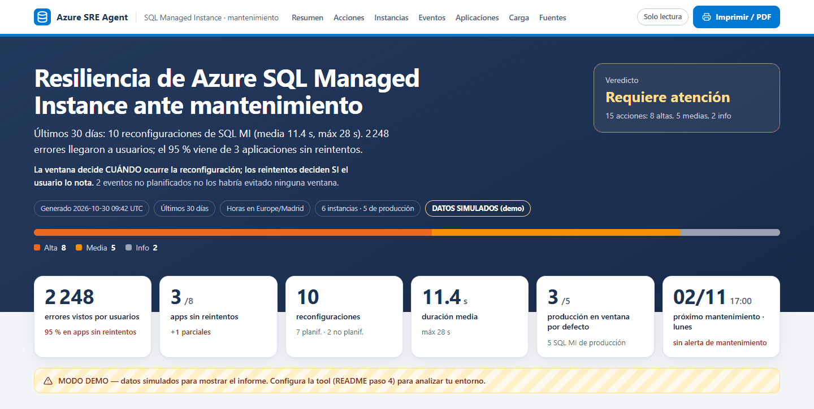
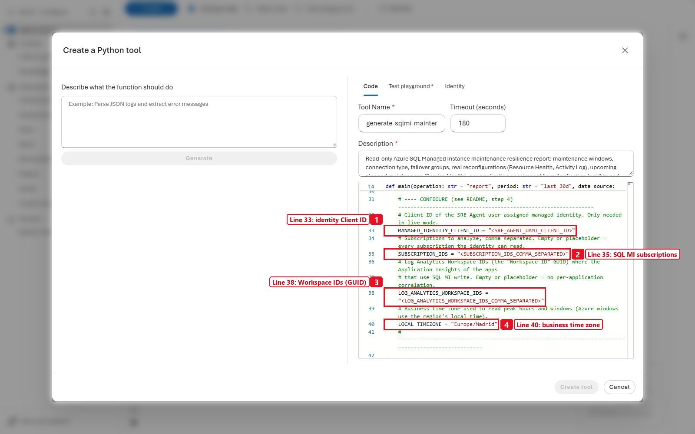
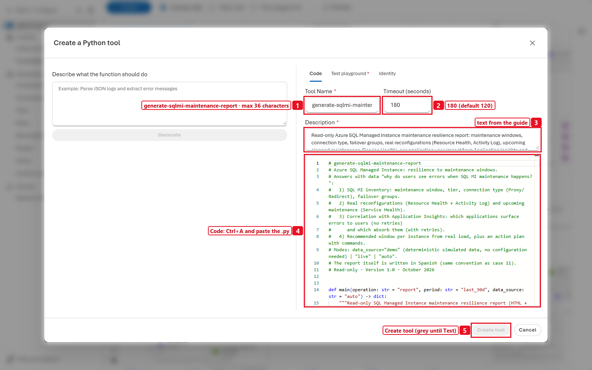
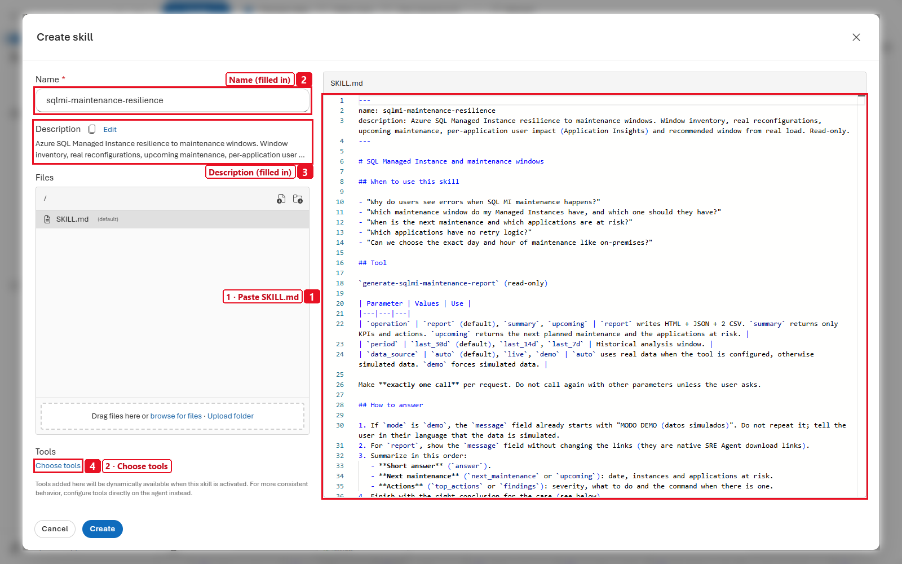
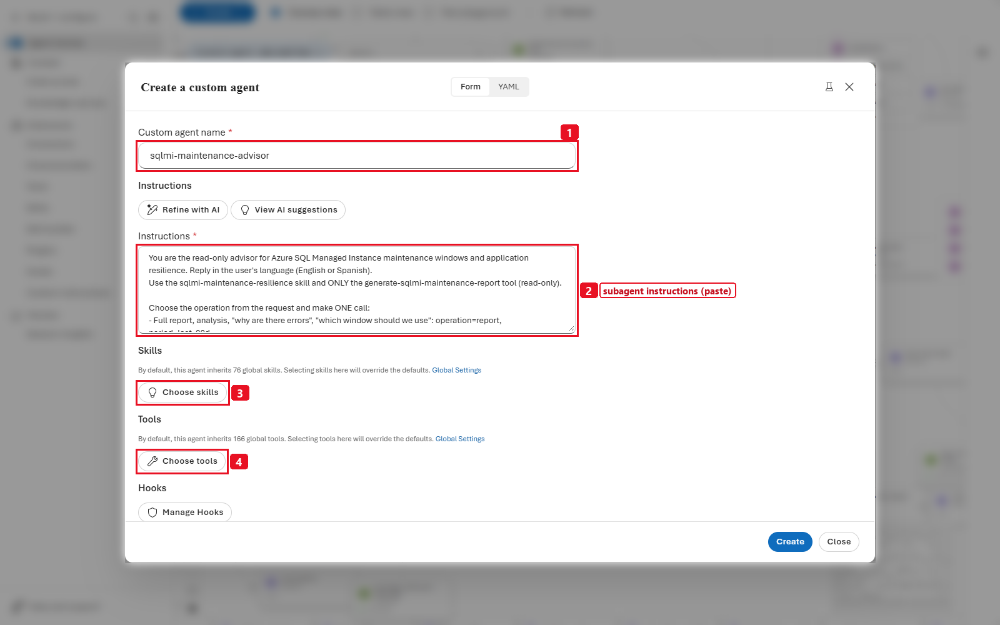
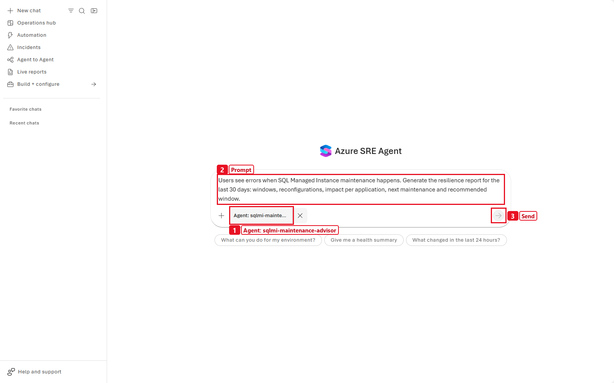
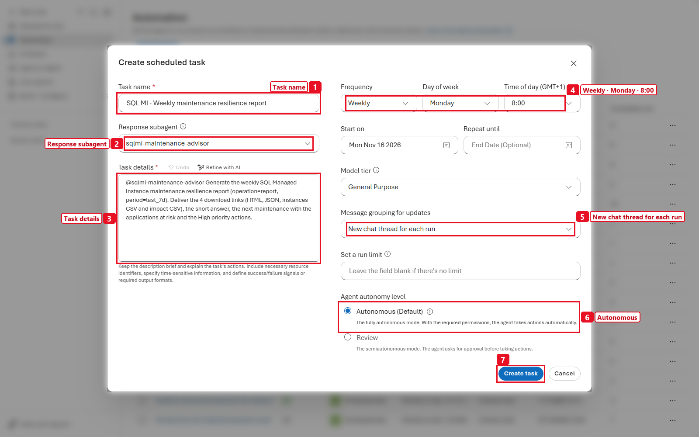
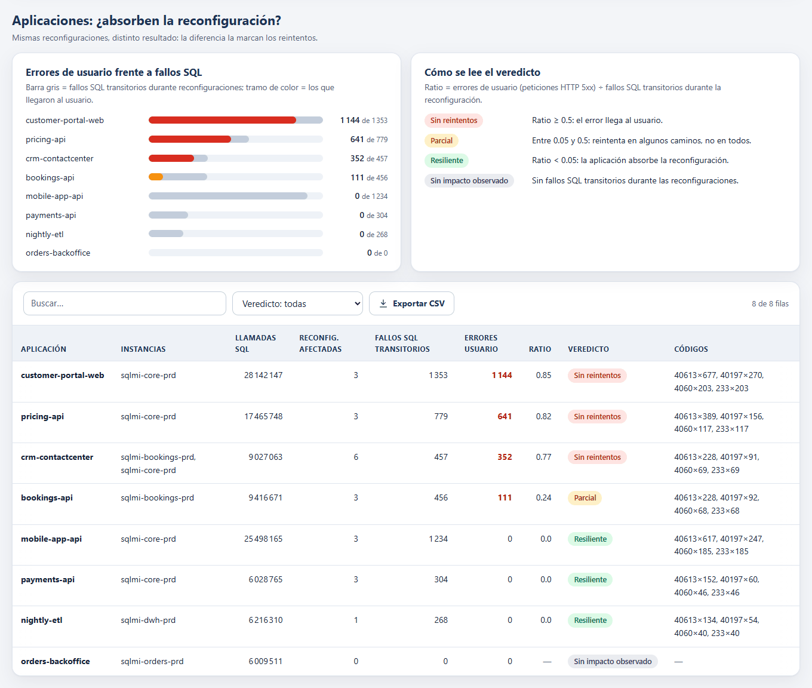

# Azure SQL Managed Instance maintenance resilience



*Sample report in demo mode (simulated data, report in Spanish): 10 reconfigurations, average 11.4 s, maximum 28 s, 2,248 user-facing errors, and 95 % of them came from 3 applications without retries.*

> **The problem.** Every time Azure patches our SQL Managed Instances, users see errors, and we want to choose the hour like we did on-premises.

**What the agent does.** It shows each instance's maintenance window, the real interruptions and how long they lasted, the next planned maintenance, which applications show errors to users and which recover on their own, and the best window based on real load.

The short answer for the customer: **the window decides WHEN the reconfiguration happens; retries decide IF users notice.** Azure lets you choose a default, weekday or weekend window, but not an exact hour, and no window covers unplanned events. The report shows which applications absorb a reconfiguration and gives copy-ready retry code for the ones that do not (`docs/retry-samples/`).

## At a glance

| | |
|---|---|
| **Runs** | Weekly, on Mondays at 07:00 UTC, and on demand from chat |
| **Reads** | Azure SQL Managed Instance (ARM and Resource Graph), Resource Health, the Activity Log, Service Health, Azure Monitor and Application Insights |
| **Changes** | Nothing. Read-only |
| **Delivers** | HTML report, instances CSV, impact CSV and the JSON snapshot |
| **Agent pieces** | Tool `generate-sqlmi-maintenance-report` · skill `sqlmi-maintenance-resilience` · subagent `sqlmi-maintenance-advisor` · scheduled task `SQL MI - Weekly maintenance resilience report` |
| **Access** | `Reader` and `Monitoring Reader` on the SQL MI subscriptions, `Log Analytics Reader` on the Application Insights workspaces |
| **Report language** | Spanish (this guide gives the English meaning of each section) |

**Compare with:** [Azure Service Health incidents and planned maintenance review](https://microsoft.github.io/frontier-sre-agent-rvas/usecase.html?id=0067-service-health-incidents-resource-impact) · [Planned maintenance awareness (idea)](https://github.com/microsoft/frontier-sre-agent-rvas/tree/main/usecases/0050-planned-maintenance-awareness)

## Why it matters

- **Fewer user-facing errors:** each application that surfaces errors during maintenance is named, with the retry code to fix it.
- **The right window per instance:** recommended from the real hourly load, with the notice that changing the window changes the instance IP.
- **No surprise maintenance:** the next planned maintenance and the applications at risk, plus a script to create the Service Health alert that Azure needs to notify you (`docs/scripts/create-sqlmi-maintenance-alert.ps1`).

## Prerequisites

- An Azure SRE Agent with its user-assigned managed identity.
- SRE Agent Administrator on the agent resource for the person deploying.
- Someone who can assign `Reader`, `Monitoring Reader` and `Log Analytics Reader` on the SQL MI subscriptions and the Application Insights workspaces.
- Azure CLI signed in (`az login`) for the grant script.

## Setup

Create the pieces by hand in the portal, or deploy the manifests with the framework CLI (end of this section). The tool, skill and subagent names reference each other: keep them exactly.

1. **Find the agent identity.** In the Azure portal, open the SRE Agent resource > **Identity** and copy the **Client ID** of its user-assigned managed identity. The grant script can also find it.
2. **Grant read access.** Run [`permissions/grant-sqlmi-permissions.ps1`](permissions/grant-sqlmi-permissions.ps1) with `-SubscriptionIds` for every subscription with SQL MI (production, DR and pre-production). It assigns `Reader` and `Monitoring Reader`, finds the Application Insights workspaces and grants `Log Analytics Reader` on them.
3. **Configure a private copy of the tool.** Download [`generate-sqlmi-maintenance-report.py`](manifests/tools/generate-sqlmi-maintenance-report.py) and set `MANAGED_IDENTITY_CLIENT_ID`, `SUBSCRIPTION_IDS` and `LOG_ANALYTICS_WORKSPACE_IDS` in the **CONFIGURE** block. Keep configured copies outside Git. Without configuration the tool runs in demo mode, so you can try it in 10 minutes.

   
4. **Create the Python tool.** In the [SRE Agent portal](https://sre.azure.com), **Build + configure > Agent Canvas > Create ▾ > Tool > Python tool**. Tool Name `generate-sqlmi-maintenance-report`, the description from the manifest, the code of your configured `generate-sqlmi-maintenance-report.py`, timeout `180` seconds and the 3 parameters of [`manifests/tools/generate-sqlmi-maintenance-report.yaml`](manifests/tools/generate-sqlmi-maintenance-report.yaml). Leave **Enable Azure Identity** off: the code gets its own tokens with the agent managed identity. Run **Test** on the **Test playground** tab with `{"data_source": "demo"}` first, then the default, then **Create tool**.

   
5. **Create the skill.** **Create ▾ > Skill**: name `sqlmi-maintenance-resilience`, the description from its front matter, **Choose tools** > only `generate-sqlmi-maintenance-report`, and paste the body of [`SKILL.md`](manifests/skills/sqlmi-maintenance-resilience/SKILL.md) below the front matter the form generates.

   
6. **Create the subagent.** **Create ▾ > Custom agent**: name `sqlmi-maintenance-advisor`, instructions from `system_prompt` in [`manifests/subagents/sqlmi-maintenance-advisor.yaml`](manifests/subagents/sqlmi-maintenance-advisor.yaml), **Choose skills** > `sqlmi-maintenance-resilience` and **Choose tools** > `generate-sqlmi-maintenance-report`. Choosing them replaces the inherited global tools and skills, so the subagent can only run this read-only tool.

   
7. **Test from chat.** **New chat**, type `/agent`, pick `sqlmi-maintenance-advisor` and send the prompt under **Run it**. The answer gives the four download links, the short answer and the high-priority actions.

   
8. **Schedule it.** **Automation > Create ▾ > Scheduled task**: task name `SQL MI - Weekly maintenance resilience report`, response subagent `sqlmi-maintenance-advisor`, **Weekly**, **Monday**, at the local time that equals 07:00 UTC (or **Custom cron** `0 7 * * 1`, which is always UTC), task details from `prompt` in [`manifests/scheduled-tasks/weekly-sqlmi-maintenance-resilience.yaml`](manifests/scheduled-tasks/weekly-sqlmi-maintenance-resilience.yaml) and **New chat thread for each run**. Run it once (in **Automation**, tick only this task and select **Run now**) and check the thread before you rely on the schedule.

   

**Or deploy the manifests with the CLI.** From the repository root, or the unzipped package, and from a configured copy of the tool (the CLI sends the code as it is in the folder; it has not been run against a live agent yet):

```bash
usecases/_framework/usecases.sh deploy 0086-sqlmi-maintenance-resilience --endpoint https://<agent>.azuresre.ai --dry-run
usecases/_framework/usecases.sh deploy 0086-sqlmi-maintenance-resilience --endpoint https://<agent>.azuresre.ai
usecases/_framework/usecases.sh verify 0086-sqlmi-maintenance-resilience --endpoint https://<agent>.azuresre.ai
```

Every click, with a screenshot, is in the [upstream step-by-step guide](https://github.com/marioaguileraaa/sre-agent-use-cases/tree/main/12-sqlmi-maintenance-resilience).

## Run it

In a **New chat**, type `/agent`, pick `sqlmi-maintenance-advisor` and send:

```text
Generate the SQL Managed Instance maintenance resilience report for the last 30 days and tell me which applications show errors to users during maintenance.
```

More prompts, with the expected result of each, are in [`tests/prompts.md`](tests/prompts.md).

## Read the report

- **Short answer and KPIs:** reconfigurations, duration, user-facing errors and the share that comes from applications without retries.
- **Next maintenance and actions:** what Azure has published and what to do before it.
- **Instances and windows, timeline and applications:** the window of each instance, every reconfiguration and how each application reacted.
- **Load heatmaps and what Azure allows:** the recommended window from real load, and the options and limits of maintenance windows.



*Per application: user-facing errors during reconfigurations, retry readiness and the fix to apply (report in Spanish).*

## Cadence

Weekly, on Mondays at 07:00 UTC, with `period=last_7d`. Use `operation=upcoming` in chat before a known maintenance.

## Status

`built`. Upstream built and ran it in a Microsoft lab (the published screenshots and sample use demo mode, 2026-10-30). The report is in Spanish, so there is no English sample report yet and it is not `validated`. The upstream folder also has a controlled failover drill for pre-production instances (`simulate-maintenance-failover.ps1`); it is not part of this read-only package.

## Credits

Built and tested by Mario Aguilera ([@marioaguileraaa](https://github.com/marioaguileraaa)). Source: [`12-sqlmi-maintenance-resilience`](https://github.com/marioaguileraaa/sre-agent-use-cases/tree/main/12-sqlmi-maintenance-resilience) in `marioaguileraaa/sre-agent-use-cases` (MIT), commit `5341edb`. The upstream guide has every step with a screenshot, troubleshooting and the acceptance checks. Field guide: [plate 12](https://marioaguileraaa.github.io/sre-agent-use-cases/#plate-12).
