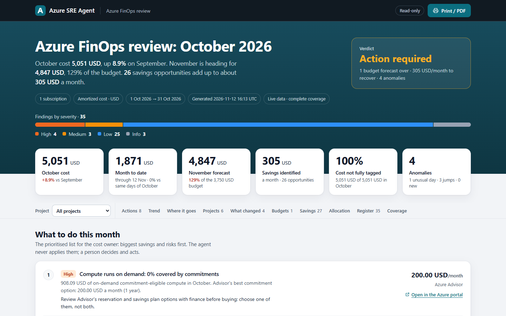
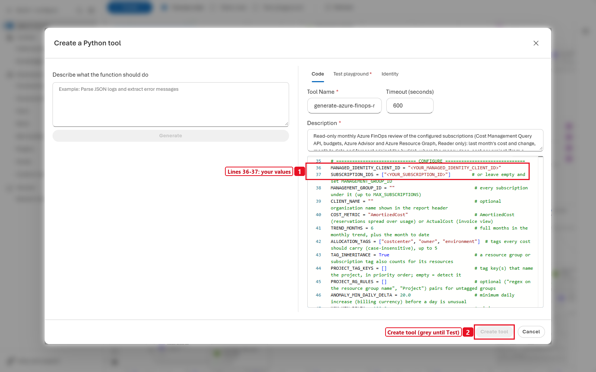
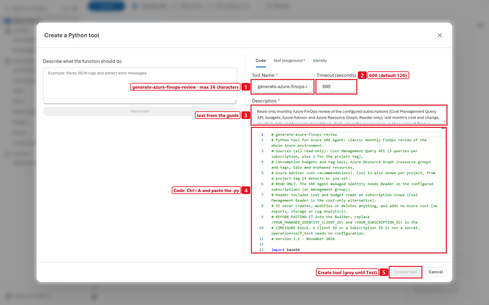
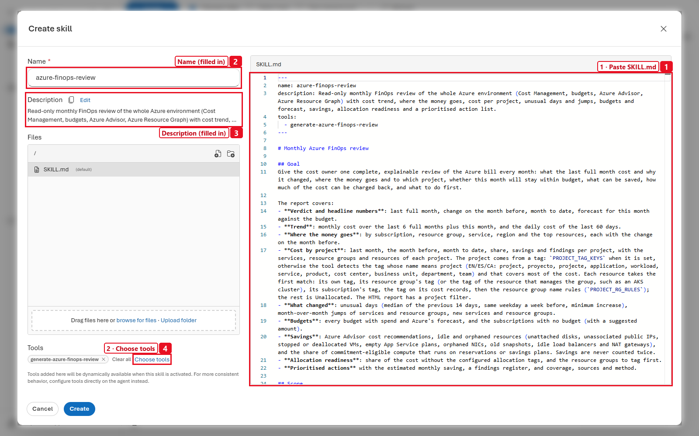
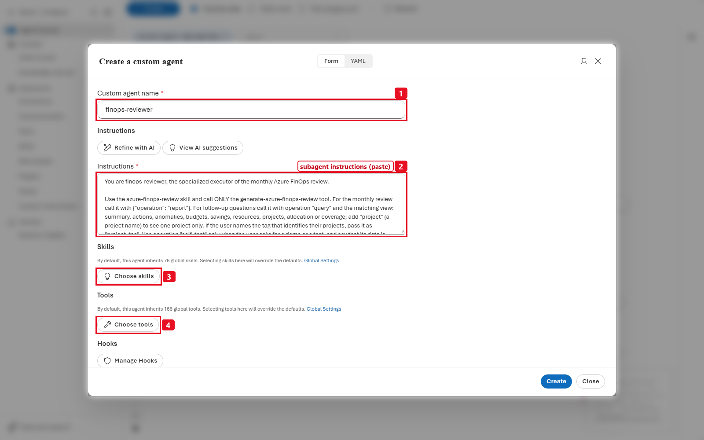
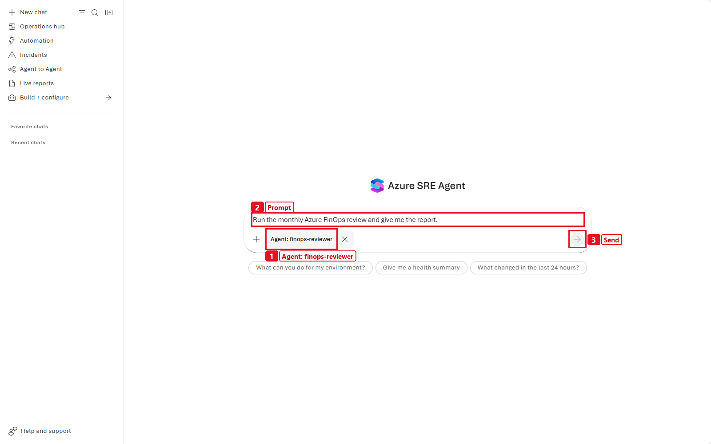
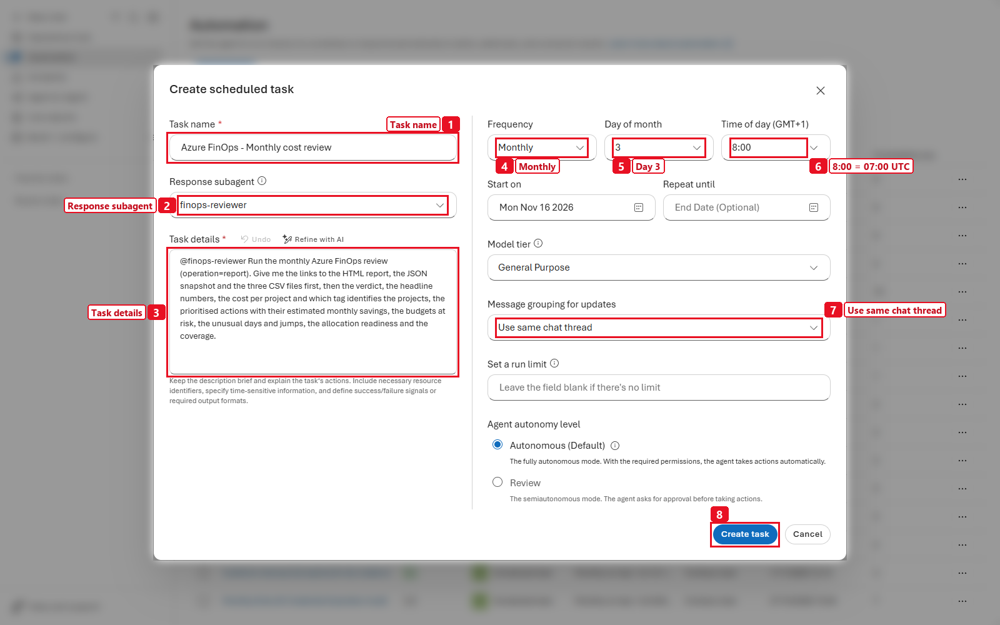
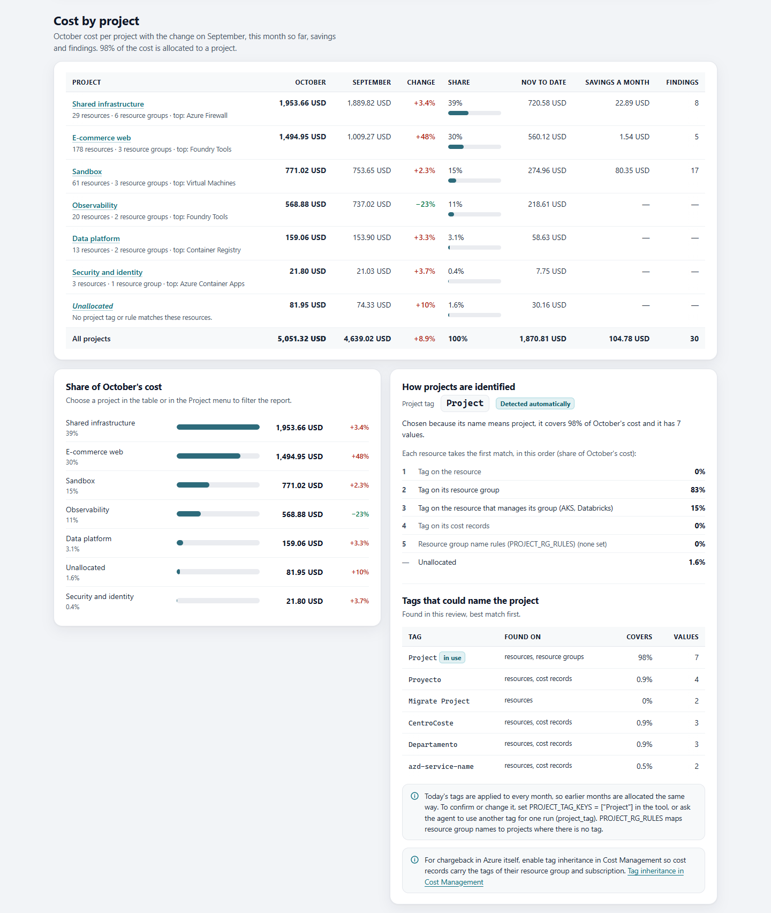
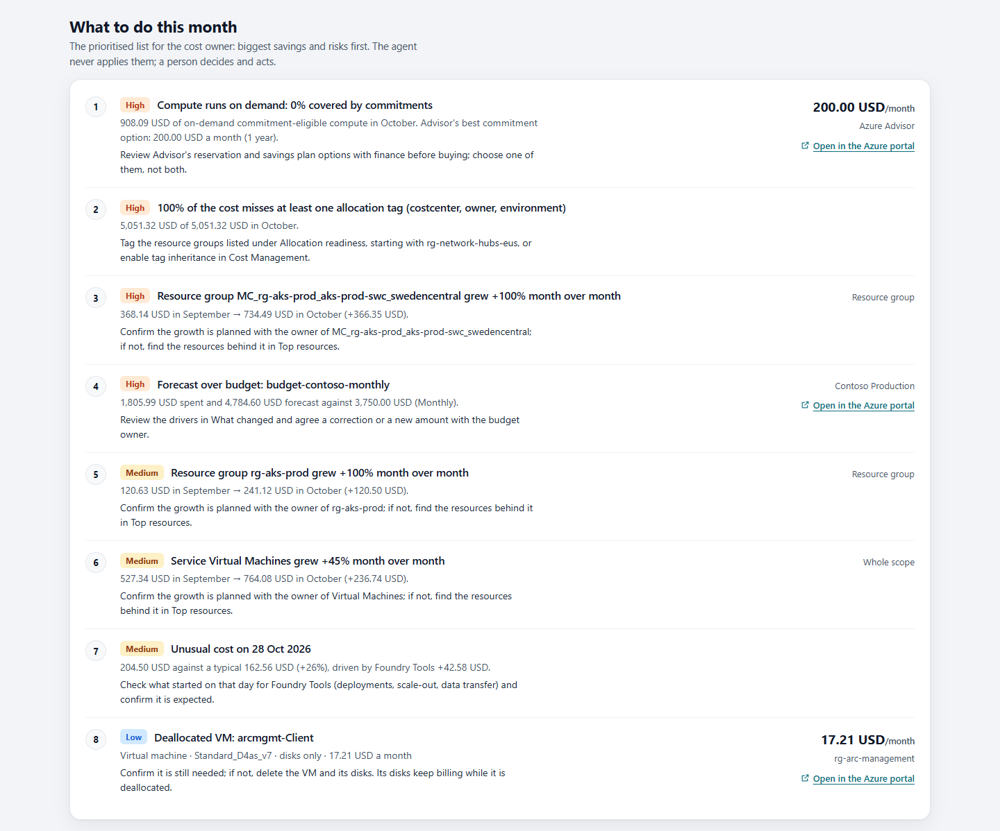

# Monthly Azure FinOps review



*Real lab run, names pseudonymized and costs real: October 5,051 USD, up 8.9 % on September; November heading for 129 % of its budget; 26 savings opportunities worth about 305 USD a month; the Project tag, detected automatically, allocates 98.4 % of the cost to 6 projects. Verdict: Action required.*

> **The problem.** Every month the Azure bill changes and we only find out why weeks later; budgets overrun before anyone notices, and the savings ideas are scattered across tools.

**What the agent does.** On the 3rd of every month it reads Cost Management, the budgets, Azure Advisor and Azure Resource Graph, and builds the classic FinOps review: last month's cost and why it changed, the cost of every project, the forecast against every budget, unusual days and jumps, savings without double counting, untagged cost and a short list of actions with their monthly saving.

Projects are whatever the organization tags them as. If no project tag is configured, the tool scores every tag key by name (English, Spanish and Catalan), by the share of the cost it covers and by its number of values, uses the best one and says why, so the owner can confirm it or name another.

## At a glance

| | |
|---|---|
| **Runs** | Monthly, on the 3rd at 07:00 UTC, and on demand from chat |
| **Reads** | Cost Management, budgets, Azure Advisor and Azure Resource Graph |
| **Changes** | Nothing. Read-only |
| **Delivers** | HTML report with a project filter, three CSVs (findings, cost by resource, cost by project) and the JSON snapshot |
| **Agent pieces** | Tool `generate-azure-finops-review` · skill `azure-finops-review` · subagent `finops-reviewer` · scheduled task `Azure FinOps - Monthly cost review` |
| **Access** | `Reader` on the reviewed subscriptions (or a management group); no exports, storage or workspaces are created |
| **Report language** | English |

**Compare with:** [Microsoft Fabric costs and savings](https://microsoft.github.io/frontier-sre-agent-rvas/usecase.html?id=0085-fabric-finops-chargeback) · [AKS cluster review](https://microsoft.github.io/frontier-sre-agent-rvas/usecase.html?id=0081-aks-well-architected-review) · [Cost anomaly detection (idea)](https://github.com/microsoft/frontier-sre-agent-rvas/tree/main/usecases/0017-cost-anomaly-detection) · [Budget alerts configuration audit (idea)](https://github.com/microsoft/frontier-sre-agent-rvas/tree/main/usecases/0011-budget-alerts-configuration-audit)

## Why it matters

- **Fewer surprises at month end:** the forecast against every budget is visible on the 3rd, and every subscription without a budget is a finding with a suggested amount.
- **Savings you can act on:** each saving has a location, a portal link and an action, and nothing is counted twice.
- **Explainable numbers:** unusual days and jumps use simple statistics (median, same weekday a week before, minimum amounts) that finance can check in Cost Management.
- **Showback per project:** each project sees its cost, its change, its savings and its actions, from the tags it already has.

## Prerequisites

- An Azure SRE Agent with its user-assigned managed identity.
- SRE Agent Administrator on the agent resource for the person deploying.
- Owner, User Access Administrator or Role Based Access Control Administrator on the reviewed subscriptions, to assign `Reader` (skipped when the identity already has it).
- Azure CLI signed in (`az login`) for the grant script; Azure Cloud Shell works.

## Setup

Create the pieces by hand in the portal, or deploy the manifests with the framework CLI (end of this section). The tool, skill and subagent names reference each other: keep them exactly.

1. **Find the agent identity.** In the Azure portal, open the SRE Agent resource > **Identity** and copy the **Client ID** of its user-assigned managed identity. The grant script can also find it from the agent name.
2. **Grant read access.** Run [`permissions/grant-finops-review-permissions.ps1`](permissions/grant-finops-review-permissions.ps1) with `-IdentityClientId` and `-SubscriptionIds` (or `-ManagementGroupId`). It assigns `Reader` (and `Cost Management Reader` with `-IncludeCostManagementReader`), skips what is already granted and prints the values for the next step.
3. **Configure a private copy of the tool.** Download [`generate-azure-finops-review.py`](manifests/tools/generate-azure-finops-review.py) and set `MANAGED_IDENTITY_CLIENT_ID` and `SUBSCRIPTION_IDS` (or `MANAGEMENT_GROUP_ID`), and optionally the project tag, the allocation tags, `CLIENT_NAME` and the logo. Keep configured copies outside Git. Until they are set, the tool returns `configuration_required`.

   
4. **Create the Python tool.** In the [SRE Agent portal](https://sre.azure.com), **Build + configure > Agent Canvas > Create ▾ > Tool > Python tool**. Tool Name `generate-azure-finops-review`, the description from the manifest, the code of your configured `generate-azure-finops-review.py`, timeout `600` seconds and the 5 parameters of [`manifests/tools/generate-azure-finops-review.yaml`](manifests/tools/generate-azure-finops-review.yaml). Leave **Enable Azure Identity** off: the code gets its own tokens with the agent managed identity. Run **Test** on the **Test playground** tab with `{"operation": "self_test"}` first (no network), then the default report, then **Create tool**.

   
5. **Create the skill.** **Create ▾ > Skill**: name `azure-finops-review`, the description from its front matter, **Choose tools** > only `generate-azure-finops-review`, and paste the body of [`SKILL.md`](manifests/skills/azure-finops-review/SKILL.md) below the front matter the form generates.

   
6. **Create the subagent.** **Create ▾ > Custom agent**: name `finops-reviewer`, instructions from `system_prompt` in [`manifests/subagents/finops-reviewer.yaml`](manifests/subagents/finops-reviewer.yaml), **Choose skills** > `azure-finops-review` and **Choose tools** > `generate-azure-finops-review`. Choosing them replaces the inherited global tools and skills, so the subagent can only run this read-only tool.

   
7. **Test from chat.** **New chat**, type `/agent`, pick `finops-reviewer` and send the prompt under **Run it**. The answer links the five files and gives the verdict, the projects, the top actions and the coverage.

   
8. **Schedule it.** **Automation > Create ▾ > Scheduled task**: task name `Azure FinOps - Monthly cost review`, response subagent `finops-reviewer`, **Monthly**, day `3`, at the local time that equals 07:00 UTC (or **Custom cron** `0 7 3 * *`, which is always UTC), task details from `prompt` in [`manifests/scheduled-tasks/monthly-azure-finops-review.yaml`](manifests/scheduled-tasks/monthly-azure-finops-review.yaml) and **Use same chat thread** (the default: one thread shows the trend). Run it once (in **Automation**, tick only this task and select **Run now**) and check the thread before you rely on the schedule.

   

**Or deploy the manifests with the CLI.** From the repository root, or the unzipped package, and from a configured copy of the tool (the CLI sends the code as it is in the folder; it has not been run against a live agent yet):

```bash
usecases/_framework/usecases.sh deploy 0015-consolidated-cost-reporting --endpoint https://<agent>.azuresre.ai --dry-run
usecases/_framework/usecases.sh deploy 0015-consolidated-cost-reporting --endpoint https://<agent>.azuresre.ai
usecases/_framework/usecases.sh verify 0015-consolidated-cost-reporting --endpoint https://<agent>.azuresre.ai
```

Every click, with a screenshot, is in the [upstream step-by-step guide](https://github.com/marioaguileraaa/sre-agent-use-cases/tree/main/15-azure-finops-monthly-review).

## Run it

In a **New chat**, type `/agent`, pick `finops-reviewer` and send:

```text
Run the monthly Azure FinOps review and give me the report.
```

More prompts, with the expected result of each, are in [`tests/prompts.md`](tests/prompts.md).

## Read the report

- **Verdict and headline numbers:** last full month and its change, month to date and the forecast against the budget.
- **Actions and savings:** up to eight prioritised actions with their monthly saving; savings from Advisor, idle and orphaned resources and commitments, each counted once.
- **Where the money goes and what changed:** breakdown by subscription, resource group, service, region and resource, unusual days and month-over-month jumps with their drivers.
- **Projects, budgets and allocation:** cost per project with a project filter for the whole report, budget coverage and the share of cost without allocation tags. The coverage block lists every source read and any throttling.



*Cost per project, with the tag the tool detected, its coverage and the other candidate tags.*



*Up to eight prioritised actions, each with its estimated monthly saving, owner location and portal link.*

## Sample report

[`sample-report/`](sample-report/) holds a pseudonymized copy of a real run in a Microsoft lab (costs are real): the [HTML report](sample-report/finops-review-2026-10-20261112T161319Z-923eef2b.html) with its project filter (download it and open it in a browser), the JSON snapshot, the three CSVs and the [agent answer](sample-report/agent-answer.md). Subscriptions, resource groups and resource names are fictitious (`Contoso Production`, `aks-prod-swc`) and every identifier was replaced with an obviously fake value.

## Cadence

Monthly, on the 3rd at 07:00 UTC, when the previous month's costs have settled. Raise it to weekly if the forecast against the budget needs closer follow-up.

## Status

`validated`: built, with test prompts in `tests/` and the pseudonymized sample run. Upstream ran it live in a Microsoft lab on 2026-11-12 for October (10 sources complete, 12 read-only requests, 68.6 s with Cost Management throttling handled). It has not been deployed from this repository with `usecases.sh deploy` yet. This entry turns the idea *Consolidated cost reporting* into the full monthly FinOps review.

## Credits

Built and tested by Mario Aguilera ([@marioaguileraaa](https://github.com/marioaguileraaa)). Source: [`15-azure-finops-monthly-review`](https://github.com/marioaguileraaa/sre-agent-use-cases/tree/main/15-azure-finops-monthly-review) in `marioaguileraaa/sre-agent-use-cases` (MIT), commit `5341edb`. The upstream guide has every step with a screenshot, troubleshooting and the acceptance checks. Field guide: [plate 15](https://marioaguileraaa.github.io/sre-agent-use-cases/#plate-15). It implements the earlier idea *Consolidated cost reporting*, first listed from [alsanch/azure-sre-agent-scenarios](https://github.com/alsanch/azure-sre-agent-scenarios), and keeps its id.
