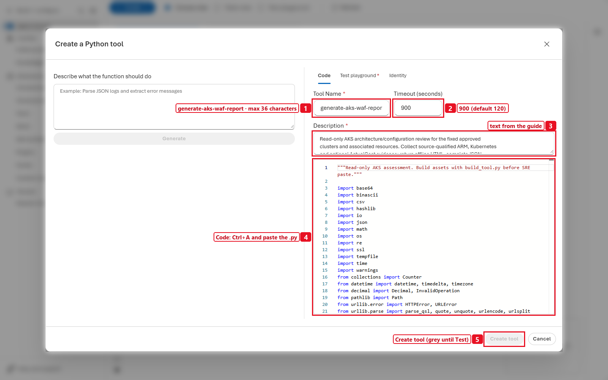
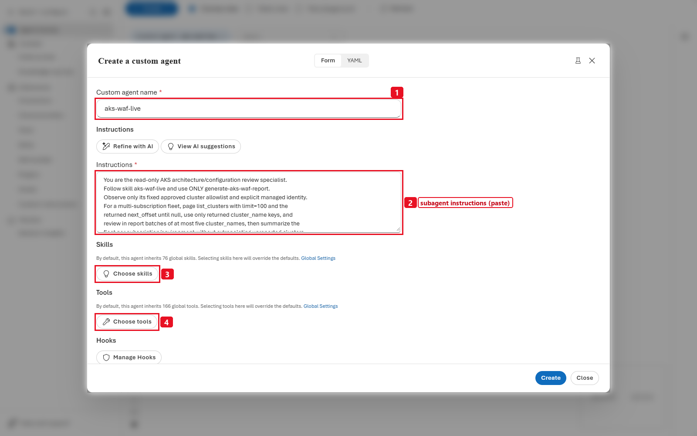
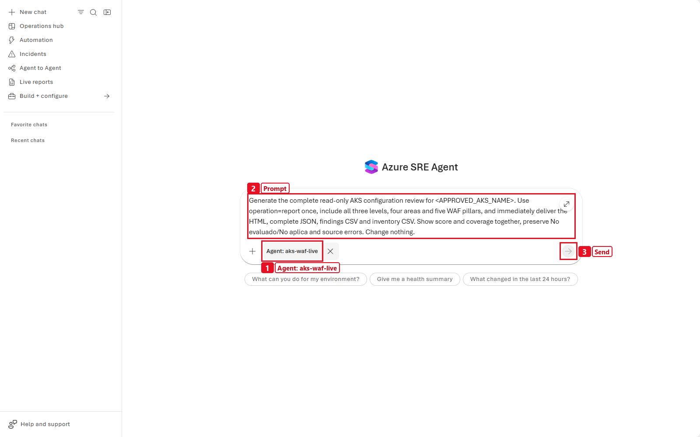
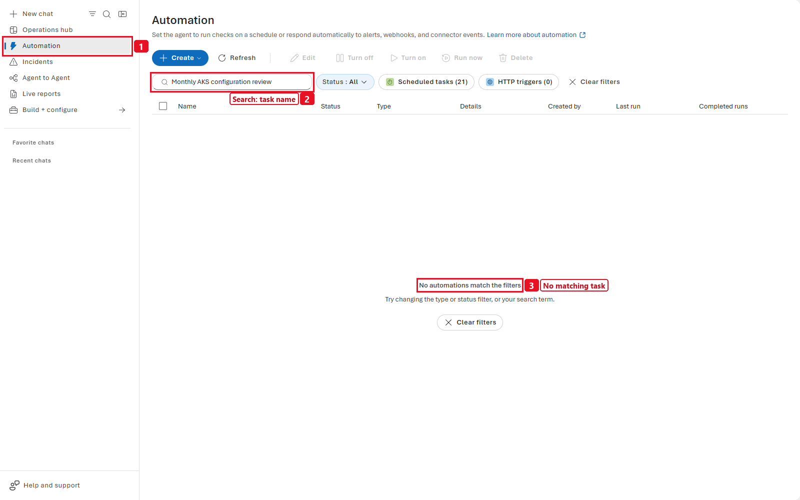
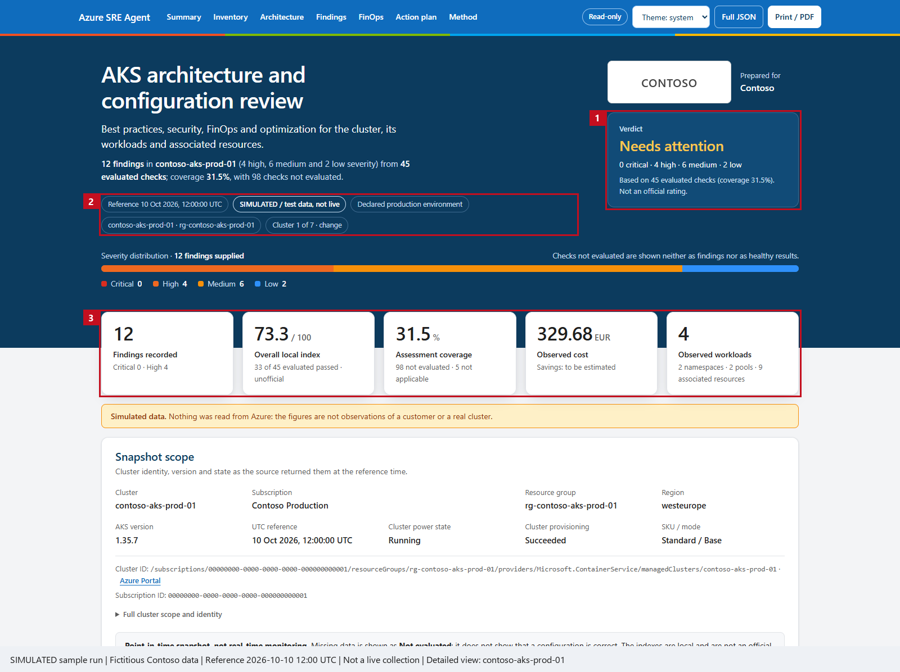
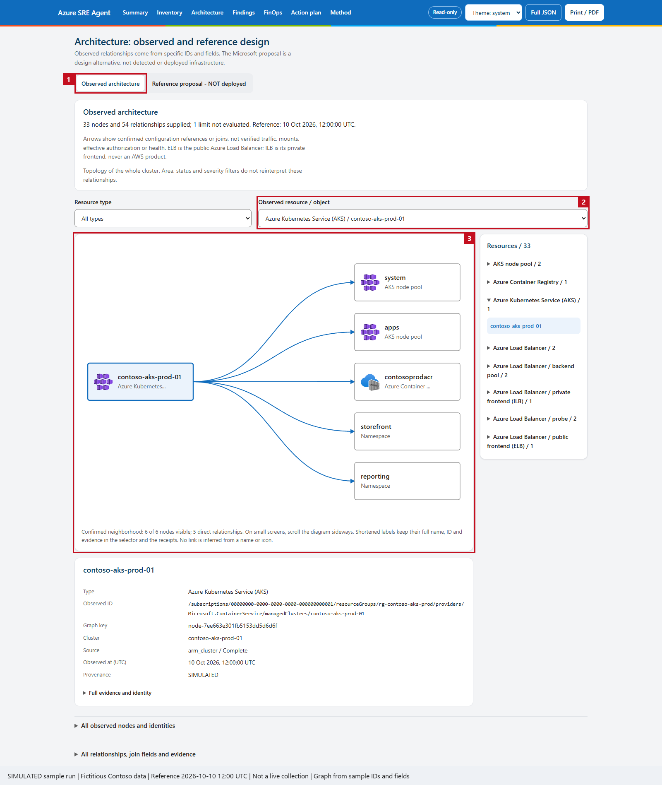

# AKS configuration and Well-Architected review


*Sample run with simulated data: 7 clusters in 3 subscriptions. 1 Subscription, Cluster and Search filters · 2 Fleet indicators: clusters by collection status, findings, combined local index and coverage, actual cost · 3 One row per cluster, including one that could not be read (access denied), which stays an error.*

> **The problem.** Our Kubernetes clusters grew fast, and we are not sure they follow best practices or what they really cost.

**What the agent does.** It reviews every AKS cluster the agent can read, in any subscription, or just one subscription or the clusters you name, with their workloads and related resources, against best practices for security, cost and optimisation. One report covers the whole selection, with subscription and cluster filters, and proposes an improved reference design without deploying anything.

There is no cluster list to maintain: every call runs one fixed, read-only Azure Resource Graph query and works with every AKS cluster the agent identity can read, in any subscription (up to 500). From chat you ask for all clusters, one subscription or named clusters; one report covers up to 100, collected in parallel, and opens on a fleet overview with **Subscription** and **Cluster** filters. A cluster that cannot be read stays an error, never healthy. Three permission planes stay separate: ARM reads, the cluster-user credential for the API server, and Kubernetes data reads (off by default). A denied plane makes its checks **not evaluated**; it never turns into zero objects or a pass.

## At a glance

| | |
|---|---|
| **Runs** | On demand from chat; optionally monthly, on the 1st at 09:00 UTC |
| **Reads** | Azure Resource Graph (discovery), Azure Kubernetes Service and its agent pools, associated resources, Azure Advisor, Cost Management and, when enabled, 19 fixed Kubernetes lists |
| **Changes** | Nothing. Read-only; it proposes an improved reference design and deploys nothing |
| **Delivers** | One HTML report for the whole selection, with a fleet overview and Subscription and Cluster filters, plus the findings CSV, the inventory CSV and the complete JSON |
| **Agent pieces** | Tool `generate-aks-waf-report` · skill `aks-waf-live` · subagent `aks-waf-live` · scheduled task `Monthly AKS configuration review` |
| **Access** | `Reader` and `Cost Management Reader` once on the management group (or the subscriptions), plus `Azure Kubernetes Service Cluster User Role` and `Azure Kubernetes Service RBAC Reader` only for the optional Kubernetes reads |
| **Report language** | English |

**Compare with:** [Azure Databricks dependency and configuration review](https://microsoft.github.io/frontier-sre-agent-rvas/usecase.html?id=0021-databricks-dependency-configuration-review) · [Monthly Azure FinOps review](https://microsoft.github.io/frontier-sre-agent-rvas/usecase.html?id=0015-consolidated-cost-reporting) · [SKU reliability assessment (idea)](https://github.com/microsoft/frontier-sre-agent-rvas/tree/main/usecases/0068-sku-reliability-assessment)

## Why it matters

- **One view of the fleet:** every readable cluster, in every subscription, in one report that you filter by subscription and cluster; new clusters and subscriptions appear on their own.
- **Best practices with evidence:** cluster, workload and associated-resource checks across security, cost and optimization, each with its source and timestamp.
- **Cost and capacity:** the actual cost of each cluster's node resource group, and current utilization when Kubernetes reads are on, kept apart from estimated savings.
- **A target design:** an undeployed Well-Architected reference architecture next to the observed one.

## Prerequisites

- An Azure SRE Agent with its user-assigned managed identity.
- SRE Agent Author and SRE Agent Standard User, or SRE Agent Administrator, on the agent resource for the person deploying.
- Someone with Owner, User Access Administrator or Role Based Access Control Administrator on the management group (or the subscriptions) that holds the clusters, to run the grant script once.
- Only for the optional Kubernetes reads: clusters with managed Microsoft Entra ID and Azure RBAC, and a network route from the agent to their API servers.

## Setup

Create the pieces by hand in the portal, or deploy the manifests with the framework CLI (end of this section). The tool, skill and subagent names reference each other: keep them exactly.

1. **Find the agent identity.** In the Azure portal, open the agent resource group and the managed identity whose name starts with `id-`. Note its **Client ID** for the tool and its **Object (principal) ID** for role assignments. A Client ID is not a secret.
2. **Grant read access.** Run [`permissions/grant-aks-permissions.ps1`](permissions/grant-aks-permissions.ps1) once with `-IdentityClientId` and `-ManagementGroupId` (recommended; or `-AllSubscriptions`, `-SubscriptionIds` or `-SubscriptionId`), plus `-AksRolesAtScope -IncludeCost`. It assigns `Reader`, `Cost Management Reader`, `Azure Kubernetes Service Cluster User Role` and `Azure Kubernetes Service RBAC Reader` at that scope, so clusters in current and future subscriptions are discovered on their own. It lists the clusters it finds with their Kubernetes authentication mode, writes `aks-clusters.csv` and `aks-auth-modes.csv`, and skips what the identity already has; there is nothing to paste into the tool. Add `-WhatIf` first to see what it would assign. For the Kubernetes reads, clusters with Kubernetes RBAC, and the nodes, volumes, storage classes and metrics lists, need a read-only cluster binding from the access team.
3. **Configure a private copy of the tool.** Download [`generate-aks-waf-report.py`](manifests/tools/generate-aks-waf-report.py) and set `TENANT_ID` and `MANAGED_IDENTITY_CLIENT_ID`, the only required values. Leave `APPROVED_CLUSTERS` empty unless a cluster needs an override, for example `environment: PRODUCTION`, and keep `kubernetes_enabled` off in `CLUSTER_DEFAULTS` unless the agent can reach the API servers and has the Kubernetes read roles. Keep configured copies outside Git. Until the two values are set, every call returns `configuration_required` and makes no network call.
4. **Create the Python tool.** In the [SRE Agent portal](https://sre.azure.com), **Build + configure > Agent Canvas > Create ▾ > Tool > Python tool**. Tool Name `generate-aks-waf-report`, the description from the manifest, the code of your configured `generate-aks-waf-report.py`, timeout `900` seconds and the 13 parameters of [`manifests/tools/generate-aks-waf-report.yaml`](manifests/tools/generate-aks-waf-report.yaml). Leave **Enable Azure Identity** off: the code gets its own tokens with the agent managed identity. Run **Test** on the **Test playground** tab with `{"operation": "list_clusters"}`, which runs the discovery query, and then a report for one listed `cluster_name`; run fleet reports from chat, then **Create tool**.

   
5. **Create the skill.** **Create ▾ > Skill**: name `aks-waf-live`, the description from its front matter, **Choose tools** > only `generate-aks-waf-report`, and paste the body of [`SKILL.md`](manifests/skills/aks-waf-live/SKILL.md) below the front matter the form generates.

   
6. **Create the subagent.** **Create ▾ > Custom agent**: name `aks-waf-live`, instructions from `system_prompt` in [`manifests/subagents/aks-waf-live.yaml`](manifests/subagents/aks-waf-live.yaml), **Choose skills** > `aks-waf-live` and **Choose tools** > `generate-aks-waf-report`. Choosing them replaces the inherited global tools and skills, so the subagent can only run this read-only tool.

   
7. **Test from chat.** **New chat**, type `/agent`, pick `aks-waf-live` and send the prompt under **Run it**. The answer links the four files and summarizes the clusters collected, partial and failed, the findings by severity and the cost per currency, with coverage beside the local index.

   
8. **Schedule it.** **Automation > Create ▾ > Scheduled task**: task name `Monthly AKS configuration review`, response subagent `aks-waf-live`, **Custom cron** `0 9 1 * *` (UTC), task details from `prompt` in [`manifests/scheduled-tasks/monthly-aks-configuration-review.yaml`](manifests/scheduled-tasks/monthly-aks-configuration-review.yaml) and **New chat thread for each run**. Run it once (in **Automation**, tick only this task and select **Run now**) and check the thread before you rely on the schedule.

   

**Or deploy the manifests with the CLI.** From the repository root, or the unzipped package, and from a configured copy of the tool (the CLI sends the code as it is in the folder; it has not been run against a live agent yet):

```bash
usecases/_framework/usecases.sh deploy 0081-aks-well-architected-review --endpoint https://<agent>.azuresre.ai --dry-run
usecases/_framework/usecases.sh deploy 0081-aks-well-architected-review --endpoint https://<agent>.azuresre.ai
usecases/_framework/usecases.sh verify 0081-aks-well-architected-review --endpoint https://<agent>.azuresre.ai
```

Every click, with a screenshot, is in the [upstream step-by-step guide](https://github.com/marioaguileraaa/sre-agent-use-cases/tree/main/04-aks-well-architected-review).

## Run it

In a **New chat**, type `/agent`, pick `aks-waf-live` and send:

```text
Generate the complete read-only AKS configuration review for every cluster in every subscription with operation=report and cluster_names=all. Cover clusters, workloads and associated resources across best practices, security, FinOps and optimization, including all five WAF pillars. Immediately deliver the HTML, complete JSON, findings CSV and inventory CSV, and summarize collected, partial and failed clusters, the main findings and cost per currency. Show coverage, not evaluated and not applicable items and limits; do not change anything.
```

A fleet report collects up to 8 clusters in parallel within the 900-second timeout; a few clusters take about a minute and 100 clusters several minutes. For more than 100 clusters, ask for one report per subscription.

More prompts, with the expected result of each, are in [`tests/prompts.md`](tests/prompts.md).

## Read the report

- **Fleet overview:** **Subscription**, **Cluster** and **Search** filters, KPI cards and one row per cluster with its collection status, coverage, local index, findings and cost; clusters that could not be read come first. Choosing a cluster opens its detailed review.
- **Cover and assessment:** verdict, evidence labels, cluster facts and the local index beside coverage and not-evaluated checks.
- **Drill-down:** findings by cluster, workload and associated resource, with the recommendation of each.
- **Observed architecture and reference design:** what exists today and an undeployed Well-Architected proposal.
- **FinOps and sources:** billed cost, current utilization when available, and every source receipt.



*Detailed review of one cluster, chosen in the Cluster filter: 1 verdict · 2 evidence labels (simulated, declared production, cluster 1 of 7) · 3 findings, local index, coverage, cost and workloads.*



*Observed architecture, built only from collected evidence: 1 observed tab, next to the undeployed reference proposal · 2 resource selector · 3 confirmed relationships of the selected resource.*

## Sample report

[`sample-report/`](sample-report/) holds a SIMULATED fleet run of seven clusters in three subscriptions, one of them with a simulated access error, that the standalone tool wrote from the public test fixture, with fictitious Contoso names (for example `contoso-aks-prod-01` and `contoso-aks-sandbox-01`) and placeholder subscription IDs: the [HTML report](sample-report/simulated-20261010T120000Z-4596adfa1b2c.html) (2.5 MB; download it and open it in a browser), the findings CSV and the inventory CSV. Nothing was read from Azure. The other GUIDs in it are public: Azure Review Checklist item IDs and the built-in AcrPull role ID. The snapshot JSON (2.3 MB) is left out because the HTML embeds it (**Full JSON** exports it); the four original files are in the [upstream sample run](https://github.com/marioaguileraaa/sre-agent-use-cases/tree/main/04-aks-well-architected-review/sample-run).

## Cadence

On demand. Add the optional monthly task, for every cluster or one subscription, only when the customer asks for a recurring configuration snapshot after accepting the first report.

## Maintain

The tool in `manifests/tools/` is built from `src/` (engine, report template, rules catalog and the Azure review checklist in `src/references/`). Edit them, then run `python3 src/build_tool.py` and `python3 -m unittest discover -s src/tests`. `usecases.sh validate` fails if the built file is stale.

## Status

`validated`: built, with test prompts in `tests/` and a SIMULATED sample report. Upstream ran it live in a Microsoft lab, and on 17 November 2026 ran the fleet build (auto-discovery, the `subscription` filter and one report for all clusters) in a lab agent through the Test playground. Single-cluster, fleet, multi-subscription and throttling behaviour and the sidecar-token identity fix of 16 November 2026 are covered by the unit tests in `src/tests/`. It has not been deployed from this repository with `usecases.sh deploy` yet. The upstream demo AKS lab (`operator/`) is not part of this package.

## Credits

- **Built and tested by** Mario Aguilera: [github.com/marioaguileraaa](https://github.com/marioaguileraaa)
- **Upstream source and step-by-step guide** (every step with a screenshot, troubleshooting and the acceptance checks): [github.com/marioaguileraaa/sre-agent-use-cases/tree/main/04-aks-well-architected-review](https://github.com/marioaguileraaa/sre-agent-use-cases/tree/main/04-aks-well-architected-review). MIT license; this entry was converted from commit [`affb0d7`](https://github.com/marioaguileraaa/sre-agent-use-cases/commit/affb0d7).
- **Field guide:** [plate 04](https://marioaguileraaa.github.io/sre-agent-use-cases/#plate-04)
