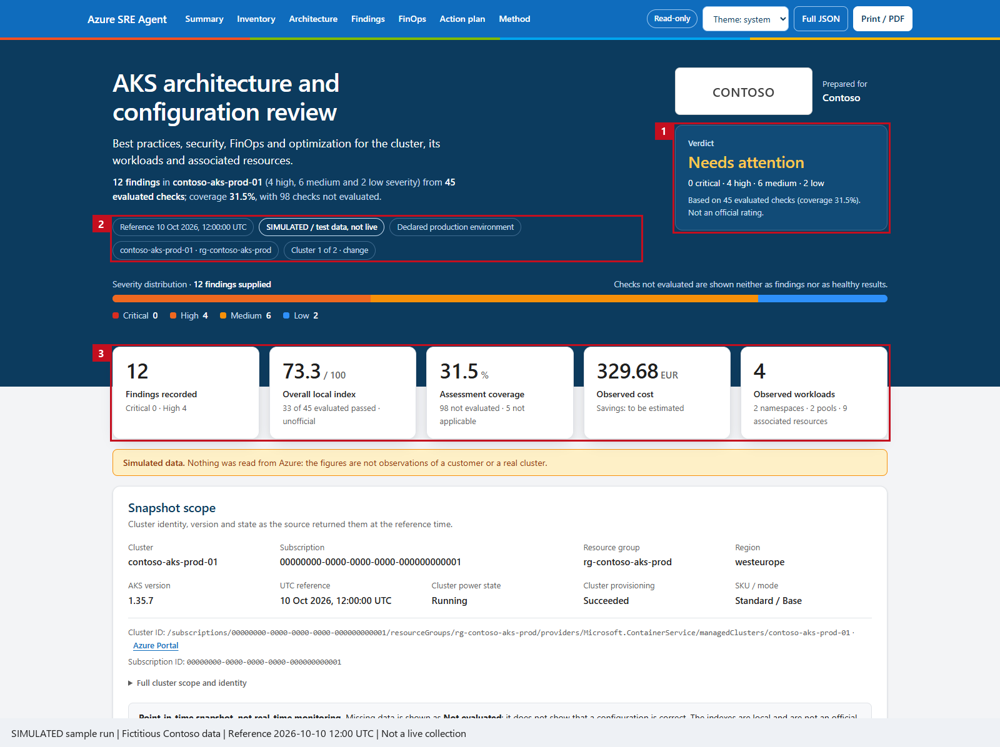
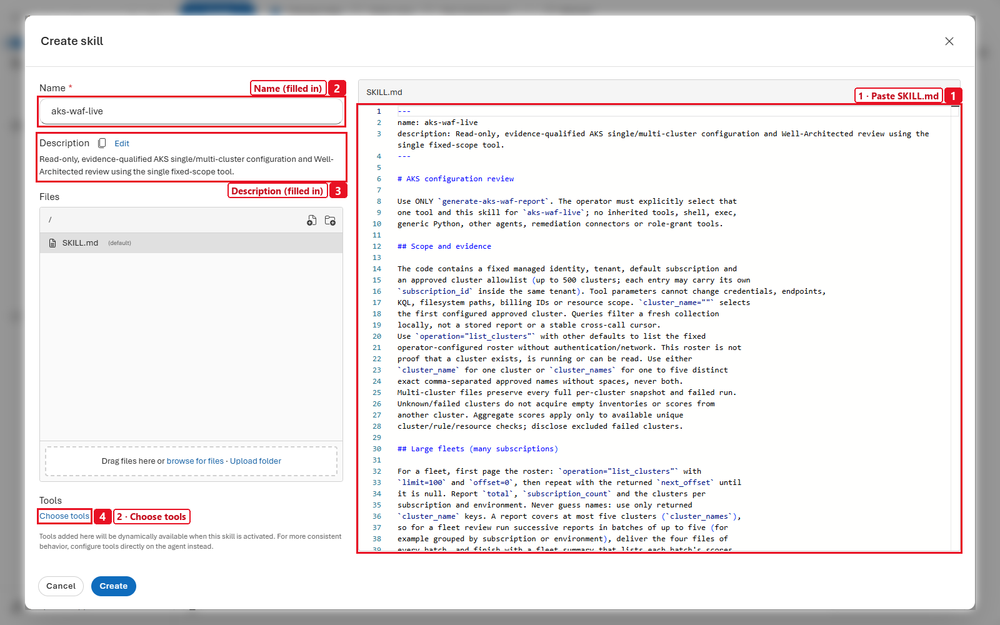

# AKS configuration and Well-Architected review



*Sample run with simulated data. 1 Verdict · 2 Evidence labels (simulated, declared production) · 3 Findings, local index, coverage, cost and workloads.*

> **The problem.** Our Kubernetes clusters grew fast, and we are not sure they follow best practices or what they really cost.

**What the agent does.** It reviews the configuration of approved AKS clusters, their workloads and related resources against best practices for security, cost and optimisation, and proposes an improved reference design without deploying anything.

Three permission planes stay separate: ARM reads, the cluster-user credential for the API server, and Kubernetes data reads. A denied plane makes its checks **not evaluated**; it never turns into zero objects or a pass. Up to 500 approved clusters across subscriptions can be reviewed in one combined report.

## At a glance

| | |
|---|---|
| **Runs** | On demand from chat; optionally monthly, on the 1st at 09:00 UTC |
| **Reads** | Azure Kubernetes Service and its agent pools, 19 fixed Kubernetes lists, associated resources, Azure Advisor and Cost Management |
| **Changes** | Nothing. Read-only; it proposes an improved reference design and deploys nothing |
| **Delivers** | HTML report, findings CSV, inventory CSV and the complete JSON |
| **Agent pieces** | Tool `generate-aks-waf-report` · skill `aks-waf-live` · subagent `aks-waf-live` · scheduled task `Monthly AKS configuration review` |
| **Access** | `Reader` on the clusters' subscriptions, `Azure Kubernetes Service Cluster User Role` and `Azure Kubernetes Service RBAC Reader` on each cluster, and optional `Cost Management Reader` |
| **Report language** | English |

**Compare with:** [Azure Databricks dependency and configuration review](https://microsoft.github.io/frontier-sre-agent-rvas/usecase.html?id=0021-databricks-dependency-configuration-review) · [Monthly Azure FinOps review](https://microsoft.github.io/frontier-sre-agent-rvas/usecase.html?id=0015-consolidated-cost-reporting) · [SKU reliability assessment (idea)](https://github.com/microsoft/frontier-sre-agent-rvas/tree/main/usecases/0068-sku-reliability-assessment)

## Why it matters

- **Best practices with evidence:** cluster, workload and associated-resource checks across security, cost and optimization, each with its source and timestamp.
- **Cost and capacity:** FinOps view with measured utilization and billed cost per resource, kept apart from estimated savings.
- **A target design:** an undeployed Well-Architected reference architecture next to the observed one.

## Prerequisites

- An Azure SRE Agent with its user-assigned managed identity.
- SRE Agent Author and SRE Agent Standard User, or SRE Agent Administrator, on the agent resource for the person deploying.
- Approved AKS clusters with managed Microsoft Entra integration, and someone who can grant ARM and Kubernetes read roles on them.

## Setup

Create the pieces by hand in the portal, or deploy the manifests with the framework CLI (end of this section). The tool, skill and subagent names reference each other: keep them exactly.

1. **Find the agent identity.** In the Azure portal, open the agent resource group and the managed identity whose name starts with `id-`. Note its **Client ID** for the tool and its **Object (principal) ID** for role assignments. A Client ID is not a secret.
2. **Grant read access.** Run [`permissions/grant-aks-review-reader.ps1`](permissions/grant-aks-review-reader.ps1) with `-IdentityClientId` (or `-PrincipalId`) and `-ClusterResourceId` for each approved cluster; add `-IncludeCost` for the billing evidence. It assigns `Reader` on each cluster's subscription, and `Azure Kubernetes Service Cluster User Role` and `Azure Kubernetes Service RBAC Reader` on each cluster, and skips what the identity already has. Clusters with Kubernetes RBAC, and the nodes, volumes, storage classes and metrics lists, need a read-only cluster binding from the access team. Add `-WhatIf` first to see what it would assign.
3. **Configure a private copy of the tool.** Download [`generate-aks-waf-report.py`](manifests/tools/generate-aks-waf-report.py) and set the values under **Parameters**, including the `APPROVED_CLUSTERS` allowlist. Keep configured copies outside Git. Until they are set, report and query calls return a configuration error.
4. **Create the Python tool.** In the [SRE Agent portal](https://sre.azure.com), **Build + configure > Agent Canvas > Create ▾ > Tool > Python tool**. Tool Name `generate-aks-waf-report`, the description from the manifest, the code of your configured `generate-aks-waf-report.py`, timeout `900` seconds and the 12 parameters of [`manifests/tools/generate-aks-waf-report.yaml`](manifests/tools/generate-aks-waf-report.yaml). Leave **Enable Azure Identity** off: the code gets its own tokens with the agent managed identity. Run **Test** on the **Test playground** tab with `{"operation": "list_clusters"}` (no network call), then **Create tool**.

   
5. **Create the skill.** **Create ▾ > Skill**: name `aks-waf-live`, the description from its front matter, **Choose tools** > only `generate-aks-waf-report`, and paste the body of [`SKILL.md`](manifests/skills/aks-waf-live/SKILL.md) below the front matter the form generates.

   
6. **Create the subagent.** **Create ▾ > Custom agent**: name `aks-waf-live`, instructions from `system_prompt` in [`manifests/subagents/aks-waf-live.yaml`](manifests/subagents/aks-waf-live.yaml), **Choose skills** > `aks-waf-live` and **Choose tools** > `generate-aks-waf-report`. Choosing them replaces the inherited global tools and skills, so the subagent can only run this read-only tool.

   
7. **Test from chat.** **New chat**, type `/agent`, pick `aks-waf-live` and send the prompt under **Run it**. The answer links the four files and states the coverage beside the local index.

   
8. **Schedule it.** **Automation > Create ▾ > Scheduled task**: task name `Monthly AKS configuration review`, response subagent `aks-waf-live`, **Custom cron** `0 9 1 * *` (UTC), task details from `prompt` in [`manifests/scheduled-tasks/monthly-aks-configuration-review.yaml`](manifests/scheduled-tasks/monthly-aks-configuration-review.yaml) and **New chat thread for each run**. Run it once (in **Automation**, tick only this task and select **Run now**) and check the thread before you rely on the schedule.

   

**Or deploy the manifests with the CLI.** From the repository root, or the unzipped package, and from a configured copy of the tool (the CLI sends the code as it is in the folder; it has not been run against a live agent yet):

```bash
usecases/_framework/usecases.sh deploy 0081-aks-well-architected-review --endpoint https://<agent>.azuresre.ai --dry-run
usecases/_framework/usecases.sh deploy 0081-aks-well-architected-review --endpoint https://<agent>.azuresre.ai
usecases/_framework/usecases.sh verify 0081-aks-well-architected-review --endpoint https://<agent>.azuresre.ai
```

Every click, with a screenshot, is in the [upstream step-by-step guide](https://github.com/marioaguileraaa/sre-agent-use-cases/tree/main/04-aks-well-architected-review).

## Run it

In a **New chat**, type `/agent`, pick `aks-waf-live` and send:

```text
Generate the complete read-only AKS configuration review for <APPROVED_AKS_NAME> with operation=report. Cover cluster, workloads and associated resources across best practices, security, FinOps and optimization, including all five WAF pillars. Immediately deliver the HTML, complete JSON, findings CSV and inventory CSV. Show coverage, sources, not evaluated and not applicable items and limits; do not change anything.
```

More prompts, with the expected result of each, are in [`tests/prompts.md`](tests/prompts.md).

## Read the report

- **Cover and assessment:** verdict, evidence labels, cluster facts and the local index beside coverage and not-evaluated checks.
- **Drill-down:** findings by cluster, workload and associated resource, with the recommendation of each.
- **Observed architecture and reference design:** what exists today and an undeployed Well-Architected proposal.
- **FinOps and sources:** measured utilization, billed cost and every source receipt.


*Observed architecture, built only from collected evidence: 1 observed tab, next to the undeployed reference proposal · 2 resource selector · 3 confirmed relationships of the selected resource.*

## Sample report

[`sample-report/`](sample-report/) holds a SIMULATED two-cluster run that the standalone tool wrote from the public test fixture, with fictitious Contoso names (`contoso-aks-prod-01`, `contoso-aks-prod-02`) and placeholder subscription IDs: the [HTML report](sample-report/simulated-20261010T120000Z-4596adfa1b2c.html) (download it and open it in a browser), the findings CSV and the inventory CSV. Nothing was read from Azure. The other GUIDs in it are public: Azure Review Checklist item IDs and the built-in AcrPull role ID. The snapshot JSON (858 KB) is left out because the HTML embeds it (**Full JSON** exports it); the four original files are in the [upstream sample run](https://github.com/marioaguileraaa/sre-agent-use-cases/tree/main/04-aks-well-architected-review/sample-run).

## Cadence

On demand. Add the optional monthly task only when the customer asks for a recurring configuration snapshot after accepting the first report.

## Maintain

The tool in `manifests/tools/` is built from `src/` (engine, report template, rules catalog and the Azure review checklist in `src/references/`). Edit them, then run `python3 src/build_tool.py` and `python3 -m unittest discover -s src/tests`. `usecases.sh validate` fails if the built file is stale.

## Status

`validated`: built, with test prompts in `tests/` and a SIMULATED sample report. Upstream ran it live in a Microsoft lab; single-cluster, multi-cluster and multi-subscription behaviour and the sidecar-token identity fix of 16 November 2026 are covered by the unit tests in `src/tests/`. It has not been deployed from this repository with `usecases.sh deploy` yet. The upstream demo AKS lab (`operator/`) is not part of this package.

## Credits

Built and tested by Mario Aguilera ([@marioaguileraaa](https://github.com/marioaguileraaa)). Source: [`04-aks-well-architected-review`](https://github.com/marioaguileraaa/sre-agent-use-cases/tree/main/04-aks-well-architected-review) in `marioaguileraaa/sre-agent-use-cases` (MIT), commit `4eb2e90`. The upstream guide has every step with a screenshot, troubleshooting and the acceptance checks. Field guide: [plate 04](https://marioaguileraaa.github.io/sre-agent-use-cases/#plate-04).
