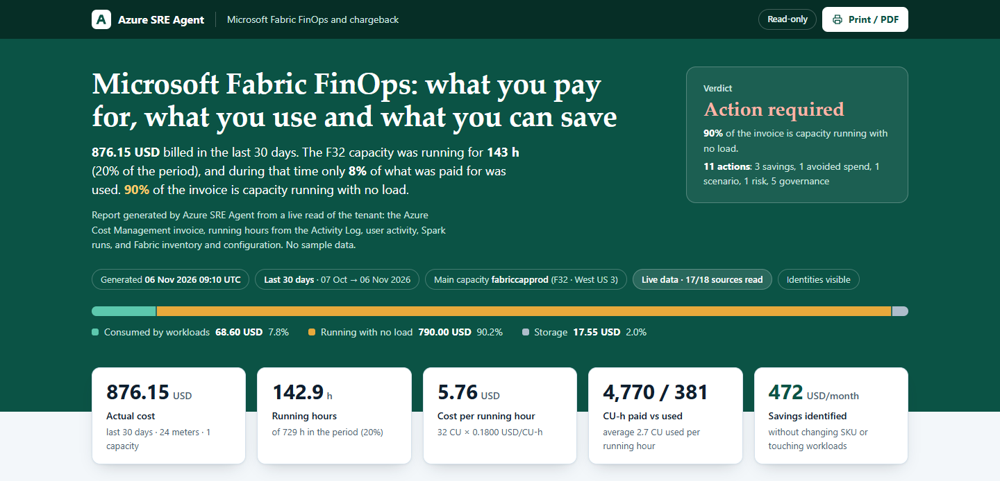
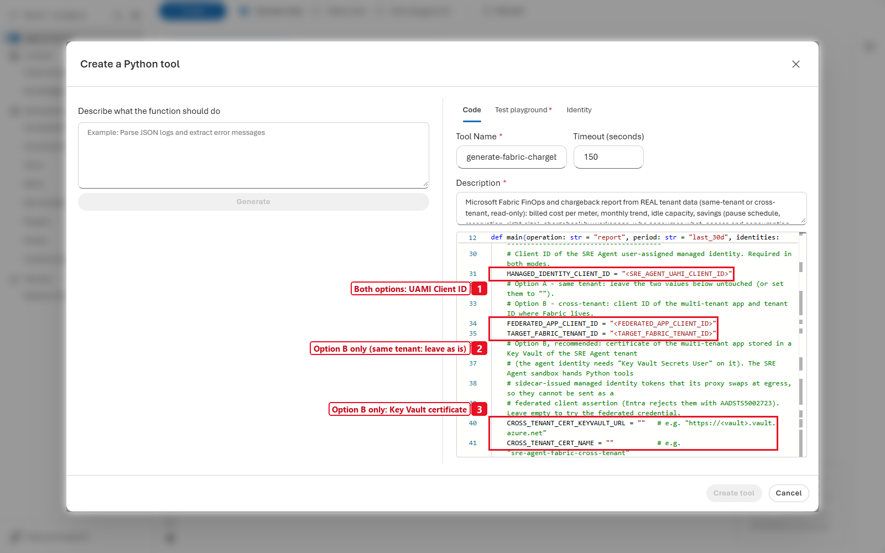
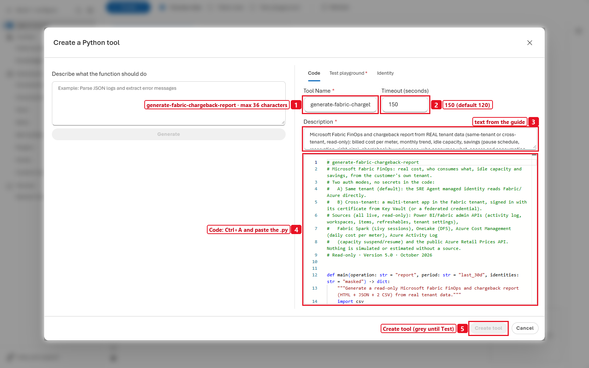
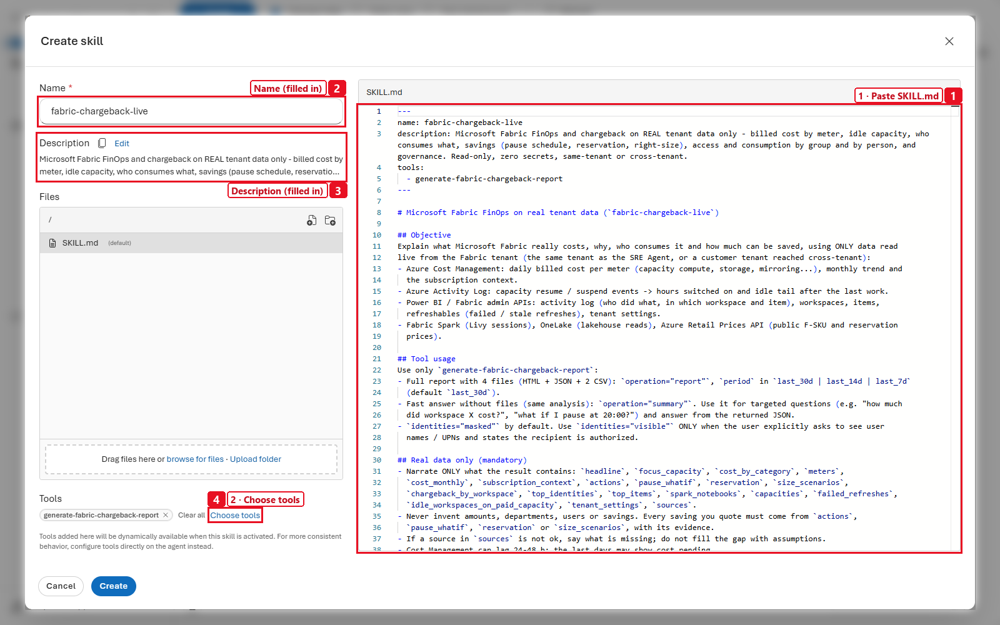
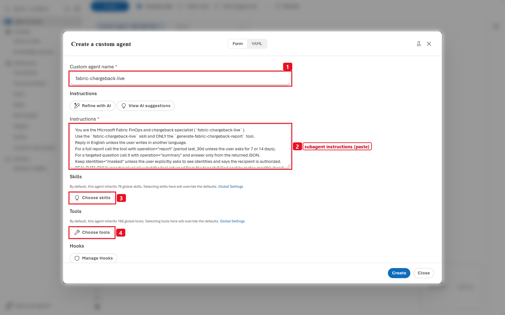
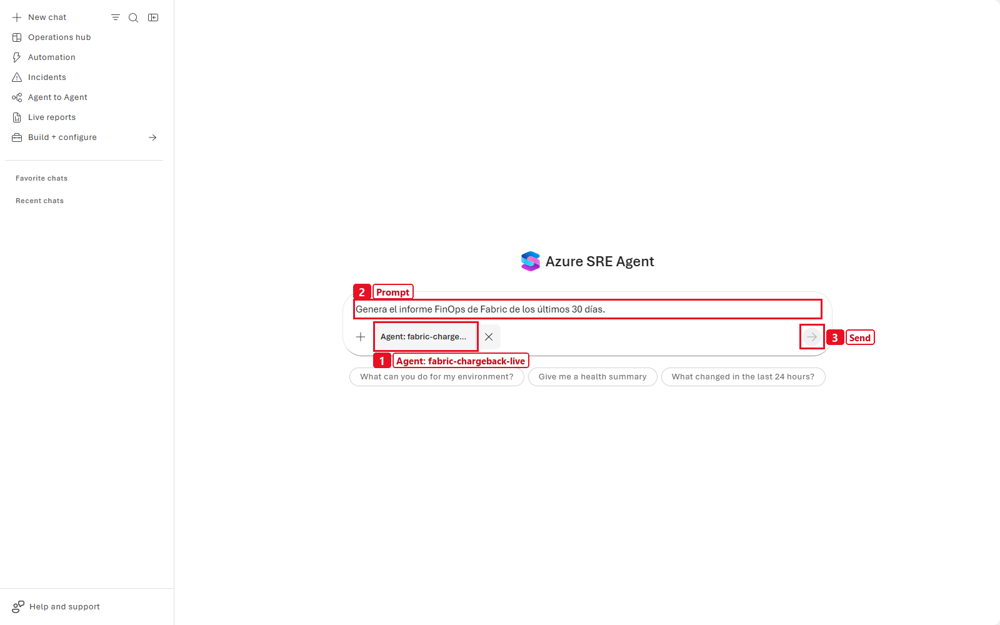
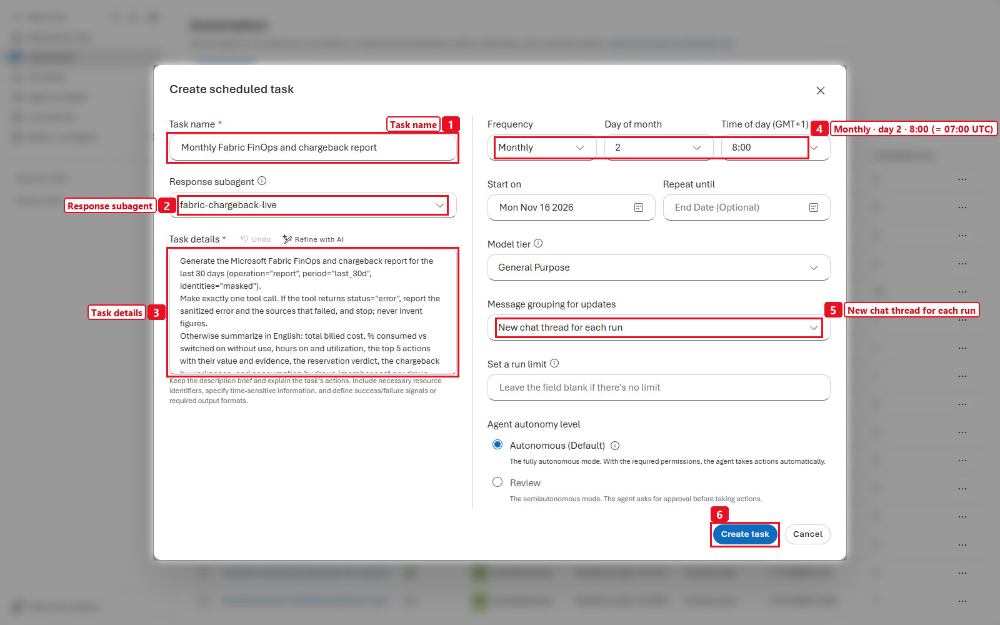
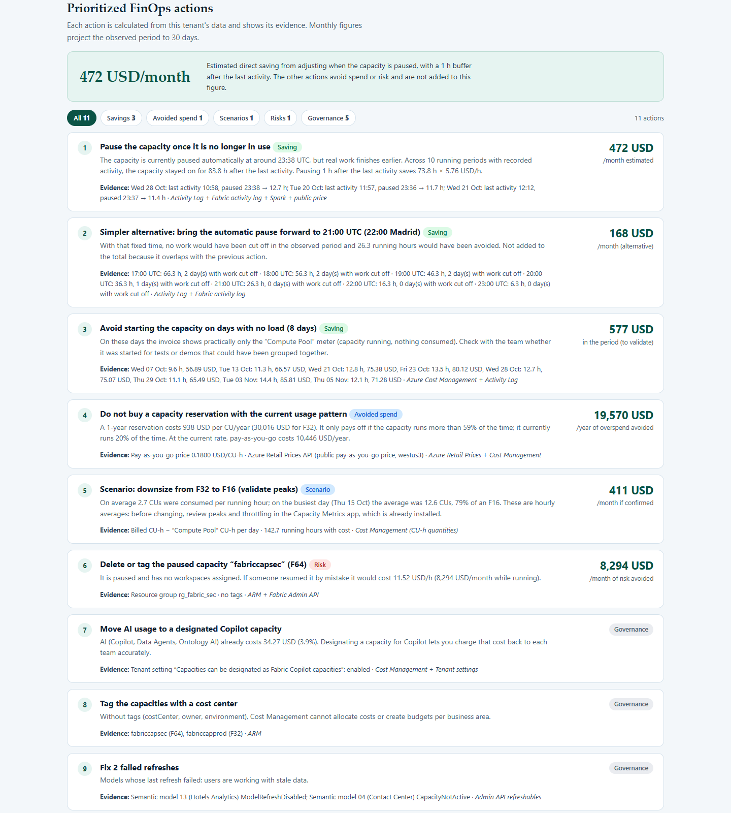
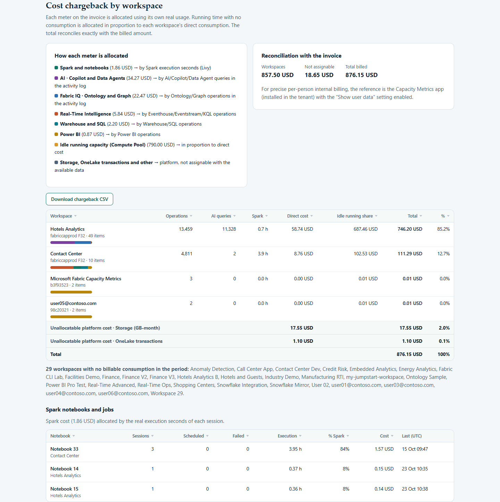

# Microsoft Fabric FinOps and chargeback



*Anonymized sample run: 876.15 USD billed in 30 days, of which 90.2 % was capacity switched on with no workload, and the actions that recover it.*

> **The problem.** We pay for Microsoft Fabric every month, but we don't know what is really used, which teams and people use it, or how much we could save.

**What the agent does.** It reads the real bill, the hours the capacity is switched on and who uses what, then shows idle time, savings options (pause, resize or reserve), a cost split per workspace, and what each user group and person consumes on the resources they can access.

Every figure comes from the tenant; nothing is simulated. The same file works in two modes: **same tenant** (the agent identity reads Fabric directly) or **cross-tenant** (a multi-tenant app whose certificate the tool reads from Key Vault, with no secrets in the code).

## At a glance

| | |
|---|---|
| **Runs** | Monthly, on the 2nd at 07:00 UTC, and on demand from chat |
| **Reads** | Azure Cost Management, the Activity Log, Microsoft Fabric and Power BI admin APIs and, optionally, Microsoft Graph (17 read-only sources) |
| **Changes** | Nothing. Read-only |
| **Delivers** | HTML report, chargeback CSV, daily cost per meter CSV and the JSON snapshot |
| **Agent pieces** | Tool `generate-fabric-chargeback-report` · skill `fabric-chargeback-live` · subagent `fabric-chargeback-live` · scheduled task `Monthly Fabric FinOps and chargeback report` |
| **Access** | Read-only Fabric admin APIs through a security group, workspace Viewer, `Reader` and `Cost Management Reader` on the capacity subscription; optional Graph group-member reads |
| **Report language** | English |

**Compare with:** [Monthly Azure FinOps review](https://microsoft.github.io/frontier-sre-agent-rvas/usecase.html?id=0015-consolidated-cost-reporting) · [Azure Databricks dependency and configuration review](https://microsoft.github.io/frontier-sre-agent-rvas/usecase.html?id=0021-databricks-dependency-configuration-review) · [Cost analysis by tag/environment (idea)](https://github.com/microsoft/frontier-sre-agent-rvas/tree/main/usecases/0016-cost-analysis-by-tag-environment)

## Why it matters

- **FinOps and finance:** the bill per meter and per workload, the monthly trend and a CSV to reconcile against the invoice.
- **Platform owners:** the exact idle hours and their cost, a pause time backed by evidence and the monthly saving.
- **Business units:** a defensible per-workspace chargeback, with the method written in the report.
- **Data and BI owners:** cost per group on the resources granted to it, who consumes what, and who has access but never uses it.

## Prerequisites

- An Azure SRE Agent; for the operator, SRE Agent Author and Standard User, or SRE Agent Administrator.
- At least one Fabric F-SKU capacity and the subscription that contains it.
- A person who is Fabric Administrator, can create security groups in Microsoft Entra ID and is Owner or User Access Administrator on the capacity subscription.
- Azure CLI 2.60 or later in PowerShell or Azure Cloud Shell.
- Cross-tenant only: permission to register applications in the agent tenant.

## Setup

Create the pieces by hand in the portal, or deploy the manifests with the framework CLI (end of this section). The tool, skill and subagent names reference each other: keep them exactly.

1. **Find the agent identity.** In the Azure portal, open **Managed Identities** > the identity attached to the agent > **Overview**, and note its **Client ID** (for the tool) and **Object (principal) ID** (for the grants). Mixing them is the most common setup error.
2. **Grant read access.** Same tenant: run [`permissions/grant-fabric-finops-access.ps1`](permissions/grant-fabric-finops-access.ps1) `-PrincipalObjectId` in the Fabric tenant. Cross-tenant: run [`permissions/setup-cross-tenant-app.ps1`](permissions/setup-cross-tenant-app.ps1) in the agent tenant, then the grant script with `-AppClientId` in the Fabric tenant. Optionally run [`permissions/grant-graph-read-permissions.ps1`](permissions/grant-graph-read-permissions.ps1) so the report can list group members. Allow about 15 minutes for the grants to propagate.
3. **Configure a private copy of the tool.** Download [`generate-fabric-chargeback-report.py`](manifests/tools/generate-fabric-chargeback-report.py) and set `MANAGED_IDENTITY_CLIENT_ID` in the **CONFIGURE** block (cross-tenant also needs the other four values under **Parameters**). Keep configured copies outside Git.

   
4. **Create the Python tool.** In the [SRE Agent portal](https://sre.azure.com), **Build + configure > Agent Canvas > Create ▾ > Tool > Python tool**. Tool Name `generate-fabric-chargeback-report`, the description from the manifest, the code of your configured `generate-fabric-chargeback-report.py`, timeout `150` seconds and the 3 parameters of [`manifests/tools/generate-fabric-chargeback-report.yaml`](manifests/tools/generate-fabric-chargeback-report.yaml). Leave **Enable Azure Identity** off: the code gets its own tokens with the agent managed identity. Run **Test** on the **Test playground** tab with `{"operation": "summary"}` for a quick check, then the default report, then **Create tool**.

   
5. **Create the skill.** **Create ▾ > Skill**: name `fabric-chargeback-live`, the description from its front matter, **Choose tools** > only `generate-fabric-chargeback-report`, and paste the body of [`SKILL.md`](manifests/skills/fabric-chargeback-live/SKILL.md) below the front matter the form generates.

   
6. **Create the subagent.** **Create ▾ > Custom agent**: name `fabric-chargeback-live`, instructions from `system_prompt` in [`manifests/subagents/fabric-chargeback-live.yaml`](manifests/subagents/fabric-chargeback-live.yaml), **Choose skills** > `fabric-chargeback-live` and **Choose tools** > `generate-fabric-chargeback-report`. Choosing them replaces the inherited global tools and skills, so the subagent can only run this read-only tool.

   
7. **Test from chat.** **New chat**, type `/agent`, pick `fabric-chargeback-live` and send the prompt under **Run it**. The answer gives the cost, the idle share, the top actions and the four file links.

   
8. **Schedule it.** **Automation > Create ▾ > Scheduled task**: task name `Monthly Fabric FinOps and chargeback report`, response subagent `fabric-chargeback-live`, **Monthly**, day `2`, at the local time that equals 07:00 UTC (or **Custom cron** `0 7 2 * *`, which is always UTC), task details from `prompt` in [`manifests/scheduled-tasks/monthly-fabric-finops-chargeback.yaml`](manifests/scheduled-tasks/monthly-fabric-finops-chargeback.yaml) and **New chat thread for each run**. Run it once (in **Automation**, tick only this task and select **Run now**) and check the thread before you rely on the schedule.

   

**Or deploy the manifests with the CLI.** From the repository root, or the unzipped package, and from a configured copy of the tool (the CLI sends the code as it is in the folder; it has not been run against a live agent yet):

```bash
usecases/_framework/usecases.sh deploy 0085-fabric-finops-chargeback --endpoint https://<agent>.azuresre.ai --dry-run
usecases/_framework/usecases.sh deploy 0085-fabric-finops-chargeback --endpoint https://<agent>.azuresre.ai
usecases/_framework/usecases.sh verify 0085-fabric-finops-chargeback --endpoint https://<agent>.azuresre.ai
```

Every click, with a screenshot, is in the [upstream step-by-step guide](https://github.com/marioaguileraaa/sre-agent-use-cases/tree/main/11-fabric-finops-chargeback).

## Run it

In a **New chat**, type `/agent`, pick `fabric-chargeback-live` and send:

```text
Generate the Fabric FinOps report for the last 30 days.
```

More prompts, with the expected result of each, are in [`tests/prompts.md`](tests/prompts.md).

## Read the report

- **Summary:** real billed cost, capacity on against used, and the identified savings.
- **Actions:** 10 to 12 FinOps actions with amount and evidence (pause schedule, no-load days, reservation yes or no, right-size, expensive notebooks, risky paused capacities, AI cost, governance).
- **Cost breakdown and usage against capacity:** meter by meter, monthly trend, hours on and after the last job of the day.
- **Who consumes what, chargeback and access by group:** per-workspace split, top items and notebooks, consumption by group and person (masked by default), people with access but no activity. The data sources section states the status of all 17 sources.



*FinOps actions with their amount and evidence: pause schedule, days without load, reservation, right-size, expensive notebooks and governance.*



*Chargeback per workspace: direct consumption by meter plus a proportional share of idle time; unassignable cost is shown apart.*

## Sample report

[`sample-report/`](sample-report/) holds an anonymized real run in English: the [HTML report](sample-report/fabric-finops-20261106T095840Z.html) (download it and open it in a browser; one file, no dependencies), the JSON snapshot and both CSVs. Capacities, workspaces, items, groups and users are pseudonyms (`userNN@contoso.com`) and every identifier was replaced with an obviously fake value. It was generated with `identities=visible` because every identity in it is fictitious.

## Cadence

Monthly, on day 2 at 07:00 UTC, because Cost Management publishes the last days of the month with a 24 to 48 hour delay. A weekly variant (`0 7 * * 1`, `period=last_7d`) is possible.

## Status

`validated`: built, with test prompts in `tests/` and the anonymized sample run. Upstream ran it live against a real Fabric tenant on 2026-11-06 (the anonymized sample run comes from that run). It has not been deployed from this repository with `usecases.sh deploy` yet.

## Credits

- **Built and tested by** Mario Aguilera: [github.com/marioaguileraaa](https://github.com/marioaguileraaa)
- **Upstream source and step-by-step guide** (every step with a screenshot, troubleshooting and the acceptance checks): [github.com/marioaguileraaa/sre-agent-use-cases/tree/main/11-fabric-finops-chargeback](https://github.com/marioaguileraaa/sre-agent-use-cases/tree/main/11-fabric-finops-chargeback). MIT license; this entry was converted from commit [`4eb2e90`](https://github.com/marioaguileraaa/sre-agent-use-cases/commit/4eb2e90).
- **Field guide:** [plate 11](https://marioaguileraaa.github.io/sre-agent-use-cases/#plate-11)
