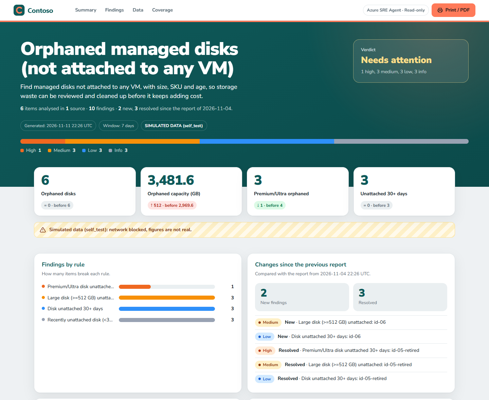
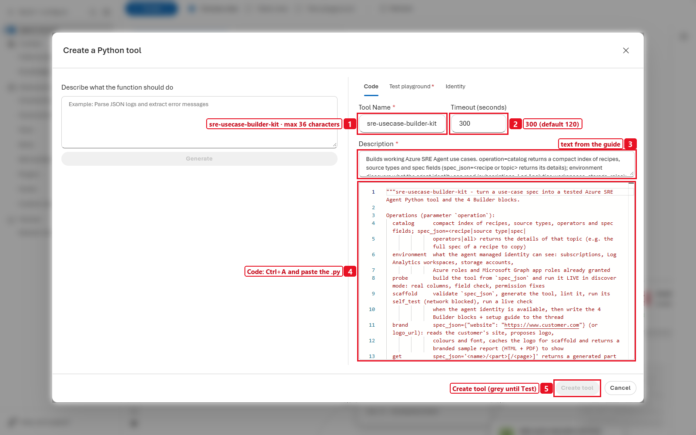
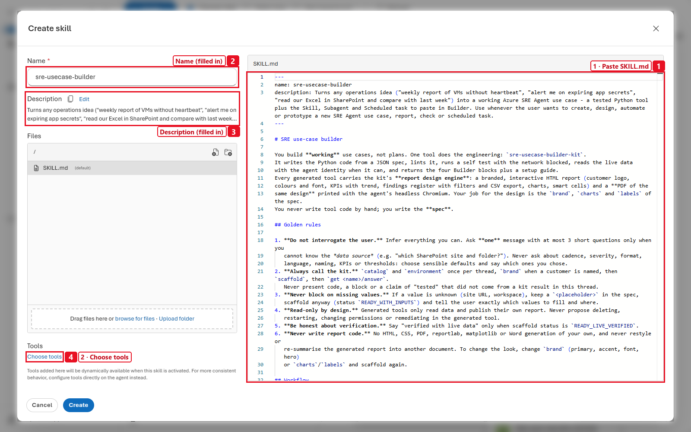
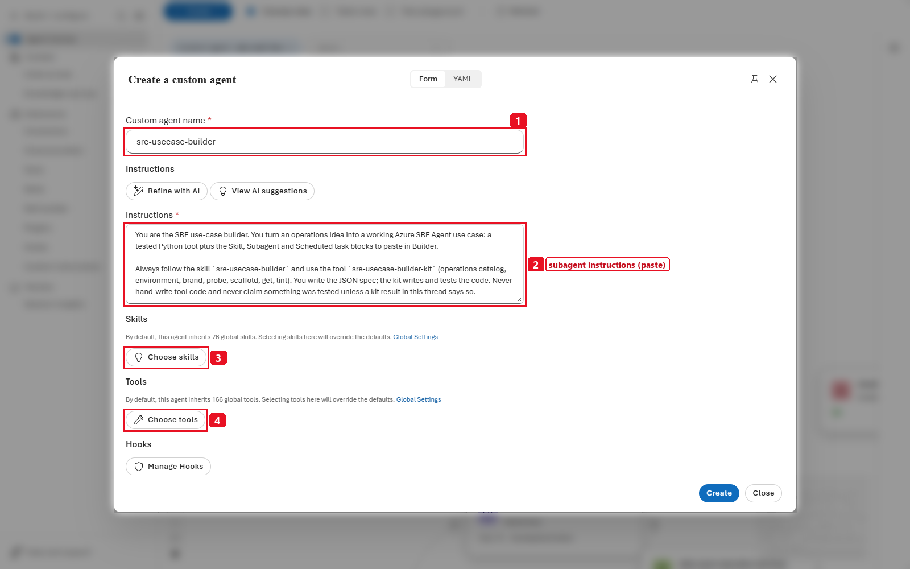
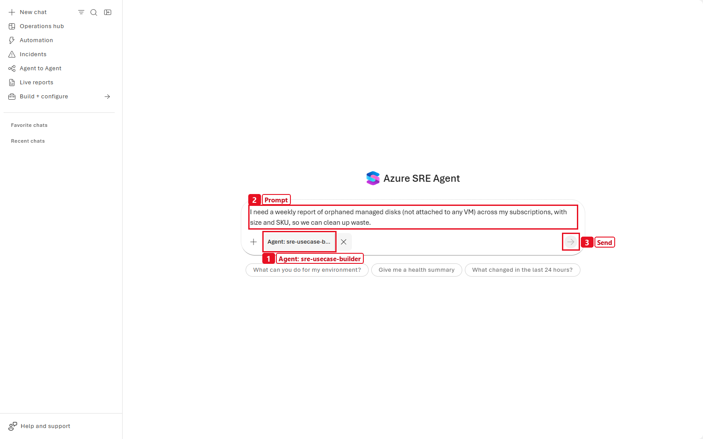
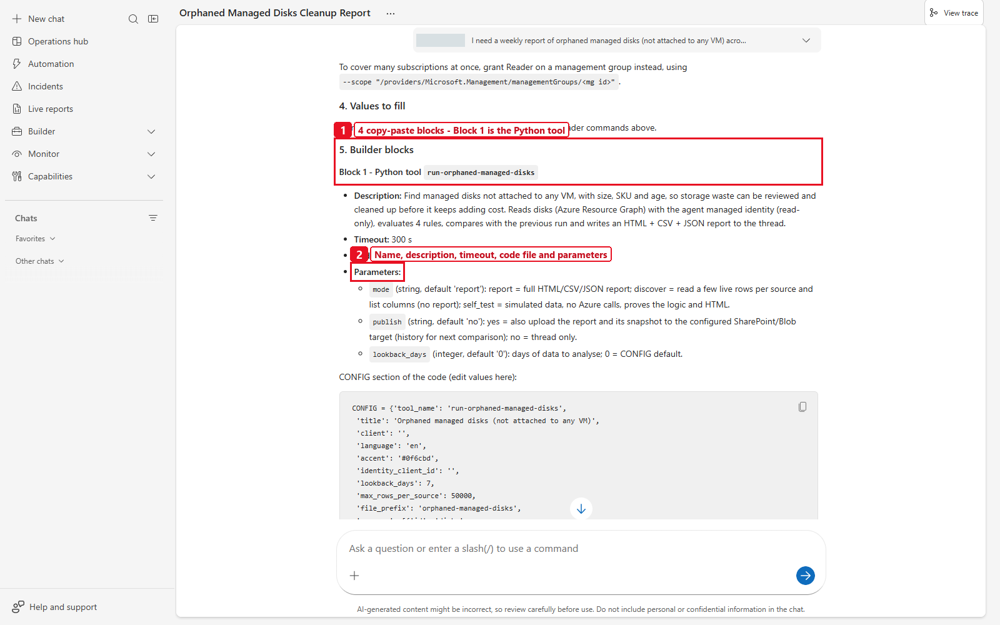

# Azure SRE Agent use-case builder



*A report the builder generated from one sentence, in a customer's brand (fictional company, simulated data): verdict, KPIs with the previous value, findings by rule and the changes since the previous report.*

> **The problem.** We need a monthly report that none of the existing use cases covers yet.

**What the agent does.** Describe the idea in one sentence. The agent writes the tool, tests it against your real data and hands back everything needed to run it as a new use case: the four building blocks, the exact permissions and a setup guide.

The language model writes only a declarative JSON spec; a fixed, tested engine generates the code, lints it, runs it with the network blocked (`self_test`) and, when the identity allows it, reads a few live rows (`discover`). Every result fits the platform's tool-result size limit, with paged `get` for long parts, so nothing is cut. Watch the 2-minute [tutorial video](https://marioaguileraaa.github.io/sre-agent-use-cases/#tutorial).

## At a glance

| | |
|---|---|
| **Runs** | On demand, from chat |
| **Reads** | Whatever the idea needs (Log Analytics, Azure Resource Graph, ARM, Cost Management, Microsoft Graph, Azure Data Explorer, SharePoint or Blob files), read-only |
| **Changes** | Nothing. The use cases it builds are read-only too |
| **Delivers** | A tested tool, skill, subagent and scheduled task, with a branded HTML and PDF report, the permissions and a setup guide |
| **Agent pieces** | Tool `sre-usecase-builder-kit` · skill `sre-usecase-builder` · subagent `sre-usecase-builder` |
| **Access** | None of its own; live checks use only what the agent identity can already read |
| **Report language** | English (the builder answers in the user's language) |

**Compare with:** [Microsoft Entra credential expiration audit](https://microsoft.github.io/frontier-sre-agent-rvas/usecase.html?id=0079-entra-credential-expiration-audit) · [Monthly Azure FinOps review](https://microsoft.github.io/frontier-sre-agent-rvas/usecase.html?id=0015-consolidated-cost-reporting)

## Why it matters

- **From idea to a scheduled report in minutes:** 2 to 4 minutes of chat plus about 10 minutes of copy-paste in Build + configure.
- **Tested before it reaches you:** lint, a network-blocked self-test and a live read with the agent identity, with the status stated (`READY_LIVE_VERIFIED`, `READY_WITH_INPUTS`).
- **Permissions found up front:** the exact `az` commands per data source, and the roles the agent already has.
- **Self-service and safe:** customer teams build their own scenarios; generated tools are read-only by design.

## Prerequisites

- An existing Azure SRE Agent and access to its portal.
- SRE Agent Administrator, or SRE Agent Author and SRE Agent Standard User, on the agent resource.
- For live checks, the read roles each generated use case needs; the builder lists them with exact commands.

## Setup

Create the pieces by hand in the portal, or deploy the manifests with the framework CLI (end of this section). The tool, skill and subagent names reference each other: keep them exactly.

1. **Find the agent identity.** Nothing to configure for the builder itself. Note the agent identity only if you later grant read roles for the generated use cases.
2. **Grant read access.** None for the builder. Each generated use case comes with its own permissions section and `az` commands.
3. **Create the Python tool.** In the [SRE Agent portal](https://sre.azure.com), **Build + configure > Agent Canvas > Create ▾ > Tool > Python tool**. Tool Name `sre-usecase-builder-kit`, the description from the manifest, the code of [`sre-usecase-builder-kit.py`](manifests/tools/sre-usecase-builder-kit.py) with no edits, timeout `300` seconds and the 3 parameters of [`manifests/tools/sre-usecase-builder-kit.yaml`](manifests/tools/sre-usecase-builder-kit.yaml). Leave **Enable Azure Identity** off; the kit uses the managed identity the sandbox already provides. Run **Test** on the **Test playground** tab with `operation` = `catalog`, then **Create tool**.

   
4. **Create the skill.** **Create ▾ > Skill**: name `sre-usecase-builder`, the description from its front matter, **Choose tools** > only `sre-usecase-builder-kit`, and paste the body of [`SKILL.md`](manifests/skills/sre-usecase-builder/SKILL.md) below the front matter the form generates.

   
5. **Create the subagent.** **Create ▾ > Custom agent**: name `sre-usecase-builder`, instructions from `system_prompt` in [`manifests/subagents/sre-usecase-builder.yaml`](manifests/subagents/sre-usecase-builder.yaml), **Choose skills** > `sre-usecase-builder` and **Choose tools** > `sre-usecase-builder-kit`. Choosing them replaces the inherited global tools and skills, so the subagent can only run this read-only tool.

   
6. **Test from chat.** **New chat**, type `/agent`, pick `sre-usecase-builder` and send the prompt under **Run it**. The builder answers with the use case, the verification, the permissions, the four blocks and the files.

   

**Or deploy the manifests with the CLI.** From the repository root, or the unzipped package (it has not been run against a live agent yet):

```bash
usecases/_framework/usecases.sh deploy 0087-sre-use-case-builder --endpoint https://<agent>.azuresre.ai --dry-run
usecases/_framework/usecases.sh deploy 0087-sre-use-case-builder --endpoint https://<agent>.azuresre.ai
usecases/_framework/usecases.sh verify 0087-sre-use-case-builder --endpoint https://<agent>.azuresre.ai
```

Every click, with a screenshot, is in the [upstream step-by-step guide](https://github.com/marioaguileraaa/sre-agent-use-cases/tree/main/case_0_v3).

## Run it

In a **New chat**, type `/agent`, pick `sre-usecase-builder` and send:

```text
I need a weekly report of orphaned managed disks (not attached to any VM) across my subscriptions, with size and SKU, so we can clean up waste.
```

More prompts, with the expected result of each, are in [`tests/prompts.md`](tests/prompts.md).

## Read the report

- **Every generated report has the same design:** verdict, KPIs with trend, findings by severity, charts, changes since the previous run and a searchable findings register.
- **Downloads:** HTML, PDF of the same design, CSV and JSON.
- **Brand on request:** name a company or its website and the report carries its logo, colours and font, read once from the public site.



*The answer ends with the four blocks to paste: Python tool, skill, subagent and scheduled task, plus the permissions with exact az commands.*

## Sample report

[`sample-report/orphaned-managed-disks/`](sample-report/orphaned-managed-disks/) is what the builder hands back for the first verified prompt: the generated tool (`run-orphaned-managed-disks.py`), its JSON spec, the four Builder blocks, the setup guide and the self-test report in the customer's brand, as [HTML](sample-report/orphaned-managed-disks/selftest-report-branded.html) (download it and open it in a browser) and [PDF](sample-report/orphaned-managed-disks/selftest-report-branded.pdf). Fictional company (Contoso) and simulated data.

## Cadence

On demand. The use cases it generates bring their own scheduled task block.

## Maintain

`manifests/tools/sre-usecase-builder-kit.py` is built from `src/` (`kit_*.py` and the generated-tool template). Edit them, then run `python3 src/build_kit.py`, `python3 src/tests/test_kit.py` and `python3 src/tests/test_report_mocked.py`.

## Status

`validated`: built, with test prompts in `tests/`, unit tests in `src/tests/` and a complete sample (the orphaned managed disks example). Upstream deployed it and ran it live end to end on a lab agent: builder, generated tool, generated subagent, report and scheduled task. On 16 November 2026 the environment check stopped relying on the `oid` token claim and now finds the identity through Resource Graph, the agent resource or Microsoft Graph. It has not been deployed from this repository with `usecases.sh deploy` yet.

## Credits

Built and tested by Mario Aguilera ([@marioaguileraaa](https://github.com/marioaguileraaa)). Source: [`case_0_v3`](https://github.com/marioaguileraaa/sre-agent-use-cases/tree/main/case_0_v3) in `marioaguileraaa/sre-agent-use-cases` (MIT), commit `4eb2e90`. The upstream guide has every step with a screenshot, troubleshooting and the acceptance checks. Field guide: [plate 00](https://marioaguileraaa.github.io/sre-agent-use-cases/#plate-00).
